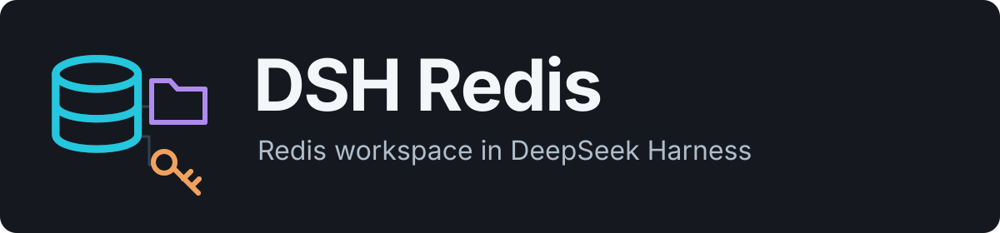
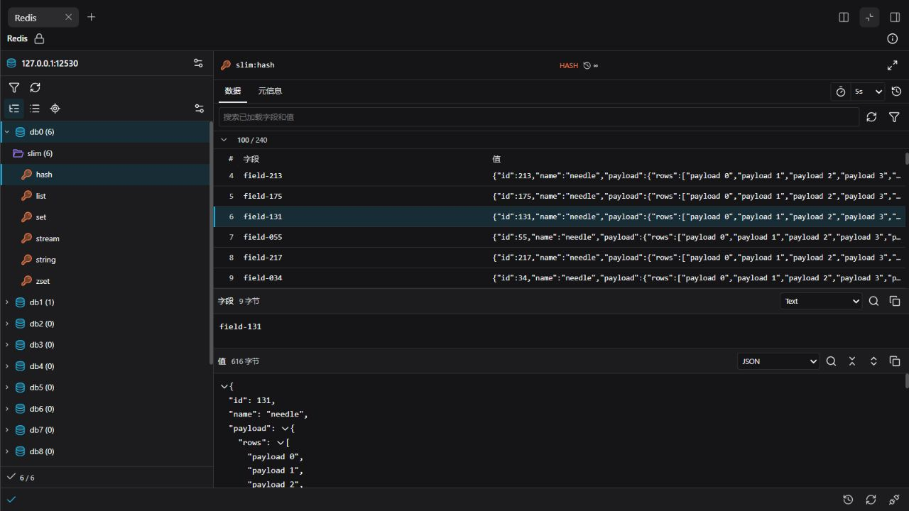
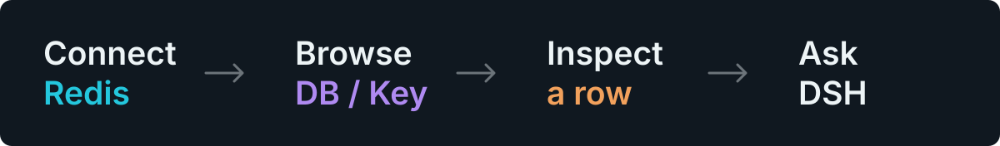
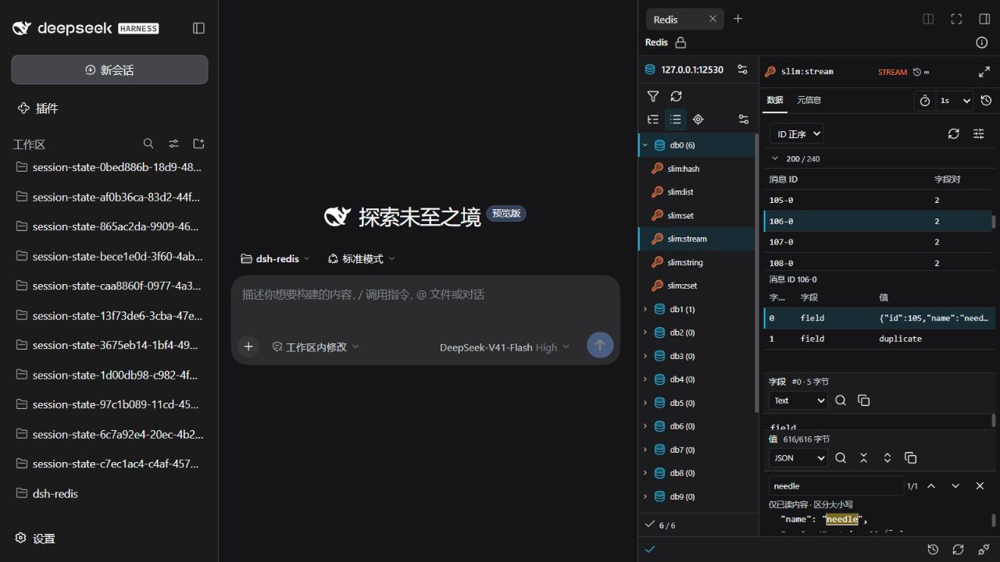

<p align="center">
  
</p>

# DSH Redis

English | [简体中文](README.zh.md)

**DSH Redis is a Redis workspace for DeepSeek Harness (DSH).** Connect to Redis, explore databases and Keys, inspect values, and work with your data in the same conversation.

**Connections · Key explorer · Data preview · Conversation tools · Diagnostics**

Current source **0.1.2** targets **DSH Web 0.2.2-rc.1**. Build and install it with the steps below. The older v0.1.0 package targets DSH 0.2.0-rc.2 and does not include the current additions.

[Install](#install-and-update) · [First use](#first-use) · [Work in conversation](#work-in-conversation) · [Features](#features) · [Requirements](#requirements) · [Limits](#data-and-limits) · [FAQ](#faq)

[](docs/screenshots/hash-workbench-dark.jpg)

*Recorded on 2026-10-19 in DSH Web `0.2.0-rc.2`, using isolated fixture data. This is an existing six-type viewer capture, not a new acceptance run for this documentation revision. [Screenshot provenance](docs/screenshots/README.md).*

- **Connect and organize:** connect to standalone Redis with ACL and TLS, and save named connection profiles.
- **Explore your data:** navigate DBs and Keys in a tree or list, then inspect String, Hash, List, Set, ZSet and Stream values.
- **Work in conversation:** ask about a Key or selection, find matching Keys, inspect diagnostics and make supported updates.
- **Make the workspace yours:** use the sidebar or expanded view, choose a light or dark theme, and switch between English and Chinese.



## Install and update

The planned stable market URL is `https://github.com/WhitePlusMS/dsh-redis/releases/latest/download/dsh-redis.tgz`. The repository is public, but the current v0.1.2 Release does not yet contain the fixed asset. Register the URL with the market only after a formal Release provides and verifies it. The fixed URL does not automatically update an installed plugin. Keep the versioned archive and checksum for rollback.

Download `dsh-redis-0.1.2.tgz` and `SHA256SUMS.txt` from the [v0.1.2 Release](https://github.com/WhitePlusMS/dsh-redis/releases/tag/v0.1.2), verify the checksum, place the archive on the DSH Host, and run `dsh plugin --profile web add <archive-path>`.

Alternatively, build the same version from source:

Version `0.1.2` targets DSH Web `0.2.2-rc.1`. Build and install from source in PowerShell on the DSH Host. Git, Node.js 24.9 or later and pnpm are required:

```powershell
git clone https://github.com/WhitePlusMS/dsh-redis.git
cd dsh-redis
pnpm install --frozen-lockfile
New-Item -ItemType Directory -Force .release | Out-Null
pnpm pack --pack-destination .release
$packageForInstall = (Resolve-Path -LiteralPath '.release/dsh-redis-0.1.2.tgz').Path
dsh plugin --profile web add $packageForInstall
dsh plugin --profile web list dsh-redis
```

The pack command runs type checking, build and tests. Keep the archive at that path while the profile references it, and restart the same DSH profile if needed. The earlier [0.1.0 Release](https://github.com/WhitePlusMS/dsh-redis/releases/tag/v0.1.0) targets DSH 0.2.0-rc.2; do not use it with 0.2.2-rc.1. See the [installation guide](docs/INSTALLATION.md) for setup, UI installation, updates, rollback and cleanup.

## First use

1. Open a DSH conversation, then select **Redis** in its right sidebar.
2. Choose **Select or create connection**. Enter address, port and optional ACL credentials; expand TLS when needed. A name and optional group let you save non-password settings.
3. Choose **Connect**. A new connection starts at DB 0 and loads Keys automatically in batches. Saving settings alone does not connect.
4. Select the DB, folder and Key. Select a collection row to inspect it directly; change preview format, find or copy from its toolbar.
5. Auto-refresh starts off, with a 5-second interval selected. Enable it with the refresh control. Key/DB/session changes, hiding the view, cancellation or a read failure stop it; showing the view again does not turn it back on automatically.
6. In the current version, ask “What is the status field of `order:1001`?” directly, or ask “Explain the selected field” after selecting one. Ask explicitly to switch DB; the sidebar follows the Host's new DB.
7. To write, open **Plugin info → Enable AI writes** in the sidebar and specify the existing Key or Hash field and complete new value in the same conversation. Execution follows DSH tool permissions: an allow policy can execute directly, while an ask policy uses the DSH approval flow. Use the returned operation ID in Plugin info to check its result.

Editing or saving a profile while connected does not change the active server. In the current version you can explicitly ask AI to connect a uniquely identified saved profile; passwords are entered through the local connection form.

## Work in conversation

Connect to Redis in a DSH conversation, then ask about a specific Key or the current selection:

- “What is the `status` field of `order:1001`?”
- “Find Keys matching `order:*`.”
- “Are there recent slow queries?”
- “Replace the existing `status` field of `order:1001` with `shipped`.”

For the update example, enable **Plugin info → Enable AI writes** and provide the complete new value. DSH applies its tool permission policy, and the operation ID can be used to look up the result. Supported targets and other operating conditions are described in [Data and limits](#data-and-limits).

## Features

<details>
<summary>Full feature list and six-type views</summary>

| Area | Available behavior |
| --- | --- |
| Connections | Standalone Redis address/port, optional ACL username/password, TLS with optional private CA; manual connect/disconnect |
| Saved profiles | Select, create, name, group, update and delete local connection settings; passwords are not saved |
| DB and Keys | DB directory and counts, manual DB selection, automatic batched `SCAN`, MATCH filtering, loaded count and bounded progress |
| Navigation | Namespace tree or flat list, configurable separator, locate and keyboard navigation; cyan DB, purple folder and orange Key icons |
| Data | String, Hash, List, Set, ZSet and Stream; select a row to inspect it on the same screen, scroll to append collection results |
| Previews | Text, JSON, Hex and Base64, find, JSON folding and copying currently read content |
| Refresh | Manual refresh and optional 1/5/10/30-second refresh; selected content and view state are preserved when still present |
| DSH integration | Native sidebar, expanded workbench, light/dark theme, English/Chinese, Lucide action icons |
| Conversation | Native DSH tools for explicit Key reads, bounded search and filtering; it also has diagnostic, connection and optional UI actions |
| Updates | Replace a supported existing String value or Hash field through conversation; inspect the operation result |

| Type | View |
| --- | --- |
| String | Bounded byte-window preview |
| Hash | Field/value table with separate field and value previews |
| List | Index/value table and selected element preview |
| Set | Member table and selected member preview |
| ZSet | Member/score table, range or scan, selected member preview |
| Stream | Message table, ordered field/value pairs and selected pair previews; duplicate field names remain distinct |

The compact Stream layout uses the same row-selection workflow:



*Recorded on 2026-10-19 with isolated fixture data; the Redis sidebar is approximately 464 px wide. The surrounding DSH workspace is part of the native capture.*

</details>

## Requirements

- **Host:** DSH Web `0.2.2-rc.1`, matching the declared peer dependencies.
- **Runtime/build:** Node.js `>=24.9.0`; verified locally with Node.js `24.22.1` and pnpm `11.22.0`.
- **Redis:** a standalone server reachable from the DSH Host. Existing evidence covers isolated Redis `8.2.6` for six types and live Redis `8.10.0` for Hash, rather than an exhaustive version matrix.
- **Chat:** an available model configured in DSH and permission to use the plugin's tools. Sidebar browsing does not require a separate model API key.

Desktop, macOS and Linux operation have not been verified. The declared Node.js range is broader than the versions actually tested.

## Conversation tools

| Tool | Purpose |
| --- | --- |
| `redis_viewer_status` | Report this conversation's connection, DB and current selected identity |
| `redis_viewer_keys` | Search Keys with bounded, independently paged results |
| `redis_viewer_value` | Read a named Key or, with no Key argument, the current sidebar selection |
| `redis_viewer_select_db` | Switch this conversation's DB when explicitly requested and synchronize the sidebar |
| `redis_viewer_prepare_write` / `redis_viewer_execute_write` | Prepare and execute an enabled, controlled String or Hash-field replacement |
| `redis_viewer_write_status` | Look up a retained operation result in the same conversation |

The plugin also registers bounded Hash filtering, memory/slow-log/server/client/consumer-group diagnostics, RedisJSON paths, TimeSeries samples, Bitmap ranges and GEO coordinates/distances, plus saved-profile and UI tools. On explicit request it can save a diagnostic sample with restricted fields locally. See the packaged [AI read guide](docs/AI_READ_USAGE.md) for read-tool parameters and limitations. These additions are not part of the historical v0.1.0 Release claim.

An initial Key-name search, Hash filter, or AI request to apply a saved MATCH preset requires DSH's native scope confirmation. The prompt shows the server, DB and actual query conditions. If the host also requires approval, DSH presents both in one prompt. Continuation pages retain the same scope. Direct reads of a known Key do not require this scan confirmation. Denial or cancellation stops the query. `SCAN MATCH` can still traverse the current DB's entire keyspace and does not produce a consistent snapshot.

Expand a tool call to inspect its **Redis read record**: returned values, query conditions, timestamps, completeness and raw results come from that call. Model explanations can still contain unsupported claims or mix in historical results; the record does not validate the model's prose. If the cumulative read allowance is exhausted, open **Plugin information → Continue reading** after pending calls finish. A new message, DB switch or reconnection does not reset that allowance.

These are custom tools registered through DSH's native Tool API, **not an MCP server**. The Client uses Typert RPC to synchronize selection identifiers; values are read from Redis when a tool is called. UI and AI paging state are separate, while both use the same session-owned network connection.

Example requests, rather than recorded model answers: “Read the `status` field of `order:1001`”, “Find Keys matching `order:*`”, or “Are there recent slow queries?”. A conversation cannot borrow another conversation's connection.

## Data and limits

Saved profiles live at `<DSH_HOME>/profiles/<profile>/data/dsh-redis/connections.json`. They contain names/groups, address, port, username and TLS/CA settings, **not passwords**. Profiles are shared within that DSH profile; connections and selections belong to individual conversations. A restarted connection does not automatically restore the previous DB or Key.

AI tool output becomes part of DSH conversation history and may be sent to the model provider configured for that conversation. Selecting a Key does not automatically send the whole DB to the model. Uninstalling retains saved profiles and does not erase conversation history; [cleanup instructions](docs/INSTALLATION.md#disable-uninstall-or-remove-saved-connections) distinguish those operations.

The Key list caches at most 5,000 Keys or 2 MiB of encoded results. Each automatic scan starts at most 1,000 batches and does not start another batch after 60 seconds; you can continue it manually. If the cache limit causes part of a batch to be dropped, narrow the filter and scan again. A filtered or interrupted scan is not a full DB snapshot, and `SCAN` is not a consistent snapshot during concurrent changes. AI replies have a 64 KiB result budget; the default String window and some collection value prefixes are 4,096 bytes. Completion and value truncation are reported separately.

The AI write MVP requires Redis 7.4 or later and no TTL on the target Key or Hash field. Key, field, old value and new value are each limited to 4,096 bytes. It replaces one complete value on an existing target; it cannot create or delete targets, perform bulk writes or change TTLs. Proposals expire after at most five minutes, or earlier when the turn ends, connection changes or writes are disabled; the target and old value are checked again before execution. Checks do not establish business intent or prevent later changes by other clients. Operation records are temporarily kept in Host memory. If the result is unknown, do not retry automatically; inspect the current target first.

DSH session history can retain the full proposal in the prepare tool's result and the execute tool's arguments, including the Key, optional field, old value and new value in Base64. Base64 preserves the bytes and can be decoded. The proposal's expiry and the Host's short-lived operation lookup do not erase those session events.

Not included: a free-form command console, direct RDB/AOF loading, snapshots, dedicated special-type views, charts, URI import, profile import/export, Cluster, Sentinel, built-in SSH tunnels or client-certificate authentication. Diagnostics are bounded samples, not a full server snapshot. JSON in a normal String can still be formatted.

## Verification

DSH Web `0.2.2-rc.1` has been exercised with an isolated Redis instance and a separate DSH profile. See the [DSH verification record](docs/verification/dsh-0.2.2-rc.1-2026-11-12.md) and [operation test record](docs/verification/ai-write-mvp-2026-11-11.md) for the tested environment and coverage.

A missing style node and oversized icons were observed once during native testing; reloading restored styling. The root cause remains unresolved.

## Uninstall

In DSH, uninstall **dsh-redis** from **Plugins**, or stop the target profile as required and run:

```powershell
dsh plugin --profile web remove dsh-redis
```

Reload/restart that same profile when required. Uninstalling retains saved connection profiles and DSH conversation history; [settings cleanup](docs/INSTALLATION.md#disable-uninstall-or-remove-saved-connections) is a separate operation.

## FAQ

**Why does the Release URL return 404?**

Check that the tag and `.tgz` asset exist, and that the DSH Host can reach GitHub. If direct installation fails, download the archive, verify its checksum and install it from a Host path.

**Can I install GitHub's Source code archive instead?**

The current Git tree omits `lib/`, while the package entry points require it. Use the built Release `.tgz`, or [build a local package](docs/INSTALLATION.md#prepare-a-built-package). A source tag alone does not make a loadable Redis package.

**Why does `cannot resolve profile bundle "dsh-redis"` appear?**

Check whether the profile still points to a moved/deleted development directory or archive. In that same profile, remove the old source and add the verified built package, then reload/restart as required. A plain dependency `install` retains the old source. See [troubleshooting](docs/INSTALLATION.md#troubleshooting).

## Documentation and license

- [Installation, update and uninstall](docs/INSTALLATION.md)
- [中文安装、更新与卸载](docs/INSTALLATION.zh.md)
- [Changelog](CHANGELOG.md) · [Repository issues](https://github.com/WhitePlusMS/dsh-redis/issues) · [Introduction](https://github.com/WhitePlusMS/dsh-redis/blob/main/PROMOTION.md)
- [Development and maintenance (中文)](docs/DEVELOPMENT.md)
- [Screenshot provenance](docs/screenshots/README.md)

MIT licensed; see [LICENSE](LICENSE). Attributions are retained in [THIRD_PARTY_NOTICES.md](THIRD_PARTY_NOTICES.md) and the [license directory](licenses/). This is a community plugin, not an official Redis or DeepSeek product.
