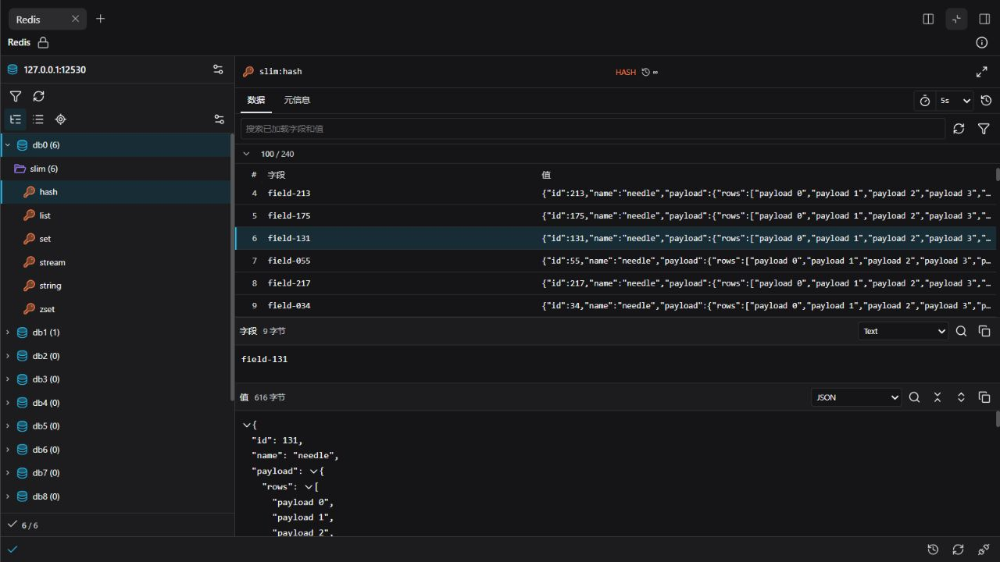
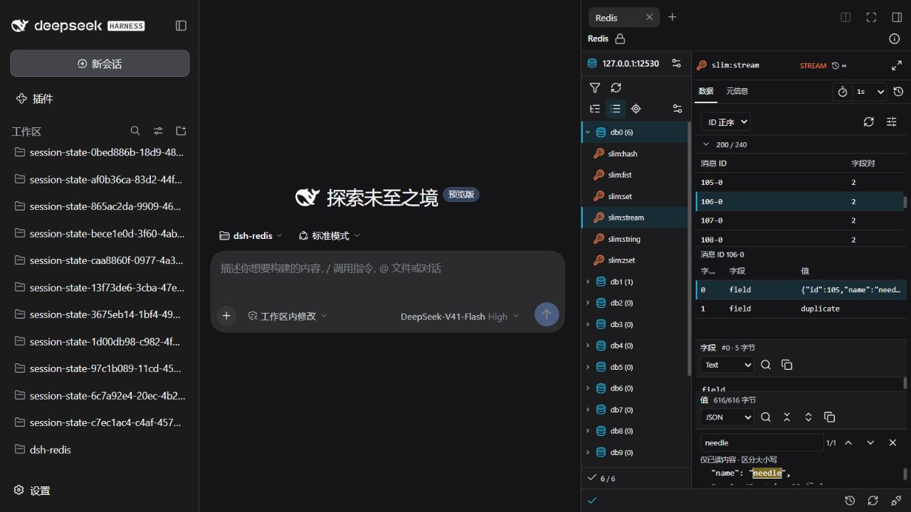

<p align="center">
  
</p>

# DSH Redis

[English](README.md) | 简体中文 · [静态标题](docs/screenshots/readme-header.svg)

面向 **DeepSeek Harness（DSH）** 的社区插件，把 Redis 查看放进当前对话所在的工作区。先定位 Key，选中一行查看详情，再围绕当前选择向 DSH 提问。支持六种基础类型，复用这个对话中手动建立的 Redis 连接。

**只读查看 · 单机 Redis + TLS · Windows / DSH Web `0.2.0-rc.2`（预发布版）**

[安装](#安装与更新) · [开始使用](#开始使用) · [功能](#功能) · [对话读取](#对话读取) · [使用边界](#数据与边界)



*截图记录于 2026-10-19，宿主为 DSH Web `0.2.0-rc.2`，使用隔离测试数据。复用已验收的六类型查看器截图，不冒充本次文档修订重新执行的验收。[截图来源说明](docs/screenshots/README.md)。*


## 安装与更新

当前是本地开发包 `dsh-redis@0.1.0`，使用已包含构建产物、经过核对的 `.tgz`；工作区暂时没有已验证的公开下载地址。

在 DSH 打开**插件 → 添加插件**，填入包在 Host 机器上的绝对路径，安装后选择**立即启用**。目标应是正在服务这个浏览器的同一个 profile；没有热重载时，按提示重启原 Host。

需要从当前源码构建时，在项目根目录执行：

```powershell
pnpm install --frozen-lockfile
pnpm pack --pack-destination .release
```

默认 `prepack` 会执行严格类型检查、全新构建和回归。SHA 唯一文件名、CLI 命令、profile 选择、更新、回退和卸载步骤见[安装指南](docs/INSTALLATION.zh.md)。当前已验证的插件管理器采用先卸载、再安装新包的更新方式。

## 开始使用

1. 打开一个 DSH 对话，在右侧栏选择 **Redis**。
2. 打开**选择或新建连接**，填写地址、端口和可选 ACL 认证，按需展开 TLS。填写名称和可选分组后可保存不含密码的连接资料。
3. 点击**连接**。新连接从 DB 0 开始，自动分批加载 Key；单独保存资料不会连接。
4. 选择目标 DB、目录和 Key，点击集合中的行即可同屏查看详情；通过工具栏切换格式、查找或复制。
5. 自动刷新默认关闭，间隔预选 5 秒，通过刷新控件开启。切换 Key/DB/会话、隐藏视图、取消或读取失败会停止；重新显示不会自行开启。
6. 在这个对话里询问“解释当前选中的字段”。需要切 DB 时明确提出，侧栏会跟随 Host 的新 DB。

连接期间编辑或保存资料不会改变实际服务器。更换服务器时，先断开，再选择目标资料并手动连接。

## 功能

<details>
<summary>展开完整功能与六类型查看方式</summary>

| 模块 | 已实现能力 |
| --- | --- |
| 连接 | 单机 Redis 地址、端口、可选 ACL 用户名/密码、TLS 与可选私有 CA；手动连接、断开 |
| 连接资料 | 本地选择、新建、命名、分组、更新和删除；不保存密码 |
| DB 与 Key | DB 目录与数量、手动切库、自动分批 `SCAN`、MATCH 筛选、加载数量与有上限的进度 |
| 导航 | 目录树或平铺列表、可配置分隔符、定位与键盘操作；青色 DB、紫色目录、橘色 Key |
| 数据查看 | String、Hash、List、Set、ZSet、Stream；选行同屏查看详情，集合滚动追加下一批 |
| 内容预览 | Text、JSON、Hex、Base64、查找、JSON 折叠、复制当前已读内容 |
| 刷新 | 手动刷新，可选 1/5/10/30 秒自动刷新；原内容仍存在时保留选中和查看状态 |
| DSH 界面 | 原生侧栏、展开工作区、明暗主题、中英文、Lucide 操作图标 |
| 对话 | 通过 DSH Tool API 注册的4个插件工具：状态、Key 检索、值读取、明确要求时切 DB |

| 类型 | 查看方式 |
| --- | --- |
| String | 有界字节窗口预览 |
| Hash | 字段/值表格，独立字段与值预览 |
| List | 下标/值表格与选中元素预览 |
| Set | 成员表格与选中成员预览 |
| ZSet | 成员/分数表格，范围或扫描，选中成员预览 |
| Stream | 消息表格、有序字段对、字段与值预览；同名字段保留独立身份 |

窄栏中的 Stream 同样通过选行直接查看：



*截图记录于 2026-10-19，使用隔离测试数据，Redis 侧栏宽约 464 px；周围 DSH 工作区属于原生截图的一部分。*

</details>

## 环境要求

- **宿主：** DSH Web `0.2.0-rc.2`，使用 `package.json` 声明的匹配 DSH peer 包。
- **运行与构建：** Node.js `^22.19.0 || >=24.0.0`；实际使用 Node.js `22.22.1`、pnpm `11.22.0` 验证。
- **Redis：** Host 能访问的单机服务器。已有 Redis `8.2.6` 六类型隔离验收及 Redis `8.10.0` 真实 Hash 验收，不声明完整的 Redis 版本兼容矩阵。
- **对话：** DSH 已配置可用模型，并允许使用插件工具。侧栏查看不需要另配模型 API Key。

Desktop、macOS、Linux 尚未验收。Node.js 声明范围也不等于范围内每个版本都已实际验证。

## 对话读取

| 工具 | 用途 |
| --- | --- |
| `redis_viewer_status` | 查询本对话的连接、DB 与当前选择标识 |
| `redis_viewer_keys` | 有界检索 Key，使用独立分页状态 |
| `redis_viewer_value` | 读取指定 Key；不传 Key 时读取侧栏当前选择 |
| `redis_viewer_select_db` | 用户明确要求时切换本对话的 DB，并同步侧栏 |

这是通过 DSH 原生 Tool API 注册的自定义工具，**不是 MCP 服务**。Client 通过 Typert RPC 同步选择标识，工具实际调用时才从 Redis 读取值。界面和 AI 的分页状态分开，复用同一会话所属的网络连接。

可以这样询问：“解释当前选中的字段”“查找 `order:*` 的 Key”“切到 DB 1，读取我指定的 Key”。这些是使用示例，不是记录下来的模型回答。尚未手动连接的对话不能借用另一个对话的连接。

## 数据与边界

资料保存在 `<DSH_HOME>/profiles/<profile>/data/dsh-redis/connections.json`，包含名称、分组、地址、端口、用户名、TLS/CA，**不含密码**。资料在同一个 DSH profile 内共用，网络连接与选择按对话隔离；重新连接不会自动恢复以前的 DB 或 Key。

AI 工具输出会进入 DSH 对话记录，并可能发送到该对话配置的模型服务。选择 Key 不会自动把整个 DB 发送给模型。卸载插件会保留资料，也不会清除对话历史；[清理说明](docs/INSTALLATION.zh.md#停用卸载与清理资料)区分了这些操作。

Key 扫描最多 5,000 个 Key、2 MiB 编码结果、1,000 批或 60 秒。筛选或中断的结果不代表完整 DB，Redis `SCAN` 在数据并发变化时也不提供一致性快照。AI 返回预算为 64 KiB；String 默认窗口及部分集合值前缀为 4,096 字节。扫描完成与值是否截断分别表达，扫描完成不代表每个值都已完整读取。

当前不包含：Redis 写入、自由命令控制台、直接打开 RDB/AOF、快照/诊断、特殊类型专用视图、曲线、URI 导入、资料导入导出、Cluster、Sentinel、内置 SSH 隧道或客户端证书认证。普通 String 内的 JSON 仍可格式化；可以查看底层 String/ZSet 内容，但没有 Bitmap/HLL/GEO 专用解释。

## 验证与已知问题

截至 2026-10-19，已有严格检查与 **21 个测试文件 / 205 项测试**。这不替代真实 Redis 或原生 DSH 验收。此前隔离 Redis 与原生 DSH 专项覆盖六类型；用户现有真实数据的模型联调覆盖 Hash、当前选择、切 DB 和会话隔离。该 DB 中另外五类没有真实样本，不冒称已通过真实业务数据验收。

原生联调曾出现一次样式节点缺失、图标放大，刷新浏览器后恢复，根因仍未定位。源码仓库保留历史验收记录，但历史功能不代表都保留在当前精简版中。

## 后续规划

以下候选未实施、未排期，当前版本继续只读。

- [ ] 可选写入先支持 Hash 单字段新增、修改，再考虑单字段删除和整个 Key 删除。
- [ ] 当前会话连接临时手动解锁，默认关闭；断开、重连、更换连接后关闭。开启开关不等于批准具体操作。
- [ ] 每次变更先展示服务器、DB、Key、字段、修改前后及 TTL 影响。AI 提出操作，用户决定是否执行。
- [ ] Host 强制校验对应单次操作的人工确认。AI 传入 `confirm: true` 不算批准；目标、DB、数据变化使旧确认失效。
- [ ] 验证未解锁、未确认、取消、重复提交和目标/数据变化等情形，再确认原读取与会话隔离正常，才考虑发布。

该候选不包含批量删除、清空 DB、任意命令和脚本执行。

## 文档与许可

- [安装、更新与卸载](docs/INSTALLATION.zh.md)
- [English installation guide](docs/INSTALLATION.md)
- [版本记录](CHANGELOG.md)
- [开发与维护说明](docs/DEVELOPMENT.md)
- [截图来源说明](docs/screenshots/README.md)

使用 MIT 许可，见 [LICENSE](LICENSE)。第三方来源见 [THIRD_PARTY_NOTICES.md](THIRD_PARTY_NOTICES.md) 和[许可目录](licenses/)。这是社区插件，不是 Redis 或 DeepSeek 官方产品。
