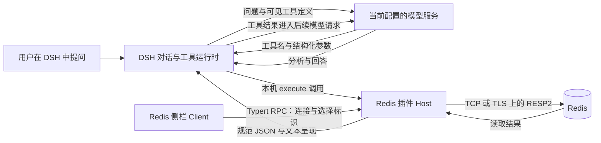

# AI 如何读取 Redis：原生 DSH 工具与 MCP 的区别

核对日期：2026-10-19。依据：当前项目源码、已安装版本对应实现，以及固定 `DSH 0.2.0-rc.2` 官方文档与源码，官方提交为 `639ed015397290b3745d163aafe02ffee4aa3f84`。

当前实现采用 **DSH 原生插件的工具注册接口**，没有为本插件部署 Redis MCP Server，也没有通过 MCP Client 转发 Redis 查询。它使用官方 `@deepseek-ai/dsh-tools` 提供的 `defineTool` / `ctx.tools.register`，将我们自己的 Redis 查询功能提供给模型调用。

## 1. 目前能够读，尚未开放数据写入

| 能力 | 当前状态 |
| --- | --- |
| 查询当前会话连接和 DB | 已实现 |
| 按条件检索 Key | 已实现，分批 SCAN |
| 读取 String、Hash、List、Set、ZSet、Stream | 已实现，按类型返回有界结果 |
| 读取侧栏当前选中的 Key、字段或元素 | 已实现，提问时可不输入名称 |
| 用户明确要求时切换当前连接的逻辑 DB | 已实现，侧栏随实际状态同步 |
| 新增、修改、删除 Key 或集合元素 | 未开放 |
| 任意 Redis 命令、脚本执行 | 未开放 |
| AI 自行新建 Redis 连接或选择其他服务器 | 未开放，需在侧栏手动连接 |

因此，“AI 可以读写”在目前应表述为：**AI 已经能够通过本插件查询和读取 Redis，并按明确要求切换 DB；还不能通过本插件修改 Redis 业务数据。** `SELECT` 改变的是所属连接当前使用的 DB，不是修改 Key 的值。

此前真实模型联调完成 7 轮对话、14 次工具调用，覆盖真实 Hash、当前选中字段、DB 往返及会话隔离。真实库只有 Hash，其他五类的证据仍来自此前隔离验收。详见[真实数据联调记录](verification/ai-read-real-data-2026-10-19.md)。本说明没有重新发送模型请求或读取业务数据。

## 2. 实际调用路径

按一次实际读取来理解：

1. 你在当前 DSH 会话的 Redis 侧栏手动连接服务器。插件 Host 建立并持有这个会话的 Redis 连接。
2. 插件启动时，向 DSH 注册工具名称、用途、参数 schema、执行函数和结果呈现函数。DSH 将调用者可见的工具定义提供给模型。
3. 你提问后，模型选择需要的工具并返回结构化参数。这属于工具调用（Tool Calling / Function Calling）。
4. DSH 在本机分派到插件的 `execute` 函数，同时提供可信 Agent、所属会话和取消信号。
5. 插件校验连接、DB、目标代次及参数，再发出固定的 Redis 读取命令。
6. 插件返回规范 JSON，包含数据、类型、读取时间、完整性或续读信息；`output.render` 将同一结果序列化为模型可读文本。
7. DSH 把工具结果加入后续模型请求，模型据此组织回答。需要续页时，可以再次调用工具。

原生插件是使用 DSH 的扩展接口，不需要为这条读取链路修改 DSH 核心源码。模型选择工具，本机插件实际执行 Redis 查询。

## 3. 我们注册了哪四个工具

这些名称属于本项目，**不是 DSH 自带的 Redis 工具**；官方提供的是工具注册和执行框架。

| 本插件工具 | 实际职责 | 对应代码 |
| --- | --- | --- |
| `redis_viewer_status` | 返回所属会话连接、当前 DB、最后同步的选择及时间 | `reader.status` |
| `redis_viewer_keys` | 当前 DB 按 MATCH 分批检索 Key，支持续读令牌 | `reader.scan` |
| `redis_viewer_value` | 明确指定 Key，或读取当前选中的 Key/字段/元素 | `reader.read` |
| `redis_viewer_select_db` | 按明确要求切换同一连接的 DB | `reader.selectDatabase` |

入口 [src/index.ts](E:/项目demo/dsh-redis/src/index.ts:3) 注入 `tools` 服务；[runtime.ts](E:/项目demo/dsh-redis/src/runtime.ts:6) 创建 `RedisRemoteService`，再把它的 AI reader 传给工具注册函数。[ai-tools.ts](E:/项目demo/dsh-redis/src/host/ai-tools.ts:17) 实际执行四次 `ctx.tools.register(defineTool(...))`。

调用身份取自 `exec.agent.session.id`，模型参数没有 `sessionId`、服务器地址或 Redis 密码。DSH 提供的会话身份决定该调用能使用哪一个连接；没有连接就报错，不借用其他会话的连接。[身份校验](E:/项目demo/dsh-redis/src/host/ai-tools.ts:6)与[连接校验](E:/项目demo/dsh-redis/src/host/ai-reader.ts:59)均在实际执行路径上。

切 DB 工具的描述要求模型仅在用户明确要求时调用；Host 校验 DB 参数与所属连接、执行 `SELECT` 并更新实际状态。自然语言中的切库意图由模型结合问题和工具描述判断。

## 4. 侧栏和 AI 怎样使用同一个 Redis

两条入口共享 Host 中的同一个 `RedisConnections`，但入口各自承担不同职责：

| 入口 | 使用机制 | 用途 |
| --- | --- | --- |
| 浏览器侧栏 → 插件 Host | DSH API Remotes / Typert RPC | 连接配置、手动连接、界面读取、上报选择标识、查询 Host 状态 |
| DSH 模型工具运行时 → 插件 Host | DSH `tools` 原生执行接口 | 对话中的状态、Key 检索、值读取、明确切库 |
| 插件 Host → Redis | TCP/TLS + Redis RESP2 协议 | 实际连接、认证及固定命令执行 |

**Typert RPC 是 DSH 的界面与 Host 通信机制，这里并不是 MCP。** AI 工具执行时直接使用 Host 的 AI reader，不绕到浏览器抓取表格文本或截图。

“解释当前这个值”依赖以下流程：

1. 侧栏选行后，通过 `setSelection` RPC 同步连接 ID、代次、DB、Key 原始字节标识，以及字段、成员、下标或 Stream 字段出现序号。此时只同步身份，不把该行值主动加入模型对话。
2. Host 将身份保存在当前会话的选择记录中。快速选行合并 60ms，Client 按会话串行发送更新和清理，Host 核对目标是否仍有效。
3. 模型调用 `redis_viewer_value` 且不传 Key 时，Host 找到该选择并重新读取 Redis。例如 Hash 字段走 `HGET`，不是把此前屏幕缓存的值当作最新结果。
4. 如果读取期间选择或连接代次变化，旧结果不会被当作新选择的数据返回。

具体代码：[Client 选择发布](E:/项目demo/dsh-redis/src/client/CurrentSelection.tsx:9)、[Client RPC 串行化](E:/项目demo/dsh-redis/src/client/index.ts:39)、[Host 选择与读取](E:/项目demo/dsh-redis/src/host/ai-reader.ts:75)、[精确元素读取](E:/项目demo/dsh-redis/src/host/selected-reader.ts:20)。

AI 和界面各自持有 reader 游标，复用同一真实连接，避免一方开始扫描覆盖另一方的续页状态。AI 切 DB 后，侧栏可见时通过 `connectionStatus` 核对 Host 内存中的实际状态，完成一轮后间隔 1 秒再查；发生变化才应用。它不为状态同步额外查询 Redis，也不新开连接。[Host 共享连接](E:/项目demo/dsh-redis/src/remote-service.ts:32)、[状态同步](E:/项目demo/dsh-redis/src/client/connection-sync.ts:15)。

## 5. 底层如何发送 Redis 命令

正式产品路径为：

`RedisAiReader → 各类型 reader / RedisSelectedReader → RedisConnections → RedisTransport → Redis`

[RedisTransport](E:/项目demo/dsh-redis/src/host/redis-transport.ts:1) 实际使用 Node.js `node:net.createConnection` 或 `node:tls.connect`，通过项目的 RESP2 编码器/有界解码器通信。TLS 路径验证证书；连接阶段按需 AUTH，并使用 PING 验证连接。

这条正式执行路径没有用 `redis` npm 包的 `createClient`。项目确实声明了 `redis` 依赖，验收夹具脚本使用它；不能仅根据依赖清单，就把正式产品的读取实现写成 node-redis。

| 操作 | 使用的固定命令举例 |
| --- | --- |
| Key 检索 | `SCAN` |
| 类型及 TTL | `TYPE`、`PTTL` |
| String | `STRLEN`、`GETRANGE` |
| Hash | `HLEN`、`HSCAN`；选中字段用 `HGET` |
| List | `LLEN`、`LRANGE` |
| Set | `SCARD`、`SSCAN`；选中成员用 `SISMEMBER` |
| ZSet | `ZCARD`、`ZRANGE`、`ZSCAN`；选中成员分数用 `ZSCORE` |
| Stream | `XLEN`、`XRANGE`、`XREVRANGE` |
| 明确切库 | `SELECT` |

模型不能向本插件提交自由命令字符串。传输层限制命令集合，`CONFIG` 仅允许读取 databases，`INFO` 仅允许 keyspace；没有提供 `SET`、`HSET`、`DEL` 等业务写入入口。

## 6. 与 MCP 接入有什么不同

| 对照项 | 当前 Redis 插件 | DSH 的 MCP 接入路径 |
| --- | --- | --- |
| 功能定义在哪里 | 本插件 Host 的 TypeScript 函数中 | 提供能力的 MCP Server 中 |
| 工具怎样进入 DSH | 本插件直接调用 `ctx.tools.register` | DSH MCP Client 发现服务端工具，再适配到工具注册表 |
| 额外协议连接 | 本插件没有 MCP 连接 | MCP Client 与 Server 通过 stdio 或 Streamable HTTP 通信 |
| 谁查询 Redis | 当前插件 Host 的 reader/transport | 若另做 Redis MCP Server，则由该 Server 的实现查询 |
| 当前侧栏选择如何关联 | 已直接同步到同会话 Host | MCP 本身不会自动获得本插件的侧栏选择，需要另外设计该关联 |
| 能否把当前包直接配置成 MCP Server | 不能，当前包没有提供该服务端入口 | 需要实际提供 MCP Server 的程序或端点 |

DSH 原生工具和通过 MCP 接入的工具，最终都可以进入 DSH 的通用工具执行体系，所以“模型能够调用工具”本身不能证明它使用了 MCP。这里的判断依据是本插件的注册、连接和执行代码。

本插件的源码、bundle patch 和依赖中没有配置 Redis MCP Server、`@deepseek-ai/dsh-mcp-client` 或 MCP SDK。该判断只针对本插件；用户的 DSH 可以另外配置与本插件无关的 MCP 服务。

## 7. 数据会到哪里

Redis socket、连接生命周期及认证处理由本机插件 Host 持有，公开连接视图不返回密码。插件按需读取的结果会进入当前 DSH 对话，并随后续请求交给**当前所选的模型服务**分析。因此，执行 Redis 查询在本机，不代表读取结果只在本机处理。

插件不自动把整个 DB 内容放进模型上下文。结果保留类型、时间、原始字节身份、分页和完整性标识：单次 JSON 结果预算 64KiB；String 默认读取 4096 字节，Hash/List/Stream 的值预览及精确选中元素的值投影最多保留前 4096 字节。字段和成员身份完整保留，不以截断身份替代；完整身份太大时仍受总结果预算约束。超预算明确失败，不丢掉批尾再继续游标。`scanComplete` 与 `complete` 分别表达扫描结束和数据是否完整。

## 8. 核对依据与本轮变更

- [DSH 官方工具编写契约，固定提交](https://github.com/deepseek-ai/deepseek-harness/blob/639ed015397290b3745d163aafe02ffee4aa3f84/docs/cookbook/adding-a-tool.md)：工具注册、执行身份、取消、规范结果及模型呈现。
- [DSH 官方 MCP 子系统说明，固定提交](https://github.com/deepseek-ai/deepseek-harness/blob/639ed015397290b3745d163aafe02ffee4aa3f84/docs/subsystems/mcp.md)：MCP Client、外部 Server、传输及工具适配。
- [DSH MCP Client 配置，固定提交](https://github.com/deepseek-ai/deepseek-harness/blob/639ed015397290b3745d163aafe02ffee4aa3f84/packages/mcp/mcp-client/README.md)：实际 MCP 配置形态，与本项目当前 patch 对照。
- [本插件安装与历史验收](AI_READ_IMPLEMENTATION.md)、[操作说明](AI_READ_USAGE.md)、[真实数据断言](verification/assets/ai-read-real-data-20261019.json)。

本轮只核对实现并补充说明、链接和更新日志，不修改应用代码、依赖、Redis 数据、模型或代理配置，不安装或重启服务。此前联调结果作为既有证据引用，没有冒称本轮重跑。
