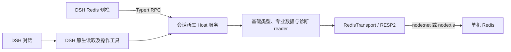

# DSH Redis 开发与维护说明

[English README](../README.md) · [中文 README](../README.zh.md) · [安装、更新与卸载](INSTALLATION.zh.md) · [CHANGELOG](../CHANGELOG.md)

本说明保留 `v0.1.0` 的历史发布流程；当前 AI 读写范围与验收状态以源码和项目任务清单为准。当前开发源码为 `0.1.2`，声明使用 DSH `0.2.2-rc.1`，不把旧发布版的验收归于当前构建。

## 1. 版本与环境

| 项目 | 声明或实际状态 |
| --- | --- |
| 插件包 | 当前源码与已发布版本均为 `dsh-redis@0.1.2`。发布后的源码调整见 [UPDATE_LOG](../UPDATE_LOG.md) |
| 宿主、DSH SDK | 固定为 `0.2.2-rc.1`，已发布包的宿主验证见 [DSH 0.2.2-rc.1 安装与工具验证](verification/dsh-0.2.2-rc.1-2026-11-12.md) |
| 官方参考源码 | 以下旧发布流程引用 `dsh-v0.2.0-rc.2` / `639ed015`，不作为当前 SDK 行为的证明 |
| Node.js | 声明 `>=24.9.0`；DSH 0.2.2-rc.1 需要 Node 24.9 或以上版本 |
| pnpm | `11.22.0`，由 `packageManager` 固定 |
| React | `18.3.1`，peer/dev 一致 |
| Cordis | peer `~4.1.0`，dev `4.1.0` |
| 已验收载体 | Windows 上的 DSH Web；Desktop、其他系统待独立验收 |

当前没有把“最新上游”“最新稳定版”当作已验证基线。升级宿主时应另开小目标，核对官方版本、Host/Client/工具接口、全部 peer/dev 依赖和真实运行结果，再同时修改环境说明。

DSH 的共享服务放在 `peerDependencies`，开发时在 `devDependencies` 使用匹配版本；不要把另一份 DSH/React 服务打入客户端，造成不同实例持有不同上下文。Redis 开发夹具使用 `redis` 开发依赖。

## 2. 目录和职责

以下为源码 checkout 的目录说明；安装后的成品包只保留运行产物、主文档和许可，不包含整个源码与历史验收材料。

```text
src/
  index.ts                  Host 插件声明与服务依赖
  runtime.ts                运行时注册与资源所有权
  typert.host.ts             Host RPC 导出
  typert.remote-client.ts    Remote Client 导出
  host/                     连接、RESP 传输、资料、六类型 reader、AI 工具
  shared/                   DTO、协议与字节身份
  client/                   原生侧栏、连接表单、各类型视图、预览与样式
tests/                      类型、协议、reader、工具及实际 bundle 回归
scripts/                    构建、真实 Redis 与原生 DSH 专项夹具
lib/                        构建输出，不直接编辑、不提交
licenses/                   必须随包保留的第三方许可
docs/screenshots/           README 使用的已核对截图和来源说明
.scratch/                   参考、历史任务与临时环境；仅upstream/runtime/artifacts忽略
.release/                   忽略的本地打包输出
```

`cordis.patch.yml` 向宿主插入 `ui-redis` 条目，模块名为 `dsh-redis`。浏览器 ModuleLoader 也以 `dsh-redis` 注册；这些标识职责不同，不应为了“统一命名”机械替换。

## 3. 当前调用方式



- 这是 DSH 原生插件，未实现 MCP server。当前注册的工具包含读取、最终回答、筛选、诊断、连接、本地资料、界面动作与受控写入，完整目录见 [AI_READ_USAGE.md](AI_READ_USAGE.md)；不另开 MCP 端口，也不要求用户添加 MCP 配置。
- 当前 RPC 协议版本为 `16`，包含 `23` 个方法（包括 UI 流）；已发布 v0.1.0 的协议版本为 `2`。Host 和 Client 从 `typert.shared.ts` 创建同一组端点与严格解析器。Host 用 Zod 接入 DSH 注册表，单次 RPC 的 Host Gateway `encode` 和 Client Remote `decode` 复用同一结果校验。生成器 `0.2.2-rc.1` 的普通 Host 参数会接收并剥离额外字段，Redis RPC 继续显式拒绝这些字段。[DSH Typert 生成器说明](https://github.com/deepseek-ai/deepseek-harness/blob/dsh-v0.2.2-rc.1/packages/typert/generator/README.md)
- 正式 Redis 访问由项目的 `RedisTransport` 通过 `node:net`/`node:tls` 和有预算的 RESP2 解析完成。`redis` npm 包用于测试和辅助脚本。生产传输在解码前限制响应大小和结构深度，按顺序执行命令，保留事务回读和提交结果不明的语义。
- 工具会话身份来自 DSH 的 `exec.agent.session.id`，不能让模型传入另一个 session 来选连接。未连接时明确拒绝，不替用户选服务器或自动重连。
- 经 `RedisAiReader.withBudget` 的工具共用会话级额度：每个额度周期最多准入 32 次、累计返回 1 MiB JSON，单次最多 64 KiB；每次准入前预留完整单次上限。准入后的失败或取消仍计次；扫描确认在准入前被拒绝时不计次。不是每条消息重新计数，切库和重连也不重置。耗尽后打开侧栏“插件信息”，待在途请求结束再手动“继续读取”；该动作重置额度，会话释放则清除记录。仅打开面板的 `redis_viewer_show` 不经过此预算。
- 名称搜索和 Hash 筛选的首批，以及 AI 应用 MATCH 预设，都复用 DSH `tools/pre-execute` 范围确认，绑定会话与当前连接/DB。预设还绑定实际 MATCH 和侧栏选择版本。宿主同时要求询问时，最终提示由 DSH 发出，提示同时显示宿主理由和查询范围，并遵循宿主调用信号。续页由既有游标校验条件。拒绝或取消不扫描，确认不可用单独报错。已知对象的直接读取不要求扫描范围确认，其他 DSH 策略仍可独立限制工具。
- AI 分页和需交付令牌的结果在 `finalizeContent` 结算。DSH 拦截或取消时释放暂存，Native 策略原样保留结果正文时推进游标，连接或会话已失效时从模型可见内容收回游标。该回调早于 DSH 追加会话结果，只能替换内容。它无法为会话追加失败回滚，也无法改写 PTC 程序的结构化值。
- 写入以 DSH `agents.turnBoundaryOf` 确定活动轮次。准备结果和执行入参都携带完整提案，DSH 可以把可解码的 Key、字段及前后值保留在会话历史中。Host 内存中的操作查询仍按会话和有效期管理。
- Client 通过 `tool.call.toolview` 呈现 16 个状态/读取工具的记录和答案证据工具，并在 `conversation.chat.turnTail` 展示本轮证据。证据订阅正式 `session/event`，使用当前轮次、连接代次和 DB 的已完成记录，不使用弃用的会话同步查询接口；最多保留 32 个读取记录，输出最多 64 KiB。它不重新查询 Redis，不校验或改写模型自由文本，也不调用 `concludeTurn()`：卡片准备完成不代表用户的解释性问题已回答，须保留后续原生 assistant 步骤。
- UI 与 AI 有各自的游标状态，复用同一真实连接。连接替换、断开、切换 DB、会话和插件释放时，一并清理对应 reader、游标、选择和写入开关。
- Client 只同步选中的原始 Key/字段/成员/下标/Stream 字段序号标识，约 60 ms 合并快速选择并串行发送；工具调用时重读值，不把展示文本当二进制身份。
- 显式切 DB 复用已有连接和目标代次保护。侧栏可见时约每秒核对 Host 内存状态，变化才应用；状态同步不读取 Redis 值，不开启内容自动刷新。

连接资料的 schema 当前是 `version: 1`。文件在 `profileContext.dir/data/dsh-redis/connections.json`；密码和运行中选择不写入其中。落盘是临时文件加 rename，POSIX 权限设置不能当成 Windows ACL 保证。

## 4. 修改原则与功能边界

1. 修改前完整阅读相关文件，先解释原因，尽量复用现有模块，保持单一职责、严格 TypeScript 与最简实现。不增加旧协议或旧代码兼容。
2. Redis 命令、DSH 接口等关键契约以真实源码或固定版本官方文档为依据。TLS 保持证书校验；不增加跳过校验的快捷开关。
3. 不提供命令字符串入口或任意脚本。`SELECT` 只改变本连接的 DB 上下文；AI 写入默认关闭，开启后仅支持既有 String 值或 Hash 字段的受控替换，遵循 DSH 工具权限；扫描范围确认不授权写入。
4. 游标推进、取消、超时和返回预算沿用现有边界，不靠多开连接规避同一会话语义。`scanComplete` 与值是否完整分开表达，不能把前缀称为完整内容。
5. 刷新按上次读取完成后再等待间隔执行，不重叠读取；保持可复用预览状态。隐藏、换目标、取消和错误后停止，不自动重新开启。
6. 更新当前文档时保留历史证据的时间边界。旧12类型、旧测试数量和先前失败报告不改写为当前成功；新结果在当前说明中引用或补独立报告。
7. 每个可验收小目标更新根目录 `UPDATE_LOG.md`，写明文件、原因、影响和验证，再本地 Git 提交；是否同步远端、创建tag或发布版本，以当前任务的明确授权为准。

## 5. 安装依赖、检查和构建

在项目根目录执行：

```powershell
node --version
pnpm --version
pnpm install --frozen-lockfile
pnpm check
```

`pnpm check` 顺序执行三层严格类型检查，然后重新构建并运行 Vitest。2026-11-06 应用源码 `622dce6` 的打包检查为 83 个测试文件 / 682 项通过；这不是之后所有提交的验证结果，维护时应记录实际源码及输出。编译错误必须先修复，不归因为浏览器缓存。

只需要构建时：

```powershell
pnpm build
```

`scripts/build.mjs` 使用 TypeScript 编译器按 Host 项目配置生成 ESM、声明文件和 RPC 导出，使用 esbuild 生成浏览器 `lib/client.js`。Client 以 ModuleLoader 包装、外置共享 React，并内联 Lucide 与客户端代码。全量检查还包含 Client 与测试的 TypeScript 检查。样式由 `installRedisStyles` 注入，当前没有独立 `index.css`。

不要直接改 `lib/`。源码改动后先做类型检查，再做与改动相关的回归；完整检查通过后，不因文档措辞微调重复执行全套测试。

本项目不需要额外启动 `npm run dev` 或 `npm run start:dev`。日常 DSH 沿用原来的实例与启动方式；独立验收服务必须有明确所有权，并在结束后关闭。

## 6. 验证层级

插件交付以工具正常调用、准确返回信息、结果经 DSH 正确交给模型为准。工具说明/schema、错误处理、会话和权限隔离、范围/预算及插件界面回执仍需核验。模型收到正确结果后的理解、推断和措辞不计入插件通过/失败；不因自由文本错误重复修补插件或追加模型评测。卡片显示与结果传递分别核对，均不能只凭最终回答推定成功。

| 层级 | 能证明什么 | 不能据此声称什么 |
| --- | --- | --- |
| `pnpm typecheck` | Host、Client、tests 的严格类型一致 | 真实 Redis/模型已连通 |
| `pnpm test` / `pnpm check` | 实际构建和单元/组装/bundle 回归 | 原生交互或现场数据全部通过 |
| Redis 专项夹具 | 真实 Redis 命令、类型、TLS、取消与预算 | 用户业务数据已通过 |
| 原生 DSH 隔离专项 | 六类型界面、选行、刷新、Host/Client 联动 | 仅显示卡片就证明结果已传给模型 |
| 本地脚本模型专项 | AgentLoop、工具、RPC 和只读命令接线 | 真实模型会正确选择工具 |
| 真实 DSH/模型链路与数据对照 | 本次实际工具调用、原始返回、结果传递、选择与会话隔离 | 模型自由文本质量属于插件保证，或未测环境全部通过 |
| 成品包/独立 profile | 包内文件、安装/组合配置/卸载与保留资料 | 已公开发布或已更新日常 DSH |

源码 checkout 的 `docs/DSH_AI_READONLY_TASKS.md` 是当前工具验收入口，`docs/verification/` 按源码和环境保留历史证据，其中旧“完整回答未通过”不再决定插件交付状态。这些文件不随成品包携带。当前安装和范围见[交付状态](https://github.com/WhitePlusMS/dsh-redis/blob/main/docs/DELIVERY_STATUS.md)，`622dce6` 等旧记录仅对应当时构建；工具自身未覆盖的场景继续如实记录，模型解释准确性不列为插件待办。真实业务 Key、字段、值、口令、模型凭据与私有控制 URL 不写进公共文档和 Git。

现有脚本不是一个可以无前置运行的通用验收命令：

- `scripts/redis-fixture.mjs` 默认需要 Docker；TLS 专项还需要有 `cryptography` 的 Python，路径由 `REDIS_TEST_PYTHON` 提供。WSL 模式要求既有 rootfs 准备记录，只清理 owner 匹配的所属实例。
- `scripts/smoke-dsh.mjs` 是持有临时 DSH/Redis 的夹具，需指定已经核对的 `DSH_CLI_ENTRY`，准备项目 `.scratch/runtime/` 内的独立 profile/home。界面验收通过原生浏览器工具进行；完成后必须调用其控制端 `/stop`，不能仅关闭浏览器。
- 运行 `node scripts/smoke-release-boundary.mjs <本次夹具的私有 JSON 路径>`，并设置 `REDIS_BROWSER_EXECUTABLE`，可在已启动的独立 DSH Web 上检查共享 React 实例和所有单次 Remote RPC 的异常响应与恢复。脚本结束时调用 `/stop`；停止核验失败时，夹具仍关闭自建 Host 和 Redis，并在报告中分别记录失败与清理状态。双向 UI 流由 `tests/ui-action-gateway.test.ts` 覆盖。
- 默认夹具阻断真实模型，`REDIS_SMOKE_REAL_MODEL=1` 才允许真实 provider。凭据副本只放忽略的临时目录，验收后删除；未经当前任务授权不改日常模型、代理、路由或真实业务数据。
- `scripts/verify-release-package.mjs` 必须显式提供 `--archive <tgz>`、`--installed <安装后的 dsh-redis 目录>`、`--output <新的报告路径>`，并设置 `REDIS_TEST_PYTHON` 和 `DSH_CLI_ENTRY`。它核对归档完整文件集、源码/安装字节、manifest、Host SDK 和依赖版本；Host SDK 要与项目 devDependencies 锁定的测试版本一致。不会启动服务，报告已存在时失败，不覆盖旧证据；不再接受旧的隐式归档或 `REDIS_VERIFY_PACKAGE_ROOT` 入口。包内容检查不代替真实模型/界面验收，React 浏览器共享身份仍需原生验证。

版本发布时重新执行默认打包检查，并从实际 Release 重新下载成品，在独立 profile 中验收 CLI 安装及原生 DSH 界面安装、启用和连接入口。真实 Redis/模型的验收范围另行记录，不用安装通过替代业务数据联调。

## 7. 本地打包与检查

```powershell
pnpm pack --pack-destination .release
$packagePath = (Resolve-Path -LiteralPath '.release\dsh-redis-0.1.2.tgz').Path
$sha256 = (Get-FileHash -LiteralPath $packagePath -Algorithm SHA256).Hash.ToLowerInvariant()
$assetName = Split-Path -Leaf $packagePath
$checksumLine = "{0}  {1}" -f $sha256, $assetName
Set-Content -LiteralPath '.release\SHA256SUMS.txt' -Value $checksumLine -Encoding ascii
Get-Content -LiteralPath '.release\SHA256SUMS.txt'
```

校验文件格式是 `HASH  ASSET`，中间两个空格。该文件只描述本次本地包，不等于已经发布。打包默认执行 `prepack: pnpm check`，不要加跳过检查的选项。

`package.json.files` 是成品白名单。本次保留运行 `lib`、组合 patch、插件图标、双语 README、CHANGELOG、安装/开发主文档、README 截图、项目许可和第三方许可。不要把整个历史 `docs/`、`.scratch/`、`.env`、profile、业务截图、缓存、私有日志或原始凭据放进去。

打包后检查：

1. 解读 tar 清单，确认包名、版本、Host/Client/RPC 导出、组合 patch 与所需许可齐全。
2. 对包内每份主文档解析相对链接和图片，确认安装后仍可读；来源库里的路径不一定存在于成品包。
3. 对打包来源和归档文件逐字节核对；确认没有私有配置、业务数据和临时运行目录。
4. 在新的、没有模型凭据的独立 `DSH_HOME` 中测试 CLI 安装、列包、配置组合、卸载和重新安装。测试连接资料保留时只使用空资料文件，不连接 Redis；这种检查不需要启动 Host 服务。
5. 不改日常 profile。若用户另行要求安装，再按安装指南备份并更新，单独核对安装后的文件与实际界面。

单独开发包同为 `0.1.2` 时，按[安装指南](INSTALLATION.zh.md#准备成品包)生成 SHA 唯一文件名，避免复用旧路径；不要删除 profile 仍引用的本地 tgz。

## 8. 版本化发布与安装入口

项目维护约定：`README.md` 为英文、`README.zh.md` 为中文，顶部互链；功能、版本、限制和图片说明同步。`CHANGELOG.md` 面向使用者，`UPDATE_LOG.md` 保存文件级原因与检查。

### 当前状态与分发约定

源码托管在私有仓库 [WhitePlusMS/dsh-redis](https://github.com/WhitePlusMS/dsh-redis)，默认分支为main。首版为 [v0.1.0](https://github.com/WhitePlusMS/dsh-redis/releases/tag/v0.1.0)，日期2026-10-20，附件为 `dsh-redis-0.1.0.tgz` 和 `SHA256SUMS.txt`；仓库保持私有，未发布到npm或社区市场。

本项目采用与 [GitGraph 当前安装说明](https://github.com/WhitePlusMS/dsh-git-graph/blob/f4ae9a9b8ed40233f7322df5f967708be9e29316/README.zh.md#安装与更新)一致的交付方式：**通过检查的提交 → 预构建 `.tgz` → 固定版本tag → Release附件 → DSH界面或CLI安装**。这是我们的版本维护约定；官方支持的机制是安装预构建npm包或tarball，也提供Git和本地开发来源。

Redis的main/exports指向`lib/*`，`files`会将lib装入成品包，但`lib/`不提交到Git。只有`prepack: pnpm check`，没有Git依赖安装用的`prepare`。因此不能把GitGraph旧版的`archive/refs/tags/...tar.gz`地址直接换成Redis仓库名：源码归档不会因为有tag而生成lib。交付的是`pnpm pack`产生的 `.tgz`，而不是GitHub自动生成的Source code归档。

### 维护者发布步骤

以下使用首版 `0.1.0`/`v0.1.0` 说明维护流程；后续发布须换成实际的新版本，不移动已发布tag或覆盖附件。

1. 确定发布版本，使 `package.json.version`、`CHANGELOG.md` 的版本与实际 `YYYY-MM-DD` 日期、中英文README、附件文件名和下载地址一致。只在发布时把对应记录移出Unreleased。
2. 在干净且明确的发布提交上冻结安装依赖，按上一节 `pnpm pack --pack-destination .release` 打包；默认prepack会完成严格类型、构建与回归。核对归档入口、许可、文档及所有需要的lib文件，生成同一成品包的 `SHA256SUMS.txt`。
3. 将源码发布提交同步到main，在该已检查提交上创建不可变的版本tag：

```powershell
git tag -a v0.1.0 -m "dsh-redis v0.1.0"
git push origin v0.1.0
```

4. 在GitHub打开 **Releases → Draft a new release**，选择该tag，按当前CHANGELOG写发布说明，上传同一次打包的 `dsh-redis-0.1.0.tgz` 与 `SHA256SUMS.txt`，再发布。仅创建tag不会自动上传成品；Redis仓库尚无自动Release工作流。可参考 [GitGraph已实现的工作流](https://github.com/WhitePlusMS/dsh-git-graph/blob/f4ae9a9b8ed40233f7322df5f967708be9e29316/.github/workflows/release.yml)，本轮未移植。
5. 发布后的固定附件URL应为：

```text
https://github.com/WhitePlusMS/dsh-redis/releases/download/v0.1.0/dsh-redis-0.1.0.tgz
```

6. 从实际Release重新取得同一个附件并核对SHA256。当前仓库私有，浏览器登录下载后先放到Host，再按[安装指南](INSTALLATION.zh.md)分别验证界面与CLI入口；浏览器登录不会自动传递给Host的pnpm。未来公开可下载时，两种入口都可使用上面完整URL。不把尚未发布的地址当成现成下载入口。
7. 在隔离profile核对安装、组合包启用、Host加载与一次主要查看操作；不以构建通过替代用户安装通过。随后才把对应实际版本和安装结果写回README/CHANGELOG。
8. 已发布tag与附件保持固定，修复使用新版本。npm发布、社区目录和市场索引是独立渠道；仅输入包名需要真实npm发布，Release发布不代表市场已收录。源码推送授权也不自动变成这些渠道的发布授权。

### 使用者的两条安装入口

- **DSH 界面：** 插件 → 添加插件 → 固定版本Release `.tgz` 来源 → 安装 → 立即启用。
- **CLI：** 在目标 Host执行 `dsh plugin --profile web add <同一个成品来源>`，核对安装版本并按需启用、重启原profile。

公开Release来源为完整附件URL；私有Release先登录下载，再用Host文件绝对路径。两者的包内容、版本和校验值一致；构建源码仅用于维护和开发。具体更新、回退、卸载与连接资料保留见安装指南。

AI 写入开关和能力限制见双语 README；写入执行遵循 DSH 原生工具权限设置。

## 9. 官方依据和许可

- [官方：插件发布与安装](https://github.com/deepseek-ai/deepseek-harness/blob/dsh-v0.2.0-rc.2/docs/user/develop/basic/publish.zh.md)
- [官方：插件与包开发说明](https://github.com/deepseek-ai/deepseek-harness/blob/dsh-v0.2.0-rc.2/docs/cookbook/adding-a-package.zh.md)
- [官方：CLI 和 profile](https://github.com/deepseek-ai/deepseek-harness/blob/dsh-v0.2.0-rc.2/apps/cli/README.zh.md)
- [官方：工具服务](https://github.com/deepseek-ai/deepseek-harness/blob/dsh-v0.2.0-rc.2/packages/core/tools/README.zh.md)
- [本项目 MIT 许可](../LICENSE)、[第三方说明](../THIRD_PARTY_NOTICES.md)、[许可文件](../licenses/)

保留现有 MIT 与上游版权通知，不为了换项目名直接改写继承的版权归属。Phosphor 导航图标、Lucide/Feather 许可和参考项目归属随成品包携带。官方资料只覆盖相应接口机制，不代表官方为本社区插件背书。
