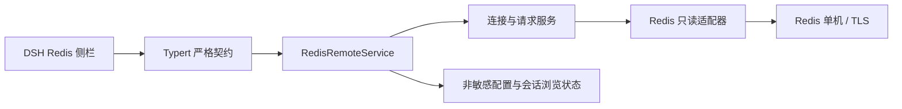

# DSH Redis 新项目开发路线与实施方案

> 当前执行基线：用户明确选择 `0.2.0-rc.2` 并继续原 29 票实现。宿主、对应源码和配套 SDK 固定该 RC 版，如实标注预发布属性；此前稳定版调查及仅文档检查保留为历史，不作为本次实现的等待条件。

> 更新2026-10-16：按用户指定 rc.2 继续全部 29 票；旧包功能证据已记录；按用户反馈重做20界面并复验21，已有证据保留对应环境与包。
>
> 本文规划独立的 DSH Redis 插件。项目根目录已建立在 E:\项目demo\dsh-redis，已有规划文档、29 张独立任务及初始 Host/Client 骨架；实时进度与验证以任务文件和 UPDATE_LOG.md 为准。
>
> Q1–Q4 已确认：个人使用、首版严格只读、单机直连与 TLS、连接配置共用而浏览状态按 DSH 会话分离。类型范围按用户随后指定的 DSH Database 与 RESP.app 2022.2 源码收敛；下文 12 类查看能力与显示格式作为拆票基线；任务粒度和阻塞依赖已由用户确认，执行以正式任务文件为准。

## 1 项目目标与确定的边界

独立项目目录为 `E:\项目demo\dsh-redis`，项目名为 `dsh-redis`；已有包和初始骨架，后续在这个独立项目中推进。

目标是：用户打开 DSH 原生右侧栏的 Redis 页签，手动连接 Redis，选择 DB、检索 Key，并查看不同类型的内容。首版完成稳定的数据查看流程。

| 决策 | 已确定内容 | 对实现的影响 |
| --- | --- | --- |
| 使用对象 | 个人开发、查看和排障 | 不建设团队共享连接、成员权限和集中审计系统 |
| 数据操作 | 首版严格只读 | Host 不提供新增、修改、删除、过期设置、清库或任意命令执行接口 |
| 连接形态 | 单机直连，支持用户名、密码和 TLS | Sentinel、Cluster、内置 SSH、双向 TLS 客户端证书进入后续候选 |
| 连接配置 | 同一 DSH profile 内共用 | 地址和连接资料不随会话重复维护；不意味着跨用户或跨 profile 共用 |
| 浏览状态 | 每个 DSH 会话分别保存 | 分别记住所选连接、DB、搜索、Key 和视图，不相互覆盖 |
| 发起连接 | 手动发起 | 打开插件、切换会话或恢复保存配置不自动建立新连接 |
| 数据范围 | 参考两个已分析客户端，控制新增范围 | 六种基础类型加六种已存在的特殊查看能力，不扩展为全部 Redis 生态类型 |
| 当前工作 | 按指定 rc.2 实现原 29 票 | 精确锁定宿主/源码/SDK，隔离验证，按真实证据逐票验收 |

本项目的“只读”指不提供修改 Redis 数据和配置的业务入口，并核查读取命令本身的副作用；不承诺 Redis 的访问统计、LRU、自然过期等服务器内部状态完全不变。HLL 的特殊情况见第 8.5 节。

## 2 参考项目的真实边界

### 2.1 固定调研基线（不作为开发版本锁定）

| 参考对象 | 本次基线 | 用途 |
| --- | --- | --- |
| 自有 Git Graph | `dsh-git-graph@0.5.0`；HEAD `33b3e67a39a429a0ff570d82d7264aab735fc1fd` | DSH 原生侧栏、Cordis、Typert、主题、本地化与构建接入 |
| DSH Database | `0.1.0-alpha.12.18`；HEAD `5d2b900b0317200b1866275c7cf48814fe84b52d` | Redis 连接、扫描、类型识别和类型读取流程 |
| RESP.app | 截图中的 `2022.2`；tag 提交 `7f5408a328dc9c6dac141b6678b31d7cbdf9ca49` | Redis 数据查看、内容格式和桌面客户端交互参考 |

本次固定调研的 Git Graph 声明面向 DSH `0.2.0-rc.2`，已有实现也使用过该基线。这些是固定研究证据，不锁定后续开发版本。当前采用用户指定 rc.2，取得与该发行对应的宿主源码和配套 SDK；参考插件源码的最新坐标、取得日期和提交另行核对记录，不把历史快照冒称未来开工时的最新提交。DSH Database README 的 Redis 基线为 7.2+；新项目建议以 Redis 7.2+ 为首版目标，版本与扩展能力纳入验收记录，不凭一份参考源码声称支持所有服务器版本。[A1][A2][D1]

### 2.2 数据类型与专用查看能力

以下“有”表示固定版本源码中存在读取或展示路径，不能据此声称已通过本轮实连验收。“未见专用支持”也不等于 Redis 命令台无法访问底层数据。

| 查看能力 | DSH Database | RESP.app 2022.2 | 新项目安排 |
| --- | --- | --- | --- |
| String | 有 | 有 | P0，文本与字节预览 |
| Hash | 有 | 有 | P0，字段和值 |
| List | 有 | 有 | P0，保留原始索引 |
| Set | 有 | 有 | P0，成员 |
| ZSet | 有 | 有 | P0，成员和分数 |
| Stream | 有 | 有 | P0，消息 ID 与字段 |
| RedisJSON | 有，规范为 json | 有 ReJSON 根值模型，未见路径浏览 | P0，JSON 内容与路径查看 |
| Bitmap | 有，String 的 Bit 模式 | 未见独立模型 | P0，偏移与位值 |
| GEO | 有，ZSet 页探测与坐标展示 | 未见独立模型 | P0，成员、经纬度表格 |
| HyperLogLog | 有，计数卡片 | 有，HYLL 特征识别与计数 | P0，识别与估算数量 |
| TimeSeries | 有，时间和值表格 | 未见专用模型 | P0，时间范围与样本表格 |
| Bloom | 有，BF.INFO 与查询入口 | 未见专用模型 | P0，统计与成员存在性查询 |
| Cuckoo | 未见 CF 命令或独立视图 | 2022.2 未见专用模型 | 不列入首版 |
| 其他模块类型 | 未识别时无专用查看器 | 工厂不支持时返回错误 | 显示真实类型、元信息和不支持状态 |

依据：DSH 类型读取与规范化 [D2]、模型与格式 [D3][D4]；RESP 工厂与 HLL 模型 [P1][P2]。

这里共 **12 类查看能力**，并不是 12 种独立 `TYPE`。Bitmap 与 HLL 基于 String；GEO 基于 ZSet。Redis 官方也说明仅凭 SCAN TYPE 无法把它们与对应基础类型可靠区分。[R1]

RESP 2022.2 的已确认类型是上述范围的子集。采用这个范围可覆盖两份参考中的已确认类型，同时不增加 Cuckoo、向量集、搜索索引管理等新目标。JSON、TimeSeries、Bloom 能否使用，取决于目标服务器是否提供对应类型和命令；插件不安装服务器扩展。

### 2.3 两个参考各取什么

| 参考部分 | 处理方式 | 理由 |
| --- | --- | --- |
| Git Graph Client 入口 | 取得最新源码副本，裁剪为最小接入骨架，替换包名、tab、locale、CSS 与 RPC 命名空间 | 原生侧栏接入位置已存在 |
| Git Graph Typert 描述与服务 | 沿用严格契约和会话绑定模式，重写 Redis DTO 与方法 | Git 的提交、路径和 Diff 契约不属于 Redis |
| Git Graph 构建方式 | 复制必要构建骨架并按目标宿主核对实际产物要求 | 新包需要独立安装和加载 |
| Git Graph 主视图、图布局、头像、Git 工具 | 不引入新项目 | 均与本项目的数据浏览职责无关 |
| Database Redis 驱动 | 从最新源码副本提取必要连接和读取分支，裁剪写操作，再按本方案修正为严格只读窄接口 | 原实现混合读写，并存在读取预算和特殊类型语义问题 |
| Database 多数据源工作台、SQL、Kafka、AI 执行控制 | 不引入首版 | 首版是专用 Redis 查看器 |
| RESP 的数据模型和交互 | 参考用户流程和展示信息 | 不复制 Qt/QML/Python 运行栈 |

Git Graph 的 HTTP 外网头像逻辑、Git subprocess 注入和模型工具注册也不自动成为新项目依赖。新首版无需为了显示数据注册 AI 工具。[A3][A4]

### 2.4 当前开发基线：0.2.0-rc.2

当前按用户明确指定的 `0.2.0-rc.2` 实现完整原 29 票，不等待稳定正式版。

- CLI/相关 SDK 固定 rc.2；宿主源码为官方 `dsh-v0.2.0-rc.2` / `639ed015397290b3745d163aafe02ffee4aa3f84`。本机 CLI 已同版，不重复安装或自动改用 alpha；桌面核心按实际验证另记。
- Git Graph、Database 保留原样参考副本与来源/SHA/日期/许可，仅在独立项目裁剪必要接入骨架与只读逻辑，既有工作先比较，不整目录覆盖。
- 只适配目标宿主真实 API，不维护旧版兼容。每次变更完成受影响类型、专项、真实 Redis 和原生包验证；历史包证据不冒充当前包通过。
- 原 29 票范围、优先级、依赖保留；当前 01–20 done、21发布复验 in-progress、22–29 ready-for-agent。测试用独立 profile 和自建 Redis，采用已验证的 wsl-image 路径，不依赖失去响应的 Docker，也不清理用户 C 盘文件。

#### 稳定正式版要求（以后另行迁移时参考）

开工与发布前，核对官方最新稳定正式版 DSH。候选版本必须是官方已发布、非 draft、非 prerelease 的发行，版本号不带 alpha/beta/rc 等后缀，并有对应可安装发行。npm `latest` 是渠道标签，默认分支 HEAD 可能领先于发行，两者均不能单独作为稳定依据。[H1][H2][H6]

核实后记录确切版本、发行 URL、发布日期、tag/commit、查询日期和配套 SDK 清单。开发期间精确锁定宿主、依赖和锁文件，不使用浮动 latest；SDK 与 Host/Client peer 以目标版官方依赖清单为准，不假定所有包同号。只适配目标版真实 API，不增加旧版兼容层。

若没有满足条件的稳定正式版，记录“稳定目标尚未具备”，保留现有代码并继续文档准备，不把 RC 或 alpha 冒称稳定版、不进行猜测性升级。既有 RC 验收只对应其原环境和包，不代替稳定目标复验。

### 2.5 前次仅文档阶段的只读快照（2026-10-16）

| 对象 | 实际结果 | 对后续执行的含义 |
| --- | --- | --- |
| 本机实际 CLI | `C:/Users/admin/AppData/Local/pnpm/dsh.ps1 --version` 返回 `0.2.0-rc.2`；另发现 npm 目录的命令入口 | 当前 PATH 实际使用 RC；升级前明确目标入口，避免升级另一份安装 |
| 官方 npm | 完整元数据 33 个版本，未见纯 `X.Y.Z` 稳定号；latest/next 为 `0.2.0-rc.2`，alpha 为 `0.2.1-alpha.4` | latest 不代表稳定版；不能据此称本机已是最新稳定版 |
| 官方发行 | API 返回 28 条公开 Release，未见非 draft 且非 prerelease 的发行；rc.2 的 prerelease 为 true | 结合 npm 列表，本轮未找到满足要求的稳定目标；开工前重新查询 |
| 桌面实际运行核心 | 本轮未核实 | 后续从实际使用入口和安装渠道检查，不以 CLI 或桌面外壳版本代替 |
| 项目现有依赖 | 引擎及相关 SDK/peer 仍固定 `0.2.0-rc.2` | 保留现状，本轮未修改 manifest 或锁文件，也未完成稳定版迁移 |
| Git Graph 上游 HEAD | master / `33b3e67a39a429a0ff570d82d7264aab735fc1fd` | 本轮通过 git ls-remote 核对；与现有参考副本相同，未重新复制 |
| Database 上游 HEAD | main / `5d2b900b0317200b1866275c7cf48814fe84b52d` | 同上；未来开工时仍需复查最新提交 |

版本查询时间为本机 2026-10-16 04:59（UTC+8）；来源为官方 Release API、npm 注册表和本机只读命令。[H1][H2][H3] 上述是当前快照，不是未来版本承诺。本轮未执行升级、安装、源码复制或功能验收。

### 2.6 以后迁移稳定版时的升级方法

以下是以前的稳定版迁移方案。当前 CLI 已为指定 rc.2，无需重复安装；本次继续实现不等待稳定正式版。

1. **辨认实际安装。** 记录 CLI/桌面入口、命令解析路径、实际核心版本、Node、包管理器与 profile；多个入口分别辨认，明确开发和验收使用哪一个。
2. **比较目标。** 与第 2.4 节核实的最新稳定正式版比较；相同则跳过重装。旧版或预发布版不符合目标时，先升级再开发；没有稳定目标时不猜测升级或降级。
3. **保全资料。** 保留必要会话、配置、插件资料和原安装信息；不清空 profile，不把密码或私人配置复制进项目或分发包。
4. **按原渠道升级。** 按目标发行官方说明，用本机原包管理器或官方桌面更新渠道安装核实过的精确版本；不混装渠道，不修改全局安装目录源码。桌面外壳与内置核心分别核对。
5. **升级后复核。** 从原有实际入口确认核心版本，检查会话/配置/插件资料，以及插件加载和 Host RPC；有失败则记录实际结果，不能标为升级成功。
6. **建立开发基线。** 获取对应源码 tag/commit 和官方配套 SDK，锁定依赖，再在独立测试 profile 与独占 Redis 上复验受影响功能和安装包；记录升级前后版本、包哈希和未验证范围，只清理自建资源。

发布前再次核实最新稳定版。若目标变化，完成必要升级及受影响复验后交付；保留旧包证据，不把历史 done 直接当作新环境已通过。

### 2.7 基于最新源码副本复制改造

**是，采用“取得最新版参考源码的独立副本，再在新项目基础上裁剪改造”的方式。** 当前官方宿主使用指定 rc.2 对应源码，Git Graph 和 DSH Database 使用核对过的参考快照；三者的版本、用途分别记录。

执行顺序：**核对指定 rc.2 与本机版本 → 固定对应宿主源码/SDK和原样参考副本 → 比较已有独立实现 → 裁剪必要改动 → 构建与真实安装验证 → 推进全部原 29 票。**

| 源码对象 | 取得和锁定方法 | 复制或参考的范围 |
| --- | --- | --- |
| 官方 DSH 宿主 | 取与指定 rc.2 对应的 tag/commit，保留原样 checkout 或快照；不取默认分支代替发布基线 | 核对侧栏、Cordis、Typert、构建和插件 API；交付仍是独立 Redis 插件 |
| 自有 Git Graph | 比较最新上游与本机源码，保留本机未提交内容；取得独立原样副本，记录 URL、分支/tag、SHA、日期、许可 | 复制必要 Host/Client、侧栏、严格协议、本地化、主题和构建骨架，换成 Redis 包、tab、RPC、样式和配置身份 |
| DSH Database | 核对最新源码提交与发行 tag 的差别，固定所取 SHA，并保留原样副本 | 提取连接、扫描、类型识别及必要读取逻辑，去掉写入、其他数据源和 AI 执行路径，按第 8 节修正只读语义和预算 |
| RESP.app | 保留用户指定的 2022.2 调研基线；另查新版时单独记录 | 参考功能和查看交互，不搬入 Qt/QML/Python 运行栈 |

改造目录为 `E:\项目demo\dsh-redis`。每项复制记录来源提交、复制范围、修改原因及许可证；保留原样副本用于对照。项目已有实现先比较再更新，不整目录覆盖，也不修改两个原参考项目。

不带入 node_modules、缓存、旧构建产物、私人配置、本机专用绝对路径文件或原仓库 Git 元数据。必要 LICENSE/NOTICE 与版权信息保留。官方宿主源码用于核对 API，不把整个宿主复制成另一个应用，不在全局安装目录开发。

若最新参考源码用了超前 API，只提取适用于目标宿主的必要部分，按该版官方接口调整；不为迁就参考源码切换到预发布宿主或增加兼容层。历史 bundle 文档只说明当时形态，实际构建和共享依赖按指定 rc.2 tag 重新核对。[H5]

## 3 值的显示格式

“Redis 类型”决定如何读取，“显示格式”决定怎样解释已读到的字节。两者必须分开。DSH 当前的 Text/Json/Hex/Binary 按钮位于 String 编辑组件，适用于 string 与规范化后的 json；不是所有类型都有同一套格式切换器。新项目把可复用的字节预览用于适合的值单元格，是本方案新增设计。

| 格式 | 已确认参考事实 | 新项目安排 |
| --- | --- | --- |
| Text | 两者都有文本显示 | P0，UTF-8 文本；非法字节不静默替换后再当作原文 |
| JSON | 两者都有 JSON 格式化 | P0，只读格式化；保留原始内容并报告解析失败 |
| Hex | DSH 有 Hex；RESP 有 HEX / HEX TABLE | P0，字节及偏移行展示 |
| Binary / Base64 | DSH Binary 实际显示长度和 Base64 | P0，明确显示字节长度与 Base64 |
| BASE64 to Text / JSON | RESP 有显式 Base64 解码格式 | P0，作为同一查看器的显式解码选项，有失败状态 |
| 逐位二进制 | RESP 通用 binary formatter 解为位串，不等于 Bitmap 专用支持 | P0 的 Bitmap 查看器负责按区间展示位，不展开整个大值 |
| CBOR、MessagePack、PHP 序列化 | RESP 嵌入式 formatter 有注册 | P2 按真实数据需要选择，不全部进入首版 |
| Pickle | RESP 仅在依赖导入成功时注册 | 不列入本项目默认格式清单 |
| 压缩值 | RESP 有内置格式检测、自动/手动解压，与外部 formatter 分开 | P2 按实际压缩样本选择，首版先展示原字节 |
| 外部/native formatter | RESP 扫描用户扩展并调用其协议 | 后续单独立项，首版不引入外部程序执行机制 |

DSH 的 Binary 不是“自动解码所有二进制协议”；RESP 的 Base64 解码也不等于 DSH 的 Base64 字节展示。新 UI 要把“显示字节”和“把文本当作 Base64 解码”分开，避免内容改变解释后无法知道原始值。RESP 内置压缩功能有独立的检测和解压路径，不应误写成只能靠外部扩展。[D3][D4][P3][P4][P5][P6]

截断或分段预览的 JSON 不应被标成完整合法 JSON；UTF-8 字节段跨字符边界时，要保留字节偏移并正确处理边界。大整数格式化不得悄悄改写数值，原文始终可查看。

## 4 总体优先级

| 优先级 | 交付目标 | 主要内容 | 阶段完成标准 |
| --- | --- | --- | --- |
| P0 | 首版可用的只读 Redis 侧栏 | DSH 接入、单机/TLS、连接管理、DB/Key、12 类查看、基础格式、资源与错误处理、安装包验证 | 目标环境中完整走通连接、检索、查看、切换和退出；适用类型分别有证据 |
| P1 | 日常查看和排障更顺手 | 命名空间/虚拟列表、连接整理、聚焦详情、概览、慢日志、客户端列表、受控自动刷新 | 交互顺畅、诊断无副作用、隐藏面板停止刷新 |
| P2 | 有实际需要的扩展 | Cluster/Sentinel、SSH/mTLS、选定 codec、Pub/Sub/MONITOR、显式 AI 只读工具 | 每项单独有兼容范围、资源规则和真实环境验收 |
| 当前范围外 | Redis 数据管理 | 增删改、TTL 写入、批量删除、清库、跨库复制、RDB 导入、任意命令台 | 不作为这个只读首版的必做任务 |

P0 是“发布首版所需范围”，不是必须一次写完才能看到界面。第 7 节把它拆成可逐步看到结果的工作顺序。

## 5 最小实现架构

### 5.1 请求链路



沿用自有项目的 Typert 通信模式，首版不再并行建设另一套 HTTP API。Client 只导入浏览器可用的契约；Redis 驱动、Node APIs 和秘密存储仅进入 Host 产物。

首版先使用清楚的服务和适配器边界，不预建通用多数据库插件框架。Worker 是否加入由真实读取资源验证决定：Redis 连接并不天然要求每个连接有一个 Worker；同样，不应在没有证据时承诺 Host 内的大响应解码可以硬性限制峰值内存。见第 8.8 节。

### 5.2 拟议模块职责

| 模块 | 职责 | 不承担的职责 |
| --- | --- | --- |
| shared/domain | 请求、响应、字节身份、分页和状态 DTO | 网络连接、密码、Redis npm 包 |
| Typert 描述 | 严格输入输出 schema、会话与取消声明 | Redis 业务读取 |
| RedisRemoteService | 接收可信 DSH 会话上下文，转交服务 | 直接在每个 RPC 中构造连接 |
| RedisConnectionService | 配置、连接池、DB 隔离、代次、请求排队和清理 | 生成 UI 表格文案 |
| RedisReader | 将固定读取操作映射到命令和类型结果 | 接受任意命令文本、任意写 operation |
| ValuePreview | 文本/字节结果、预算与显示格式 | 重新查询数据库或写回格式化结果 |
| RedisWorkspace | 会话浏览状态、搜索、选择、刷新和详情 | 保存密码或创建 TCP 连接 |

这些是职责划分，不要求为每一行建立继承层次或插件注册器。一个实现函数可以保持很小；出现重复功能时合并到明确归属。代码采用严格 TypeScript，不使用 any；注释解释字节身份、目标代次、分页及副作用等关键约束，日志只记录必要的连接/错误生命周期。

### 5.3 接口边界

拟议 RPC 分为四组：

- 配置：list/save/remove profiles。save 是保存插件连接资料，不是写 Redis 数据。
- 连接：test/connect/disconnect/status。test 的临时资源在所有出口释放。
- 浏览：scanKeys/readMetadata/readValue。
- 会话状态：read/save browsing state；不能把保存的选择自动解释为联网授权。

readValue 使用严格的类型化请求，内部按类型和视图处理；不用 `command:string` 或可变 `operation` 为以后写入预留通道。Bloom 的存在性查询是固定的只读操作。

统一使用新项目的共享 DTO 和 DSH `RemoteResult`，按照现有 Typert 接入保持一致。参考 Git Graph 并没有 `src/common/dto/api-response.dto.ts`；当前新项目也不是 Nest 后端，不引入不存在的文件路径或第二种响应封装。[A5]

## 6 连接、会话和只读规则

### 6.1 配置与秘密

连接配置至少有 ID、名称、host、port、username、TLS 开关及服务器 CA 配置。默认不回传已保存密码；公开状态只带是否存在凭据等标记。日志不输出密码、完整连接 URI、Key 内容或读取值。

非敏感配置保存在当前 DSH profile 的插件数据目录，避免写入被查看的业务仓库。密码默认仅保留在 Host 内存；若实现“记住密码”，只能用已核实的平台凭据保护机制，失败时明确报错，不能退回明文。Windows 可参考已分析的 DPAPI CurrentUser 路径；其他平台不因此被虚构为已支持持久保存。

TLS 的首版范围是服务器证书与主机名验证、必要的 CA；不提供默认跳过验证开关。客户端证书/私钥属于后续 mTLS。

### 6.2 会话与 DB 隔离

- 连接配置共用，浏览状态以可信 DSH session 身份索引。
- 浏览状态包含 profileId、DB、MATCH、选中 Key 字节身份、当前格式、分页和布局选择；持久化时不保存读取值或秘密。
- 每个可信会话独立持有一条当前连接；SELECT前推进generation并串行派发，前后读取均验证DB和代次，不影响其他会话。
- 打开或恢复面板只查询已有状态；连接由手动操作建立，不预建跨会话连接池。
- profile 修改、断开和重新连接产生新 generation；缓存、游标和请求结果都检查该代次。
- 会话移除释放自身引用；不能把另一个会话正在使用的共享连接一起关闭。

切换会话只恢复选择和界面状态，不主动新建连接。若对应连接仍存在则显示真实状态；若已不存在则等待用户手动连接。

2026-10-16任务18交付：当前Host生命周期的session Map保存上述配置ID/DB/MATCH/Key与八视图格式、String已提交窗口；不保存值、密码、集合结果或opaque游标，不承诺跨DSH重启恢复，布局选择由20继续实现。222回归、普通直连双会话21组及lib70一致通过；两workspace的blank切换采用DSH原有工作区入口，实际无自动Redis命令/连接、迟到HTTP响应不覆盖另一会话。证据和失败追溯见[18验收](verification/18-session-browsing-state.md)。

### 6.3 只读必须在 Host 成立

首版既不渲染写入控件，也不注册对应 Host 方法。RedisReader 只接受已列出的结构化读取动作；必要的认证、SELECT、连接握手属于连接生命周期内部步骤。

不依赖命令名以 GET 开头来判断只读。例如 GETDEL、GETEX、XREADGROUP，以及会改变消费组状态的操作不属于本首版读取流程。Bitmap 不沿用可混入写子命令的任意 BITFIELD 参数入口。HLL 单 Key PFCOUNT 的内部缓存问题单独处理。

Redis ACL 作为服务端约束，提供与实际固定命令对应的最小权限清单；不能仅授予 `@read` 就假定 INFO、SELECT 等连接和诊断步骤也都可用。权限拒绝要显示为权限问题，不伪装成“Key 不存在”或“模块没有安装”。[R5]

### 6.4 取消、超时和断线恢复的实际语义

2026-10-16任务19验收：复用每会话有界串行传输（active1+queued15）和每次读取总10秒截止。取消停止等待并丢弃当前结果，已发回复仍须排空；已取消排队命令和旧generation命令不得派发。排空前满队列仍可busy；active硬截止、TCP EOF和已执行但取消的SELECT只关闭自身状态不确定的连接。其他会话独立可读，手动重连新generation且仅握手，不重放旧读取、自动SCAN或自动SELECT。

界面先提示刷新连接状态，断开时密码重输、手动连接，再显式读取恢复Key；取消不能宣称Redis计算已经停止。225回归、真实恢复8组、原生18组通过，实际生产截止约10秒、安装lib70文件一致，源字节/绝对过期/监测写计数不变。失败追溯、plain延迟代理边界和资源退出见[19验收](verification/19-read-cancellation-recovery.md)；20布局和21全套发布门禁继续。

### 6.5 共享侧栏布局与主题

2026-10-16任务20按用户选择A完成：插件实际容器宽度小于640px时列表/详情往返，达到640px时左右分栏；窄栏返回保存当前挂载列表滚动/选中焦点、已读数据和窗口，无隐式重读。连接配置采用原生details，连接时收起。所有类型共享KeyBrowser容器，根高度链及各自滚动留在插件内，长标题省略但原Key字节身份完整。

TimeSeries/Stream双边界等宽，小于等于420px时与元信息堆叠；共享表头/原数字单行和局部横滚，GEO成员最小宽度，主题token与明确明暗错误/焦点规则。实际DSH拖拽300/340/900px、Settings/General明暗切换、12类查看、键盘返回与横滚、加载/错误/空态和只读不变均验证；225回归及最终包原生22组通过，lib70一致。两次人工截图发现的可读性遗漏、原报告和修正后检查见[20验收](verification/20-sidebar-layout-themes.md)。布局不新增值/秘密或跨重启缓存持久化，21完整发布门禁继续。

### 6.6 P0 独立包发布门禁

2026-10-16任务21完成：共用strict result codec补rc.2实际调用的decode，23项RPC在浏览器状态/缓存前复用同一schema；移除三个界面重复parse，本地输入校验保留。真实插件React与宿主seed引用相同且版本18.3.1，沿实际CLI解析12个Host peer均匹配，最终包79文件与安装目录、70个lib与构建一致。

最终包bb2b83e51c1a83abc18c9f638484bded2e53451931ffa2d534f5c06d9584a1ea完成226回归、原生全类型+会话87组、TLS双阶段17/17组、布局22组、取消恢复18组；所有本轮自建资源退出，旧清理拒绝目录保留。完整P0矩阵、源提交/日期/许可、包/锁/源码输入SHA、只读与大响应边界、操作/复现和未验证版本见[21发布验收](verification/21-release-verification.md)。P0通过不等于29票完成，继续22及其余P1，不改变原范围、编号和依赖。

### 6.7 Database / RESP 工作台调整

2026-10-16用户反馈明确当前前端文字堆叠不符合预期，覆盖6.5的窄栏往返偏好。工作台采用连接/DB导航、Key导航、右侧详情；受限宽度压缩连接入口，Key和详情保持左右。连接表单放原生dialog，复用原资料选择与连接状态，默认不增加Redis连接。

数据/元信息切换不卸载读取器，常用格式在工具栏，完整Key身份在元信息，详细hint/budget/live解释按需展开；错误、只读和实际加载/覆盖范围保持可见。不引入参考项目写入/删除/通用控制台；Host/DTO/命令/预算保持。离线A/B原型独立分支955b860只供交互判断，当前默认A不是用户已确认。实际生产界面需要重新验证20/21，不把旧226回归或bb包结果当作新视觉通过。

## 7 P0 的逐步开发清单

下面是建议执行顺序；每完成一步记录修改文件、原因、影响、验证与未验证项到新项目根目录 `UPDATE_LOG.md`。代码阶段不启动用户已在运行的前后端服务。

### P0-00 核对实际宿主与交付约定

**先做什么：** 核对用户指定 rc.2、实际入口/Node/profile；本机同版不重装，固定对应宿主源码/SDK与原样参考快照。

**实现内容：** 记录 release/tag/commit、实际版本、资料保留及许可，按目标 API 裁剪必要接入/读取逻辑；不整目录覆盖或维护旧版兼容。Redis、扩展与运行环境按真实验收另记。

**验收：** 目标 rc.2 原生侧栏/RPC和产物一致性有实际证据；历史通过只适用各自包，变更后复验受影响行为。本次无需等待稳定正式版。

### P0-01 建立独立 DSH 插件并打通 RPC

**依赖：** P0-00。

**实现内容：** 新建包 manifest、Cordis patch、Host/Client 入口和严格协议；注册独立 Redis tab，挂载 remote；先做无需 Redis 的状态方法。Client 处理挂载完成、不可用和重试。

**验收：** 目标 DSH 的原生侧栏能加载页签，Client 调到 Host；卸载/重载不会重复注册样式、tab 或事件。类型检查、构建和安装包入口检查通过。

**阶段结果 M1：** 用户能看到独立 Redis 侧栏与连接空态。

### P0-02 先固定身份、DTO、取消和预算规则

**依赖：** P0-01。

**实现内容：** 定义 profileId/generation/DB/KeyBytes/视图/游标/请求序号；Key、Hash 字段和集合成员的字节身份与显示文本分离。采用可跨 RPC 传输的 Base64 字节身份，Host 还原原始 Buffer。

请求结果必须区分完整、仍有更多、截断、不支持、无权限、已消失和读取失败。游标保留为不透明字符串并绑定目标，不做 JavaScript Number 转换。

**验收：** 非法或额外请求字段被拒绝；二进制 Key 往返不丢字节；旧 generation/cursor 无法用于新目标。预算配置被 Host 校验，而不只在 UI 限制。

### P0-03 实现单机与 TLS 连接生命周期

**依赖：** P0-02。

**实现内容：** 连接表单、测试、手动连接/断开、状态；建立 Redis 客户端、错误监听、超时、凭据处理和 profile 存储。test 连接不遗留客户端。CA 和主机名验证作为 TLS 验收项。

连接服务只建立必要客户端；同一客户端上影响 SELECT 的动作要隔离，异步返回携带有效代次。自动重试不得在用户断开后重新连接。

**验收：** 正确密码、错误密码、用户名账号、无密码、TLS 正确/错误证书、不可达、主动断开分别验证；退出插件和失败路径无遗留连接。配置持久化无秘密明文。

**阶段结果 M2：** 侧栏能连接目标 Redis 并显示真实状态。

### P0-04 实现 DB 选择和 Key 检索

**依赖：** P0-03。

**实现内容：** 选择 DB、SCAN MATCH、继续扫描、刷新、字节身份去重；输入变化废弃旧扫描。首版允许明确输入 DB 编号；INFO/CONFIG 仅用于可选发现，不让发现权限成为浏览前置条件。

不默认 KEYS、不自动全量加载。列表首先显示 Key 与已获信息，按可见范围有界补充类型等元数据；避免每条 Key 无上限地单独查询。界面同时显示已加载数和是否扫描完成。

**验收：** 空页但非零游标继续有效；重复项不重复渲染；搜索/切库/断开不会混入旧结果；受限账号可用已授权的浏览路径。

### P0-05 打通 String、元信息和基础格式

**依赖：** P0-04。

**实现内容：** 点击 Key → TYPE/PTTL/长度 → 字节区间读取 → Text/JSON/Hex/Binary；显示采集时间、完整性和字节偏移。Base64 解码由用户显式选择。

先从 String 做完整闭环，避免一开始并行搭建 12 个半成品查看器。JSON 格式错误、非法 UTF-8、空字符串、Key 过期和类型变化分别处理。

**验收：** 大 String 使用 GETRANGE 分段，不用先全量 GET 再截断声称读取有界；不同格式对应相同原始字节；只读界面没有保存和删除入口。

**阶段结果 M3：** “连接 → 找 Key → 查看值”的第一条完整链路可演示。

### P0-06 顺序补齐五种基础集合类型

**依赖：** P0-05 的目标、字节和预览模型。

**实现顺序：** Hash → List → Set → ZSet → Stream。

**实现内容：** 每次加入一种读取器和对应查看器；Hash 显示字段/值，List 显示原始索引，Set 显示成员，ZSet 显示成员/分数，Stream 显示 ID/字段对。共享表格与单元格预览，不复制五份页面状态。

**验收：** 每种类型的分页、空态、二进制元素、失效 Key、权限失败和刷新行为分别覆盖。Stream 仅查看已有消息，不建立或推进消费组。

### P0-07 加入 RedisJSON、Bitmap、GEO

**依赖：** P0-05/06。

**实现顺序：** RedisJSON → Bitmap → GEO。

**实现内容：** RedisJSON 与普通 String JSON 分开；Bitmap 从 String 的位视图进入；GEO 保留 ZSet 原始视图并允许明确选择坐标视图，不能把启发式探测当作确定类型。

**验收：** 不支持 JSON 命令、错误 JSON 路径、超大 JSON、位边界、非 GEO ZSet、空/缺失坐标等有明确状态。地图不是本步骤的完成条件。

### P0-08 加入 HLL、TimeSeries、Bloom

**依赖：** P0-05/06 和能力状态。

**实现顺序：** HLL → TimeSeries → Bloom。

**实现内容：** HLL 只读估算计数；TimeSeries 以时间范围/样本读取；Bloom 展示信息和固定成员存在性查询。逐项按第 8 节实现，扩展缺失与 ACL 拒绝分开。

**验收：** 有适用的真实扩展环境与只读证据；HLL 不用单 Key PFCOUNT 更新源缓存；时间分页不重复/漏边界；Bloom 结果使用概率语义，不虚构原始成员列表。

**阶段结果 M4：** 12 类查看能力全部有实现和适用范围记录。

### P0-09 统一会话状态和侧栏体验

**依赖：** P0-01 起即应用基础布局；本步对完整功能收口。

**实现内容：** 配置共用/会话状态独立、连接切换、同 Key 刷新、最新请求生效、取消、加载/错误/空态、主题和窄宽度布局。恢复选择不自动联网。

窄侧栏使用“Key 列表 ↔ 详情”切换与返回定位；宽侧栏允许分栏。滚动留在插件内部，不滚动 DSH 会话正文。主题使用宿主 token。

**验收：** 快速切会话/DB/Key 无串数据；窄宽度可浏览；不同会话状态互不覆盖；插件退出无持续刷新和遗留资源。

### P0-10 真实验收和可安装首版

**依赖：** P0-00–09。

**实现内容：** 类型检查、专项回归、构建、包文件闭包、真实 DSH 安装加载；对 12 类能力分别执行实际适用环境检查。测试代码纳入版本管理，不照搬 Git Graph 忽略 tests 的规则。

**验收：** 发布前再次核对指定 rc.2；本机不符按原渠道对齐并验证，实际宿主、对应源码和配套 SDK 精确固定，完成受影响类型/专项/安装交互验证。发布包与验证源码一致，记录官方来源、核对日期、升级前后实际版本、源码 SHA、包哈希/版本、DSH/Node/Redis/扩展版本和测试结果；不支持或未运行的类型不能写成“已完整支持”。

**阶段结果 M5：** 可重复安装的只读首版，交付使用说明和准确验收范围。

## 8 每类数据的读取方法与关键限制

### 8.1 基础读取映射

下表是拟议读取方式，不是可直接复制运行的实现代码。

| 对象 | 固定读取方式 | 展示与续读规则 |
| --- | --- | --- |
| 元信息 | TYPE、PTTL、类型对应长度命令 | 类型、TTL 状态、长度、采集时间；内存信息若加入则独立授权与预算 |
| Key 列表 | SCAN cursor MATCH pattern COUNT hint | 游标保持字符串，去重，零结果页可继续 |
| String | STRLEN、GETRANGE start end | 按字节区间预览，标明非完整内容 |
| Hash | HLEN、HSCAN；必要时固定字段 HGET/HSTRLEN | 字段和值字节身份保留；COUNT 不保证每页条数或元素大小 |
| List | LLEN、LRANGE start end | 保留 0 起始索引；并发插入下不宣称快照一致 |
| Set | SCARD、SSCAN | 无序游标，不把 UI 本地排序当全库排序 |
| ZSet | ZCARD、受限 ZRANGE WITHSCORES，或明确的 ZSCAN 模式 | 有序模式与无序扫描不混淆；分数原文保留 |
| Stream | XLEN、XRANGE/XREVRANGE 与 COUNT | 使用消息 ID 边界；不调用 XREADGROUP |
| RedisJSON | JSON.TYPE、指定路径 JSON.GET，按需增加受限路径浏览 | JSON.GET 不是通用分页接口，超大节点走拒绝/缩小范围策略 |
| Bitmap | STRLEN、受限 GETRANGE 后解位，或 GETBIT / BITFIELD_RO | 偏移与位数限制，绝不提供 SETBIT |
| GEO | 有界成员读取、GEOPOS | 坐标表格；保留 ZSet 视图和明确选择 |
| HLL | 头部特征检查；经验证的无源缓存更新计数路径 | 展示估算数量，不展示不存在的原始成员 |
| TimeSeries | TS.INFO、TS.RANGE/REVRANGE 与时间范围/COUNT | 时间戳保留整数精度；正确计算下一页边界 |
| Bloom | BF.INFO、BF.EXISTS 或受限 BF.MEXISTS | 统计及概率性存在结果，无原始成员枚举 |

### 8.2 RedisJSON 与普通 JSON 文本

普通 String 里的 JSON 仍按 String 字节读取，再在前端格式化；RedisJSON 由服务端类型和 JSON 命令读取。两者的 Key 类型和读取路径不能互换。

首版先支持根或指定路径的内容查看与明确超限状态，不承诺任意巨大 JSON 文档都能按字节分页。遇到巨大节点，应要求缩小路径；能力探测要区分命令缺失、路径不存在和权限不足。按需路径树可以后续增强。

### 8.3 Bitmap

Bitmap 是 String 的解释视图。首版提供起始 bit 偏移和固定窗口，保留实际总 bit 数与区间；不自动把所有二进制 String 都标为 Bitmap。

参考 DSH 当前读取使用 `BITFIELD GET u1`；新项目采用 GETRANGE 解位或固定的 BITFIELD_RO，避免把可写 BITFIELD 的任意子命令带进只读接口。位窗口仅限量展开，不将 512 MiB 字符串展开成数十亿 UI 单元。[D2][R6]

### 8.4 GEO

GEO 底层是 ZSet，TYPE 或一次 GEOPOS 成功都不是业务语义的可靠证明。新项目默认保留 ZSet 查看；用户进入 GEO 视图后读取成员坐标，疑似识别可以作提示。

P0 查看成员、经度、纬度即可。地图瓦片服务、地理检索、距离排序、外网依赖和大范围聚合不是必做项。二进制 member 的请求身份不能由显示字符串重建。

### 8.5 HLL 的严格只读计数

两个参考实现都用单 Key `PFCOUNT key`。Redis 官方文档明确：单 Key PFCOUNT 可能改写 HLL 最后 8 字节的基数缓存，因此不能直接当作“绝无值改动”的读取。[D2][P2][R3]

拟议实现使用 `PFCOUNT key key`：同一 Key 作为两个输入，通过多 Key 临时合并分支计算自身并集的估算数量。Redis 7.2.11 的 `pfcountCommand` 在 `argc > 2` 时合并到临时寄存器并直接返回；重复 Key 没有拒绝分支，该分支不写源基数缓存。7.4.2 也有同样分支。单 Key 的缓存更新在另一分支。[R4][R7]

当前已在Redis8.2.6独占实例完成源语义6组、实际reader7组及原生67/15组验收，覆盖稀疏/稠密、有效/失效缓存、缺失/伪HYLL、ACL、源字节与绝对过期时刻，证据见docs/verification/15-hll-count.md；不将该结果扩大为其他版本已实测。目标不支持时显示不可用，不回退单Key计数。

HLL 只能提供基数估计，不能列出最初加入的元素。扫描到的 HYLL 头仅是识别线索；格式验证失败时应保留普通字节查看。

### 8.6 TimeSeries 的分页

以时间戳和值表格作为 P0 展示；曲线属于后续增强。首屏给出明确时间范围与 COUNT，下一页起点由上一条时间戳正确递增，并处理范围终点、整数上限和空页。

不能把 Stream 的 `(messageId` 排他语法直接复制成 TS.RANGE 的 `(timestamp`。参考 DSH 当前代码存在这种构造；新项目应以目标版本 TS.RANGE 文档和真实测试为准，采用有效时间边界，避免把参考实现行为当作已证明协议。[D2][R8]

时间戳以字符串/整数精确运算处理，JSON 输出不能由于 JavaScript Number 转换丢精度。TS.INFO 权限不足时与样本读取的结果分别呈现。

现已在Redis8.2.6/TimeSeries80210完成源RESP2探针3组、真实reader7组和包原生73组，202项回归通过；两方向包含端点，下一页末时间戳±1并在0/Int64最大值停止。客户端显式运行严格结果schema后再缓存和渲染；缺命令UI使用明确响应故障注入，不能冒称真实无模块环境。详见docs/verification/16-timeseries-view.md。

### 8.7 Bloom

只展示 BF.INFO 和存在性查询。结果语义为“不存在”或“可能存在”，不能把阳性显示为确定存在；更不能展示并不存在的完整成员枚举能力。[R9]

类型匹配应明确区分 Bloom 和其他 RedisBloom 模块类型。参考 DSH 的 `includes('bloom')` 不能证明所有同模块类型都可以用 BF.INFO。Cuckoo 不纳入本首版。

2026-10-16实证：已完成严格 Bloom 单项链路，TYPE精确MBbloom--，INFO-only与显式≤4KiB Text/Base64项分开；non-scaling的Expansion rate=null按目标80212实测处理。实际never-added-643假阳性仅显示可能存在，缺失/转型导致的EXISTS0经TYPE重检丢弃。216回归、源3/真实6/原生79组通过，完整证据及限制见[17验收](verification/17-bloom-view.md)。会话/取消恢复/布局/发布门禁仍由18–21完成。

### 8.8 读取预算必须说明在哪一层生效

建议先用可调整的开发默认值：SCAN COUNT 100、集合目标页 100 项、String 字节窗口 64 KiB、单次对外结果约 1 MiB、列表缓存上限 5000 个 Key、读取总超时约 10 秒。它们是实现起点，不是压测结论；编码后 Base64/JSON 大小也计入响应预算。

应分别记录：

1. 命令层是否有区间或 COUNT 参数。
2. Redis 返回数据被驱动接收/解码时的实际大小。
3. Host 对外结果预算、每个单元格预览和累计缓存大小。
4. 浏览器渲染节点与解析开销。

GETRANGE 可限制 String 返回区间；SCAN/HSCAN 的 COUNT 只是提示，集合单个元素也可能很大。JSON.GET 的某条路径也可能一次返回巨大节点。因此“响应截断到 1 MiB”不等于“Redis 网络读取和 Host 峰值内存最多 1 MiB”。[R1][R2]

P0-02 先定协议中的 oversize/truncated/unsupported 状态；P0-05/06/07 必须对相应命令验证实际大响应行为。对无法限制的巨大元素，采用明确拒绝/降级和有界外发策略，不以条数代替字节保证。若实际驱动行为仍会冲击宿主，先解决受控读取隔离或缩小支持范围，再通过 P0-10；不能把未解决风险留给发布后。

当前驱动核查：锁定node-redis6.2.1的公开选项没有解码前bulk/array/回复字节上限，decoder会按声明长度分配数组并拼接大bulk。为满足本项目读取边界，05阶段采用只覆盖所需RESP2类型的有界接收适配器：在分配/解码前检查声明长度、累计回复、节点和深度；固定命令构造，单连接有界排队、总超时与取消，保留既有TLS/认证/会话生命周期。该调整必须先通过协议分片/二进制/异常及真实大声明回复资源测试，再接入SCAN和区间读取；不能把设计描述当作已验证。[R10]

取消也分层处理：前端停止展示不等于 Redis 停止计算。复用客户端时不能因取消一个请求而无条件销毁其他会话的请求；服务需要明确请求队列、隔离或取消后丢弃及超时清理的策略。

## 9 拟议目录与构建安排

以下为模块职责和目录建议，实际文件以当前实现与验收记录为准。

```text
dsh-redis/
  package.json
  cordis.patch.yml
  tsconfig.*.json
  src/
    index.ts
    runtime.ts
    typert.shared.ts
    typert.host.ts
    typert.remote-client.ts
    shared/
      domain.ts
      limits.ts
    host/
      remote-service.ts
      connection-service.ts
      profile-store.ts
      secret-store.ts
      redis-reader.ts
      value-preview.ts
    client/
      index.ts
      RedisWorkspace.tsx
      ConnectionForm.tsx
      KeyBrowser.tsx
      KeyDetails.tsx
      views/
      locales.ts
      styles.ts
  scripts/build.mjs
  tests/
  docs/
  UPDATE_LOG.md
```

目录表达职责，不要求按每一种数据类型建立完整框架；readers 或 views 过大时再按稳定职责拆分。

构建从最新自有参考源码副本复制必要骨架，并按目标宿主核对；原调研的产物形式为 Host ESM、Client DSH ModuleLoader 注册，不能把历史形式当作未来 API 保证。新包独立命名并保持导出、Cordis patch、loader id 与 RPC namespace 一致。[A6][A7]

新项目需要明确执行 Host/Client/tests 类型检查；参考构建脚本的转译过程不能代替 TypeScript 编译检查。检查浏览器产物没有引入 Redis 驱动、Node 凭据模块或未注册的第三方 require。若后续加入 Worker 或 codec 资源，再补充其运行文件闭包；首版不预建空资源链。

测试文件应受 Git 管理。不要复制参考仓库中忽略 tests 的发布习惯，也不复制本机专用 verify tsconfig 的绝对路径。

## 10 P1 与 P2 的后续顺序

### 10.1 P1：先提升浏览，再增加诊断

| 顺序 | 功能 | 对应实现工作 | 完成条件 |
| --- | --- | --- | --- |
| P1-01 | Key 命名空间与大列表体验 | 配置分隔符、增量分组、虚拟列表、返回选中位置 | 分组只代表已加载数据，不伪装成全库完整树 |
| P1-02 | 详情聚焦与本地查看 | 详情展开、搜索、复制、JSON 折叠 | 单份选择状态，窄侧栏和宽面板都能用 |
| P1-03 | 连接整理 | 重命名、分组、URI 录入、配置导入导出 | 导出不含秘密；导入预览后保存，不自动联网 |
| P1-04 | 服务器概览 | INFO 选定字段与可见面板采样 | 缺字段/无权限可辨认，采样停止可验证 |
| P1-05 | 慢日志与客户端列表 | SLOWLOG GET / CLIENT LIST 的结构化只读快照 | 不增加 RESET/KILL 等写管理动作，敏感内容限量展示 |
| P1-06 | 自动刷新与图表增强 | 选定 Key 手动开启刷新；必要指标、TimeSeries 小图 | 隐藏/关闭停止刷新，时间与完整性清楚 |

每项复用既有连接、目标、预算和错误契约，不为一个诊断页另建连接管理系统。

### 10.2 P2：根据真实阻碍单独选择

- 连接需求：Cluster → Sentinel 或实际需要的相反顺序；SSH、mTLS 按环境需求推进。Cluster 的全主节点扫描、DB0 和拓扑变动需要专门验收。
- 内容需求：选定的 MessagePack/CBOR/压缩解码；限制输入/输出/解压膨胀，不预建任意外部 formatter 平台。
- 持续观察：Pub/Sub、MONITOR 单独设计 start/read/stop、租约、背压和清理，不能用一次 RPC 等待无限流。
- DSH AI 协作：先让用户明确授权模型可读的连接、DB、Key 和预算，再注册只读工具。用户能在 UI 查看数据不自动代表同意把值提交给模型。

P2 是候选池，不是必须全部完成的承诺。

## 11 与上一份功能对比的对应关系

旧文档第 23 节的优先级面向补齐第三方插件，不能直接沿用为新项目开发顺序。

| 旧方案 | 新只读项目安排 | 原因 |
| --- | --- | --- |
| G01 批量删除 | 当前范围外 | 修改 Redis |
| G02 批量 TTL | 当前范围外 | 修改 Redis |
| G03 跨连接复制 | 当前范围外 | 向目标写入 |
| G04 RDB 导入 | 当前范围外 | 数据导入与受控实例管理不是查看 |
| G05 服务器概览 | P1-04 | 基础查看稳定后增加 |
| G06 慢日志/客户端 | P1-05 | 只读诊断快照 |
| G07 MONITOR/PubSub | P2 | 持续连接和背压需独立设计 |
| G08 SSH | P2 | 首版已选择单机直连 |
| G09 mTLS | P2 | P0 已含服务器 TLS，客户端证书另算 |
| G10 格式化/解压 | 基础显示 P0，额外 codec P2 | 基础字节查看与协议解码分别建设 |
| G11 命名空间/大树 | 有界扫描 P0，树和虚拟体验 P1 | 大结果规则不能推迟到交互优化阶段 |
| G12 配置整理 | 基本配置 P0，分组导入导出 P1 | 先能可靠建立连接 |
| G13 聚焦布局 | 正确侧栏布局 P0，效率增强 P1 | 可用布局是基础要求 |
| G14 清库 | 当前范围外 | 不符合只读边界 |

String SET 丢 TTL、Hash 删除参数、List 按值删除等旧项目写入问题，不作为新只读项目的修复任务；新项目根本不引入这些写入路径。旧项目的大结果预算和字节身份问题则必须在新设计中直接解决。

## 12 验收与交付记录

### 12.1 必须区分的验证层次

| 验证层 | 证明什么 | 不证明什么 |
| --- | --- | --- |
| 静态源码核对 | 接线、协议和命令分支存在 | 真实服务器可用和性能 |
| 类型检查 | Host/Client/tests 类型正确 | Redis 命令语义和 UI 可用 |
| 受控逻辑回归 | 代次、字节身份、分页状态、失败处理 | 真实 ACL/TLS/扩展兼容 |
| 独占测试 Redis | 具体版本、类型、只读语义、分页 | 用户生产环境和其他拓扑 |
| DSH 真实加载/交互 | 安装包、侧栏、RPC、主题和会话行为 | 所有桌面平台或所有 DSH 版本 |
| 最终包核验 | 验证源码与发布产物一致 | 未来版本兼容 |

真实数据夹具由测试准备过程建立在独占测试实例中；查看器运行阶段保持只读，不拿用户业务库当测试夹具。需要启动测试基础设施时记录并清理自己创建的资源，不停止用户原本在运行的服务。

### 12.2 P0 重点验收项

- 版本：核对指定 rc.2、对应宿主源码 tag/SHA、配套 SDK 与包产物，记录来源/日期/许可和复制范围；如实标为 RC，同版不重装。历史包验收不代替变更后验证。
- DSH：加载/卸载/重载、remote 挂载失败、会话删除、窄/宽侧栏、明/暗主题、无重复注册。
- 连接：密码与 username、TLS CA/主机名、失败清理、断开后不自动重连、配置公开响应无秘密。
- 目标：多会话/多 DB、快速切换、旧请求晚到、旧 generation 和游标拒绝、共享连接引用清理。
- Key：中文、空格、换行、非法 UTF-8、二进制 Key/字段/member、搜索空页、扫描重复、过期和类型变化。
- 值：空值、长 String、巨大集合元素、JSON 超大节点、嵌套/大整数、Base64 错误、UTF-8 分段边界。
- 六种基础类型：分页的边界和实时数据变动；Stream 不产生消费组/Pending/ACK 副作用。
- 特殊类型：JSON/TS/BF 缺失与 ACL 拒绝区分；Bitmap 位界限；普通 ZSet 切 GEO；HLL 原字节和过期时刻；TimeSeries 下一页；Bloom 概率文案。
- 只读：Host 没有写 action 或任意命令入口；实际发出命令符合固定读取清单，UI 没有写按钮。
- 资源：大响应的实际接收/解码边界、并发/排队、取消与超时、隐藏停止轮询、插件退出清理。
- 发布：锁定版本、跟踪测试文件、typecheck、专项回归、构建、安装包文件清单与必要资源。

### 12.3 历史验证与当前实现范围

前期调研已做的是三份参考的入口、类型路径、格式化器和相关构建/文档的只读核对，以及官方 Redis 文档/固定源码核查。GPT-6 LUNA 负责批量源码事实检索，主任务复核关键源码并制定方案。

既有记录显示独立项目曾在 `0.2.0-rc.2` 实现并验收 01–06。05 的严格类型、构建、53 项回归、真实 Redis 8 组、资源 4 组、原生包 15 组及认证/TLS 回归记录见 docs/verification/05-db-key-browser.md；06 的 String 验收另见 docs/verification/06-string-preview.md。此前真实 Redis 使用官方固定镜像文件与既有 WSL，未作为 Docker 验收。这些记录只证明各自记录的环境和包，不是本轮重跑结果。

07 Hash与08 List已有 RC 验收，各自证据见docs/verification/07-hash-view.md和08-list-view.md。08记录95项回归、真实List6组、原生安装包31组通过，安装lib与构建40文件一致；该证据仅适用于其记录的包。当前按用户反馈重做20界面并复验21，01–19 done、22–29 ready；各自证据只对应记录的包和环境，当前按指定rc.2继续剩余原任务；29 票范围、粒度与依赖不变，完整首版仍未完成。

## 13 来源索引

本地旧文档：[DSH Database Redis 功能与实现说明](E:/项目demo/dsh-redis/docs/references/DSH_Database_Redis_功能与实现说明.md)。该文档保留固定源码研究及 RESP 对照；本文件只补充独立新项目的路线。

### 自有 DSH 接入参考

- [A1：package manifest][A1]：版本、导出、DSH Client 注入与依赖。
- [A2：开发说明][A2]：DSH 目标、Host/Client 产物及历史验证范围。
- [A3：Client 入口][A3]：原生 tab、slot、locale、remote 与 session 绑定。
- [A4：Host runtime][A4]：remote 服务与模型工具是分开的注册入口。
- [A5：Remote Client 契约][A5]：SessionId、RemoteResult 与严格方法签名。
- [A6：构建脚本][A6]：Host ESM、Client ModuleLoader。
- [A7：Cordis patch][A7]：独立插件注入配置。

### 固定第三方源码

- [D1：DSH Database README][D1]：Redis 基线和来源身份。
- [D2：DSH Redis 驱动][D2]：readKey、特殊类型、分页和读取命令。
- [D3：DSH String 查看组件][D3]：Text/Json/Hex/Binary。
- [D4：DSH Key 模型][D4]：视图路由、列、编码与 Binary 的实际格式。
- [P1：RESP 2022.2 Key 工厂][P1]：基础类型、ReJSON、Stream。
- [P2：RESP String/HLL 模型][P2]：HYLL 识别和 PFCOUNT。
- [P3：RESP 内置格式化器][P3]：Plain Text、HEX、HEX TABLE、JSON、Base64 解码。
- [P4：RESP 嵌入式格式注册][P4]：binary/cbor/msgpack/php 与条件 pickle。
- [P5：RESP 压缩工具入口][P5]：格式检测、压缩和解压接口。
- [P6：RESP 多行值查看器][P6]：自动解压与手动选择格式。

### 官方 DSH 版本与插件依据

- [H1：DSH 官方发行列表][H1]：区分正式发行与 Pre-release。
- [H2：官方 npm 包元数据][H2]：dist-tags、已发布版本与精确包版本。
- [H3：v0.2.0-rc.2 发行页][H3]：明确标为预发布。
- [H4：官方 README][H4]：Developer Preview 与源码入口。
- [H5：独立 bundle 发布与安装][H5]：固定预发布源码的插件形态、共享依赖及源码包/产物区别；不是新项目正式目标。

### 官方技术依据

- [R1：SCAN][R1]：COUNT 提示、重复/空页、TYPE 与特殊存储类型的区别。
- [R2：GETRANGE][R2]：字节区间读取。
- [R3：PFCOUNT][R3]：估算计数、临时合并、单 Key 缓存修改。
- [R4：Redis 7.2.11 HLL 源码][R4]：PFCOUNT 多 Key 与单 Key 分支。
- [R5：Redis ACL][R5]：命令、子命令、类别与权限边界。
- [R6：Bitmap][R6]：String 基础与只读位命令。
- [R7：Redis 7.4.2 HLL 源码][R7]：多 Key 分支交叉核对。
- [R8：TS.RANGE][R8]：时间区间、COUNT 与参数语义。
- [R9：Bloom filter][R9]：统计、存在性与概率语义。

[A1]: https://github.com/WhitePlusMS/dsh-git-graph/blob/33b3e67a39a429a0ff570d82d7264aab735fc1fd/package.json
[A2]: https://github.com/WhitePlusMS/dsh-git-graph/blob/33b3e67a39a429a0ff570d82d7264aab735fc1fd/docs/DEVELOPMENT.md
[A3]: https://github.com/WhitePlusMS/dsh-git-graph/blob/33b3e67a39a429a0ff570d82d7264aab735fc1fd/src/client/index.ts
[A4]: https://github.com/WhitePlusMS/dsh-git-graph/blob/33b3e67a39a429a0ff570d82d7264aab735fc1fd/src/runtime.ts
[A5]: https://github.com/WhitePlusMS/dsh-git-graph/blob/33b3e67a39a429a0ff570d82d7264aab735fc1fd/src/typert.remote-client.ts
[A6]: https://github.com/WhitePlusMS/dsh-git-graph/blob/33b3e67a39a429a0ff570d82d7264aab735fc1fd/scripts/build.mjs
[A7]: https://github.com/WhitePlusMS/dsh-git-graph/blob/33b3e67a39a429a0ff570d82d7264aab735fc1fd/cordis.patch.yml
[D1]: https://github.com/zhuoxiaoshuai/dsh-database/blob/5d2b900b0317200b1866275c7cf48814fe84b52d/README.zh.md
[D2]: https://github.com/zhuoxiaoshuai/dsh-database/blob/5d2b900b0317200b1866275c7cf48814fe84b52d/src/host/data-sources/redis/index.mjs
[D3]: https://github.com/zhuoxiaoshuai/dsh-database/blob/5d2b900b0317200b1866275c7cf48814fe84b52d/src/client/redis/key-string.tsx
[D4]: https://github.com/zhuoxiaoshuai/dsh-database/blob/5d2b900b0317200b1866275c7cf48814fe84b52d/src/client/redis/key-model.ts
[P1]: https://github.com/redis/RedisDesktopManager/blob/7f5408a328dc9c6dac141b6678b31d7cbdf9ca49/src/app/models/key-models/keyfactory.cpp
[P2]: https://github.com/redis/RedisDesktopManager/blob/7f5408a328dc9c6dac141b6678b31d7cbdf9ca49/src/app/models/key-models/stringkey.cpp
[P3]: https://github.com/redis/RedisDesktopManager/blob/7f5408a328dc9c6dac141b6678b31d7cbdf9ca49/src/qml/value-editor/editors/formatters/ValueFormatters.qml
[P4]: https://github.com/redis/RedisDesktopManager/blob/7f5408a328dc9c6dac141b6678b31d7cbdf9ca49/src/py/formatters/__init__.py
[P5]: https://github.com/redis/RedisDesktopManager/blob/7f5408a328dc9c6dac141b6678b31d7cbdf9ca49/src/app/qmlutils.cpp
[P6]: https://github.com/redis/RedisDesktopManager/blob/7f5408a328dc9c6dac141b6678b31d7cbdf9ca49/src/qml/value-editor/editors/MultilineEditor.qml
[R1]: https://redis.io/docs/latest/commands/scan/
[R2]: https://redis.io/docs/latest/commands/getrange/
[R3]: https://redis.io/docs/latest/commands/pfcount/
[R4]: https://github.com/redis/redis/blob/7.2.11/src/hyperloglog.c#L1268-L1362
[R5]: https://redis.io/docs/latest/operate/oss_and_stack/management/security/acl/
[R6]: https://redis.io/docs/latest/develop/data-types/strings/bitmaps/
[R7]: https://github.com/redis/redis/blob/7.4.2/src/hyperloglog.c#L1210-L1304
[R8]: https://redis.io/docs/latest/commands/ts.range/
[R9]: https://redis.io/docs/latest/data-types/probabilistic/bloom-filter/

[H1]: https://github.com/deepseek-ai/deepseek-harness/releases
[H2]: https://registry.npmjs.org/@deepseek-ai%2Fdsh
[H3]: https://github.com/deepseek-ai/deepseek-harness/releases/tag/dsh-v0.2.0-rc.2
[H4]: https://github.com/deepseek-ai/deepseek-harness#developer-preview
[H5]: https://github.com/deepseek-ai/deepseek-harness/blob/86a402200d95fecef4529d969836f1fe13c6cb0d/docs/user/develop/basic/publish.md
[H6]: https://docs.github.com/en/rest/releases/releases#get-the-latest-release

[R10]: https://redis.io/docs/latest/develop/reference/protocol-spec/

当前进度：01–20 done；Database/RESP工作台改版已完成真实24组布局检查，21 新界面发布复验 in-progress，22–29 ready-for-agent。最终布局包509aa7b06132ab0fa3123bafca18f75f43df10ac019c00cfbffdcfc950373e43与旧20/21报告分别记录，原29票编号/优先级/依赖不变。
