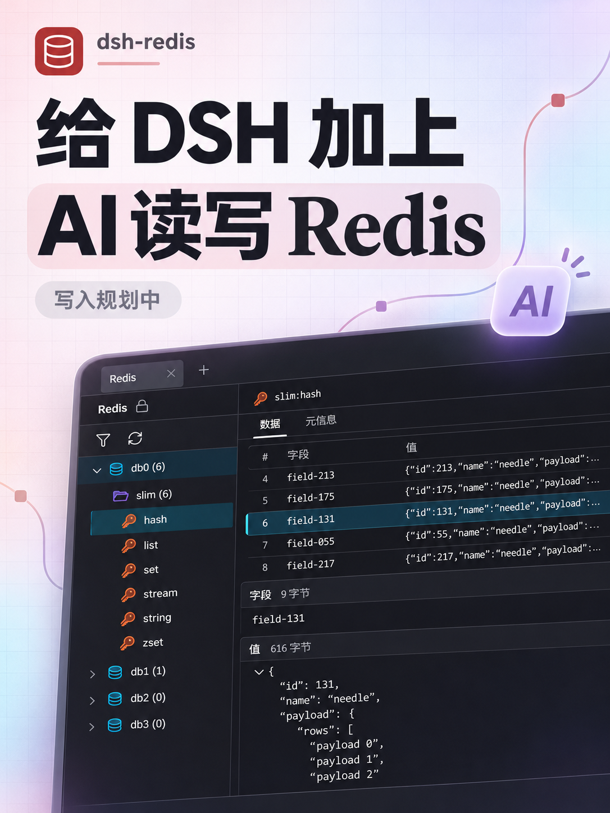
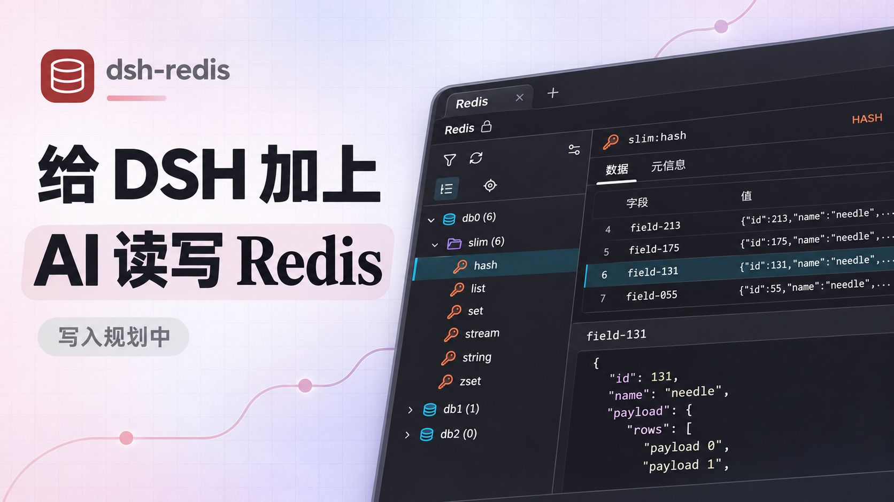
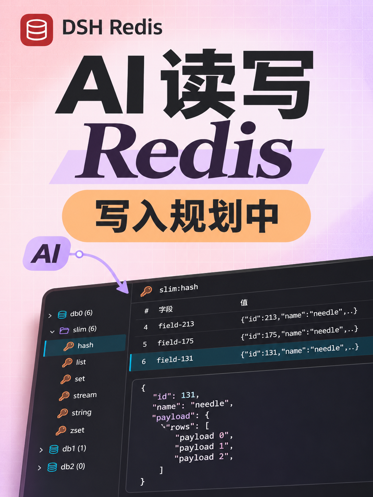
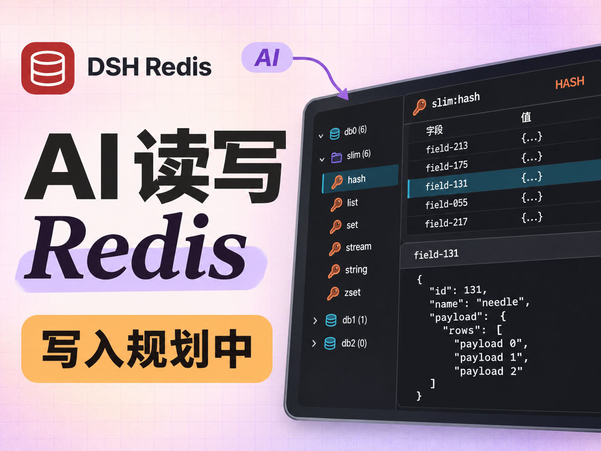
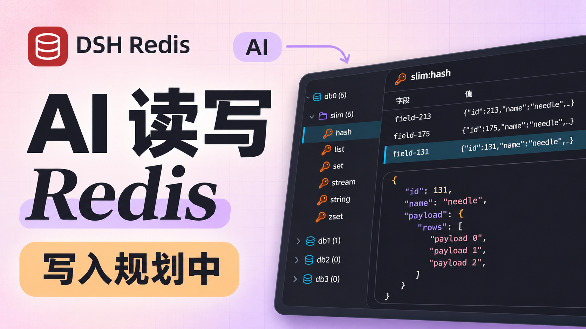
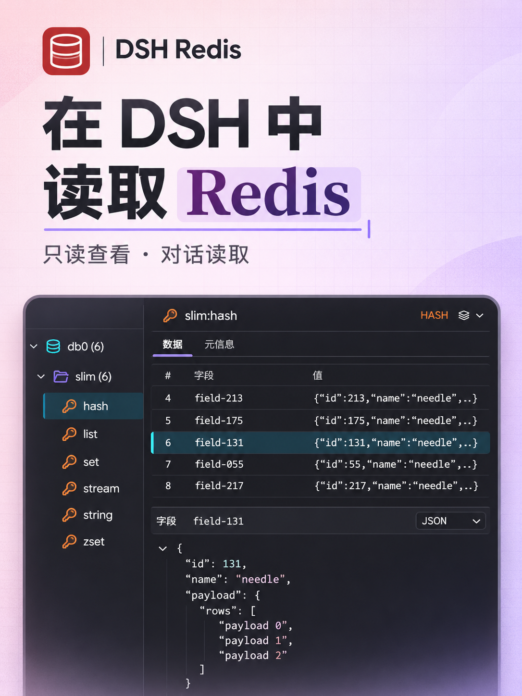
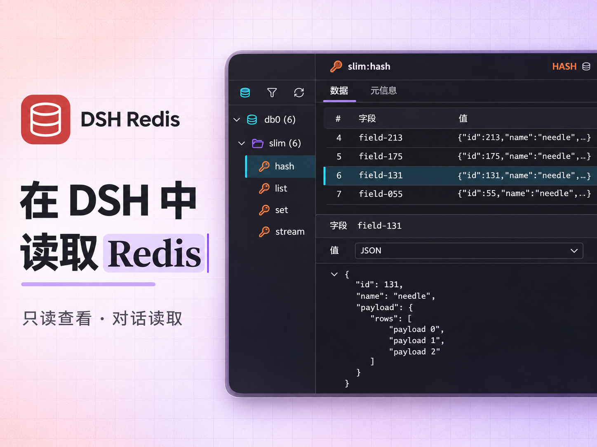
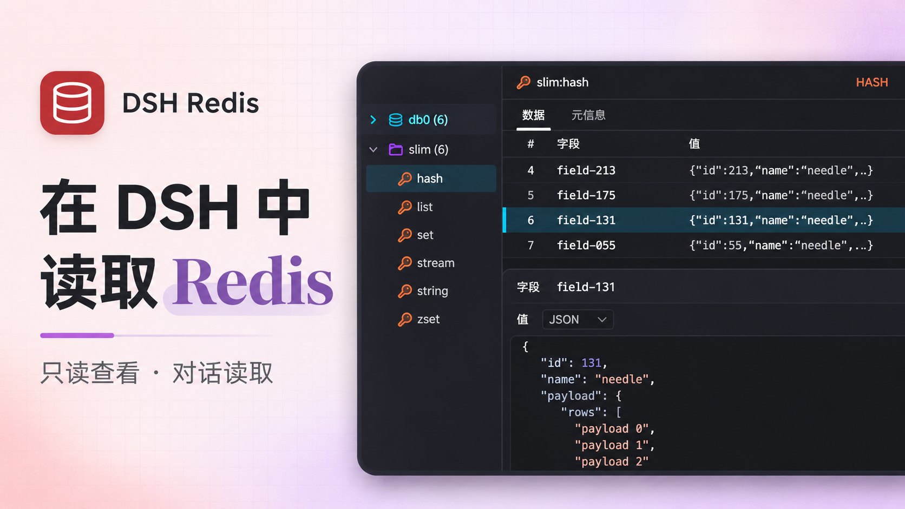
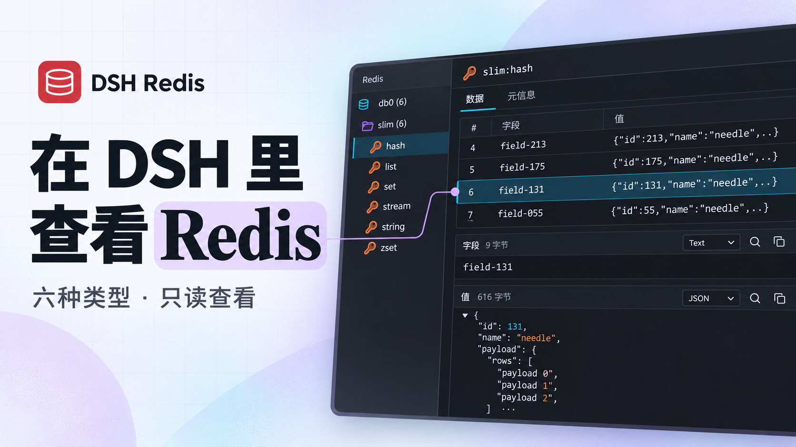

# DSH Redis 推广素材

## DSH 与 AI 读写封面

以“给 DSH 加上 AI 读写 Redis”为主标题，保留“写入规划中”说明。封面借鉴用户参考图的信息层级，并根据项目 Hash 测试截图重新绘制界面；当前 Redis 数据写入尚未实现，画面不作为实机验收记录。

| 3:4 竖版 | 4:3 横版主封面 | 横向伴随版 |
| --- | --- | --- |
|  |  |  |
| 1086×1448，3:4 | 1448×1086，4:3 | 1672×941，近似 16:9 |

[内容分析](dsh-redis-dsh-ai-20261107.oil-cover/analysis.md) · [封面方案](dsh-redis-dsh-ai-20261107.oil-cover/cover_plan.md) · [生成记录](dsh-redis-dsh-ai-20261107.oil-cover/generation-record.json)。

## 前一版：AI 读写方向封面

主标题突出“AI 读写 Redis”，同时明确标注“写入规划中”。当前插件已实现 AI 读取 Redis，数据写入尚未实现。封面依据现有测试截图和项目图标生成，界面为宣传重构，不是写入操作或实机验收记录。

| 3:4 竖版 | 4:3 横版主封面 | 横向伴随版 |
| --- | --- | --- |
|  |  |  |
| 1086×1448，3:4 | 1448×1086，4:3 | 1672×941，近似 16:9 |

[内容分析](dsh-redis-ai-20261107.oil-cover/analysis.md) · [封面方案](dsh-redis-ai-20261107.oil-cover/cover_plan.md) · [生成记录](dsh-redis-ai-20261107.oil-cover/generation-record.json)。封面未使用头像，没有本地贴字或裁切。

## 上一版：对话读取封面

这组三张封面以项目原生 Hash 截图和项目图标为参考，突出 DSH 中的只读查看与对话读取。界面经图像生成工具重新绘制，用于推广，不是实机截图或新的验收记录。

| 3:4 竖版 | 4:3 横版主封面 | 横向伴随版 |
| --- | --- | --- |
|  |  |  |
| 1086×1448，3:4 | 1448×1086，4:3 | 1672×941，近似 16:9 |

[内容分析](dsh-redis-chat-20261107.oil-cover/analysis.md) · [封面方案](dsh-redis-chat-20261107.oil-cover/cover_plan.md) · [生成记录](dsh-redis-chat-20261107.oil-cover/generation-record.json) · [推广介绍](../../PROMOTION.md)。封面未使用头像，未本地贴字、拼贴或裁切。

## 原有封面

三张封面均根据现有原生Hash界面和项目图标生成，用于产品介绍。图中数据来自隔离测试，界面为推广重构，不作为原生截图或运行验收证据。

| 3:4 竖版 | 4:3 横版主封面 | 横向伴随版 |
| --- | --- | --- |
|  |  |  |
| 1086×1448，精确3:4 | 1448×1086，精确4:3 | 1672×941，近似16:9 |

文案见[推广介绍](../../PROMOTION.md)，产品事实、环境与安装入口见[中文README](../../README.zh.md)和[English README](../../README.md)。这些素材仅在本地整理，没有对外发布。

## 来源与复用

- [输入截图](dsh-redis-demo.jpg)原样复用[已核对的Hash画面](../screenshots/hash-workbench-dark.jpg)。
- [内容分析](dsh-redis-demo.oil-cover/analysis.md)记录主题、证据和文字依据。
- [封面方案](dsh-redis-demo.oil-cover/cover_plan.md)列出三幅实际尺寸、构图和检查结论。
- [生成记录](dsh-redis-demo.oil-cover/generation-record.json)记录工具、参考图、文件哈希及原样复制状态。
- [3:4提示词](dsh-redis-demo.oil-cover/cover_3x4.prompt.md)、[4:3提示词](dsh-redis-demo.oil-cover/cover_4x3.prompt.md)、[16:9提示词](dsh-redis-demo.oil-cover/cover_16x9.prompt.md)可用于后续按指定画幅调整。

采用oil-cover的Agent自主模式和内置图生图工具，无人物，没有本地贴字、拼贴、裁切或视觉修补。宽屏版保留工具实际返回尺寸，未裁切成精确16:9。项目图标和README原生截图均保持原样；来源与第三方归属仍见[项目说明](../../THIRD_PARTY_NOTICES.md)。
