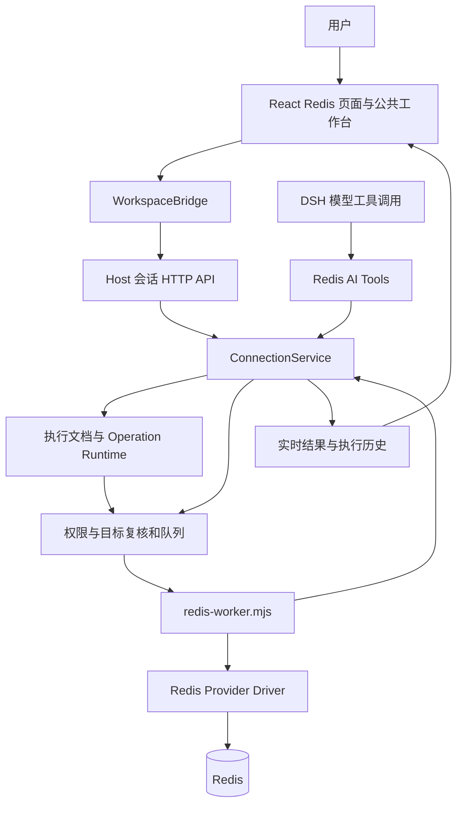
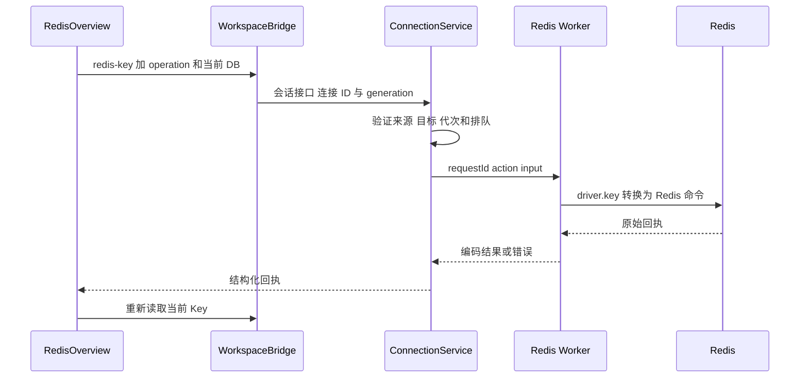
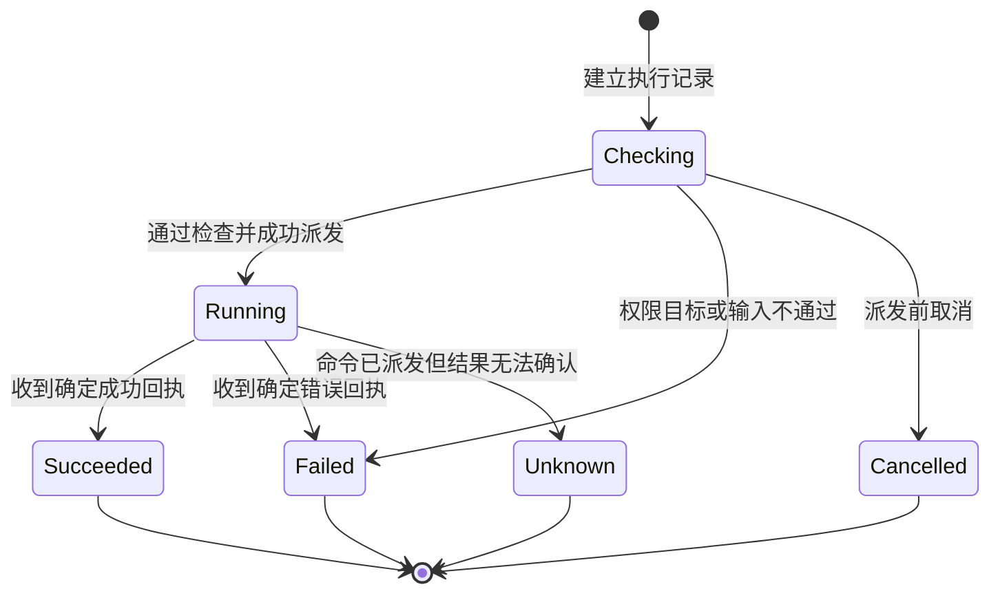
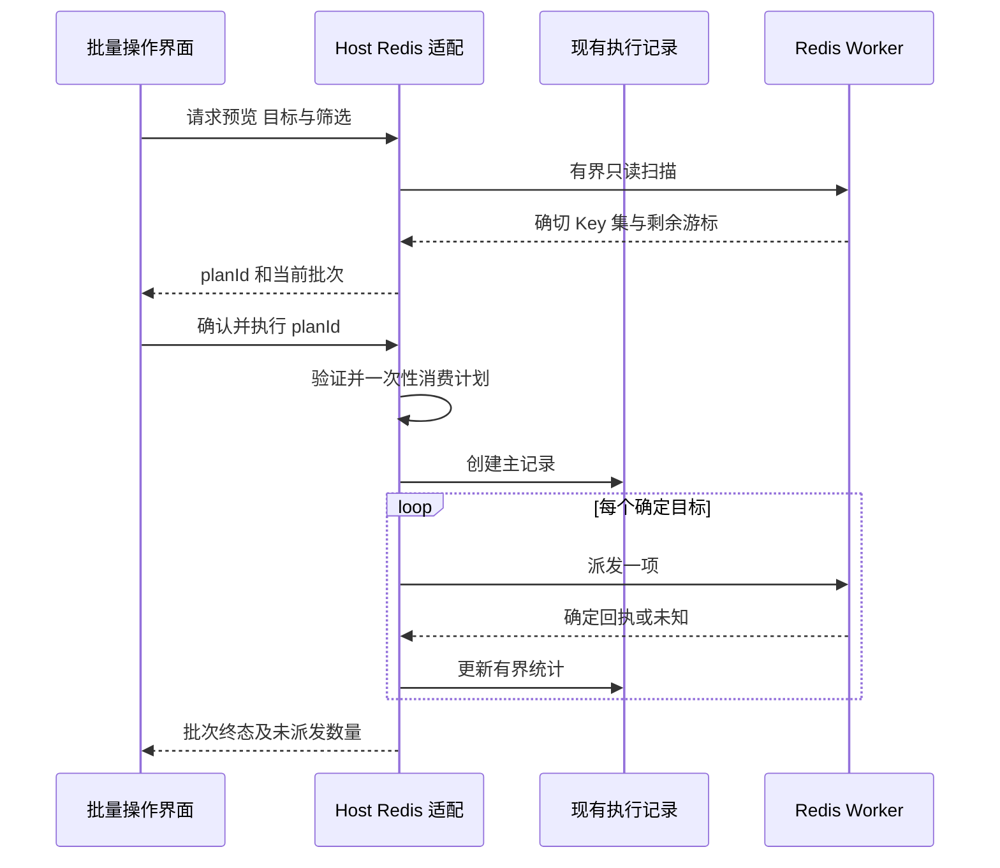

# DSH Database Redis 功能与实现说明

文档日期：2026 年 10 月 15 日  
项目：`zhuoxiaoshuai/dsh-database`  
分析版本：`0.1.0-alpha.12.18`  
源码提交：[`5d2b900b0317200b1866275c7cf48814fe84b52d`](https://github.com/zhuoxiaoshuai/dsh-database/tree/5d2b900b0317200b1866275c7cf48814fe84b52d)  
适用读者：需要了解、维护或参考实现 DSH Redis 插件的开发人员。

本插件在 DeepSeek Harness 会话右侧提供 Redis 连接、Key 浏览、类型化内容编辑、命令台和 AI 工具。Redis 驱动运行在 Node Worker 中；浏览器通过 Host 的会话接口发起操作，不直接连接 Redis。它复用插件已有的多数据源工作台和执行文档机制。

本文说明上述提交的实际实现方法。代码中的现有问题放在第 15 节，修复建议不代表已落地。本文基于源码、测试代码和仓库历史记录的静态核对；未安装插件、安装依赖、运行测试、连接 Redis 或启动服务。源码版本与 README 指向的 `alpha.12.15` 发布包应分别验收。

第 20–24 节新增 RESP.app 2022.2 的功能对比及 DSH 补齐方案。对比基线为 RESP.app 提交 `7f5408a328dc9c6dac141b6678b31d7cbdf9ca49`。新增功能名、接口名、文件名、资源预算和实施顺序均为设计建议，当前插件中尚未实现；它们与前 19 节的现状说明分别阅读。

## 目录

1. 功能范围与使用流程
2. 分层架构与源码职责
3. 数据契约
4. 连接建立与数据库选择
5. Key 搜索与对象树
6. 类型化内容读取
7. 可视化写入
8. 命令台与命令解析
9. AI 工具与协作控制
10. 执行生命周期与结果投影
11. 权限与凭据处理
12. 超时取消与恢复
13. 参数和资源上限
14. 测试构建与兼容性
15. 已确认的问题与建议处理
16. 按模块复现实现的方法
17. 典型调用全链路
18. 验收建议
19. 固定版本源码索引
20. RESP app 对比与功能缺口
21. 缺少功能的具体实现方案
22. 接入契约与共用执行规则
23. 实施顺序与验收矩阵
24. 对比依据与技术资料索引

## 1 功能范围与使用流程

### 1.1 已有功能

| 功能域 | 实际功能 | 主要边界 |
| --- | --- | --- |
| 连接管理 | 单机、Sentinel、Cluster；账号密码；TLS 与自定义 CA | 哨兵配置只接收一个入口地址；哨兵与 Redis 共用输入凭据；集群 DB 只能为 0 |
| DB 浏览 | 展示 `db0` 等节点，选择浏览 DB | 前端选中的 DB 与建连默认 DB 是两个概念 |
| Key 浏览 | SCAN、搜索、游标加载、冒号分组、刷新 | SCAN 可能空页或重复；未完成不等于没有更多 Key |
| 内容查看 | 类型、TTL、原始 RESP 编码、表格或专用卡片 | 根据 Redis 类型和特征判断展示方式 |
| Key 维护 | 新建、重命名、删除、设置 TTL、取消过期 | 新建面板提供五种基础类型；其他类型可通过命令或专用内容区操作 |
| 内容维护 | String、Hash、List、Set、ZSet 等编辑；Stream、Bitmap 等专用操作 | 各类型能力不同，部分现有路径存在缺陷，见第 15 节 |
| 命令台 | Redis CLI 风格的单条命令、参数提示、Key 补全、结果与本页历史 | 每条命令使用独立连接；不维持交互式事务状态 |
| AI 协作 | 连接状态、Key 扫描、值读取、SIT 任意单条命令 | UAT/PVT 禁止 AI 任意命令；人工命令不受此环境限制 |
| 执行追踪 | 执行身份、连接代次、文档修订、派发状态、未知回执 | 完整命令和值不作为普通执行历史正文持久化；错误原文另有边界 |

参考：[S01]、[S02]、[S03]、[S04]、[S05]。

### 1.2 用户操作顺序

1. 在会话右侧打开数据库工作台，添加 Redis 连接。
2. 选择单机、哨兵或集群，填写地址、端口、默认 DB，以及按需提供的账号、密码、TLS 和 CA。
3. 可先测试连接，再正式连接。测试成功不等同于已经建立可浏览的保存连接。
4. 在左侧选择 DB，加载 Key；输入搜索条件后重新扫描。
5. 点击 Key 查看内容；根据类型使用文本编辑、表格编辑、流消息或位图界面。
6. 需要直接命令时进入命令台，例如输入 `PING` 或 `GET app:demo`。
7. 需要 AI 操作时使用 AI Query。人工接管后，AI 不能继续覆盖或操作当前协作文档；归还后再继续。

本流程是产品已有入口说明，不代表本文执行了这些操作。

## 2 分层架构与源码职责

### 2.1 整体结构



图中有两条主要执行路径：

- **结构化路径**：浏览 Key、读取内容、可视化编辑通过 `redis-scan`、`redis-key-suggest`、`redis-key` 等 action 发送给 Worker。
- **文本路径**：人工命令台和 AI 的 `redis_execute` 进入标准文本执行机制，经过解析、授权、文档校验及执行记录，再派发 `redis-command`。

它们最终使用相同 Redis Provider，但并非所有权限、记录和取消处理都完全相同。不能把文本路径已有的保护自动推定为结构化写入也具有。

### 2.2 主要文件

下表路径均相对于插件仓库根目录；链接见第 19 节。

| 层次 | 文件 | 职责 |
| --- | --- | --- |
| Host 来源模块 | `src/host/data-sources/redis/module.ts` | 组合连接、AI 工具、对象浏览、经验和文本执行能力 |
| Worker 描述 | `src/host/data-sources/redis/runtime.mjs` | 声明 Worker 入口、可接受 action、命令文档类型 |
| Redis 驱动 | `src/host/data-sources/redis/index.mjs` | 建连、模式适配、SCAN、按类型读写、RESP 编码 |
| Worker | `src/host/redis-worker.mjs` | 管理实际 Redis 客户端、请求分发、心跳、取消和连接释放 |
| 服务层 | `src/host/connection-service.ts` | 管理连接与代次、排队、分发、超时、执行文档和工具调用 |
| HTTP | `src/host/connection-api.ts` | 接收会话请求、转换取消信号、调用服务层并返回 JSON |
| 请求整理 | `src/host/redis-request.ts` | 校验 DB；将结构化输入整理为 Worker 参数 |
| 命令授权 | `src/host/redis-policy.ts` | 解析并应用 Host 配置的命令黑名单 |
| 文本执行 | `src/host/data-sources/redis/execution.ts` | 标准文本的准备、目标归一化、授权、状态分类和结果预览 |
| AI 注册 | `src/host/redis-ai-tools.ts` | 注册四个模型工具并绑定会话身份、连接和文档 |
| AI 读取适配 | `src/host/data-sources/redis/read-operation.ts` | 把只读工具转成受生命周期管理的结构化请求 |
| 对象浏览 | `src/host/data-sources/redis/explorer.ts` | 把 SCAN 结果转换为通用对象节点，并解码对象引用 |
| 客户端接线 | `src/client/redis/workspace.tsx` | 为公共工作台提供编辑器、总览、结果、命令目标和缓存 |
| Key 总览 | `src/client/redis/overview.tsx` | SCAN 列表、详情草稿、分页、创建、编辑和刷新 |
| 详情组件 | `src/client/redis/key-*.tsx` | 各类型的显示、编辑表单、工具栏、卡片和树结构 |
| 展示模型 | `src/client/redis/key-model.ts` | 类型到视图映射、表格列、格式、筛选、排序、下一页参数 |
| 编辑器与补全 | `src/client/redis/command-editor.tsx`、`completion.ts`、`key-cache.ts` | 命令输入、参数位置识别、候选生成及缓存 |
| 共享契约 | `src/shared/redis-result.ts`、`redis-command.ts`、`data-sources/redis.ts` | 响应联合类型、浏览器可用命令解析、连接和 DB 描述 |

### 2.3 模块组合方式

`redisModule` 的 `execution.mode` 为 `standard-text`，连接部分复用已有输入验证和配置存储；AI 注册调用 `registerRedisAiTools`；对象浏览委托 `redisExplorer`。`redisProvider` 声明 `command`、`scan`、`key` 三项能力，其 `driver` 提供实际 Redis 操作函数。

这种组合使公共工作台只依赖来源描述和桥接接口。Redis 保留自身的 RESP、DB、游标和类型语义，不需要伪装成 SQL 的行列查询。参考：[S01]、[S03]、[S06]。

## 3 数据契约

### 3.1 连接与目标

Redis 使用共享连接模型，其中 Redis 相关配置主要包括：

| 字段 | 含义 | 实现约束 |
| --- | --- | --- |
| `dialect` | 数据源类型 | `redis` |
| `host`、`port` | 单机地址、哨兵地址或集群种子地址 | 由共享连接验证和驱动消费 |
| `database` | 建连默认 DB | 字符串表示的 0–65535 整数；实际服务器是否提供该 DB 由服务器决定 |
| `username`、`password` | Redis ACL 用户和密码 | 允许不提供；是否成功取决于目标认证配置 |
| `redisMode` | 连接模式 | `standalone`、`sentinel`、`cluster` |
| `sentinelMaster` | 哨兵 Master 名称 | 哨兵模式必须提供非空名称，长度不超过 128 |
| `tls` | 启用 TLS | 布尔值 |
| `caPem` | 自定义 CA 内容 | 有内容时必须启用 TLS；输入验证限长 |
| `environment` | 环境标签 | SIT、UAT、PVT；参与 AI 命令授权 |

`connectionId` 标识保存连接，`generation` 标识当前运行代次。重连后，旧代次不能继续用于当前操作。文档的 `revision` 则标识文本、控制权和执行上下文对应的版本。三者用途不同，不应混用。

### 3.2 RESP 值表示

Redis 返回值不是统一字符串。`RedisValue` 保留以下类型：

```typescript
type RedisValue =
  | { type: 'nil' | 'truncated' }
  | { type: 'integer' | 'string' | 'error'; value: string; length?: number }
  | { type: 'binary'; value: string; length: number; encoding: 'base64' }
  | { type: 'array' | 'set'; value: RedisValue[] }
  | { type: 'map'; value: [RedisValue, RedisValue][] }
```

这是源码中的共享契约。整数按字符串呈现；Buffer 可以按 UTF-8 无损往返时表示为字符串，否则转 Base64 并保留原长度。数组、集合和 Map 递归编码。它解决的是返回值表示，不能据此认为所有 Key 名和表格编辑都支持二进制往返。

### 3.3 扫描和详情响应

SCAN 的响应形状为：

```typescript
interface RedisScanResult {
  cursor: string
  keys: string[]
  scanned: number
  complete: boolean
}
```

单 Key 读取包含 `key`、`keyType`、`ttl`、`value`、`offset`、`more`，并按需带 `cursor`、`rows` 或 `card`。`value` 是 RESP 编码；`rows` 是详情表格使用的字符串单元格；`card` 表示 HLL 数量或 Bloom 元信息。写操作则用 `RedisMutationResult` 包装编码回执。

以下为解释契约的示意数据，不是实际数据库回读：

```json
{
  "key": "app:queue",
  "keyType": "list",
  "ttl": -1,
  "offset": 0,
  "more": false,
  "value": {
    "result": {"type": "array", "value": [{"type": "string", "value": "job1", "length": 4}]},
    "truncated": false
  },
  "rows": [{"id": "1", "cells": {"index": "0", "value": "job1"}}]
}
```

详情同时存在 `value` 与 `rows`，是理解后续大结果问题的关键。参考：[S07]、[S01]。

## 4 连接建立与数据库选择

### 4.1 建连驱动

驱动根据 `redisMode` 选择 node-redis 的三种工厂：

- 单机：`createClient`，设置主机、端口、DB、认证和 socket 参数。
- 集群：`createCluster`，提供一个 `rootNodes` 种子节点及默认认证、TLS 参数。
- 哨兵：`createSentinel`，提供 Master 名称、一个 `sentinelRootNodes` 地址；Redis 节点配置和哨兵配置复用输入的账号密码。

客户端通过 `withTypeMapping` 将 RESP Blob String 映射为 Buffer，以便之后判断是否为有效 UTF-8。驱动 socket 的 `connectTimeout` 为 8 秒，通用 socket 参数设置 `reconnectStrategy: false`。这不意味着浏览器永不恢复连接；Host 和来源模块还有独立的恢复逻辑。

单机客户端可以直接发送参数数组；集群和哨兵的客户端则通过 `adapt` 转成统一的 `sendCommand(args)` 形状。集群还暴露 `masters` 和 `nodeClient`，供全主节点 SCAN 使用。参考：[S01]。

### 4.2 Worker 初始握手

Worker 收到第一次消息后，执行以下流程：

1. 复制连接输入到内部 `credentials`。
2. 取得 Redis Provider 并验证连接目标。
3. 建立 Redis 客户端，执行 `PING`。
4. 尝试 `INFO server` 取得版本；INFO 被 ACL 拒绝时仍可返回一般 Redis 标识。
5. 清空原始 `input.password` 和 `input.caPem`；内部凭据副本保留供后续命令连接和恢复使用。
6. 测试连接模式：关闭客户端，返回探测结果，不进入长期工作状态。
7. 正式连接模式：读取 DB 列表，设置心跳和请求监听器，返回 ready 回执。

这一步把“认证及网络可连接”与“长期承载后续操作”区分开。它没有对 Redis 最低版本做完整特性验收，探测出版本也不代表所有扩展命令可用。

### 4.3 DB 列表生成

集群固定返回 `['0']`。非集群优先尝试 `CONFIG GET databases`，同时用 `INFO keyspace` 补充已有数据的 DB 编号；两者可能被 ACL 拒绝。

列表生成有 128 个 DB 的上限。没有配置值时，以默认 16 个、当前 DB 及 INFO 中可见的最高 DB 综合决定展示数量。因此列表在权限受限时属于尽力发现，不是服务器数据库配置的权威枚举。底层 DB 输入允许到 65535，也不等于 UI 一定列出所有这些编号。

### 4.4 浏览 DB 与命令 DB

`redisSelectedDatabase` 仅在当前对象根节点属于已知 DB 时返回选择值；未选择时返回空字符串。总览据此提示先选择 DB。

`redisCommandDatabase` 则在未选择对象 DB 时退回连接默认 DB，所以命令台仍有明确的执行目标。`useRedisBindings` 把这一值放进 `executionContext.database` 和补全上下文。

Worker 的 `clientFor` 不通过共享客户端 `SELECT` 来切库：主 DB 复用主客户端，其他 DB 建独立客户端并缓存；新额外 DB 打开成功后，会清理其他额外 DB 客户端。这使浏览 DB 的切换不直接改变主连接的 DB 状态。命令台则另开单次连接，见第 8 节。

## 5 Key 搜索与对象树

### 5.1 普通 SCAN

`scan` 使用：

```text
SCAN <cursor> MATCH <pattern> COUNT 100
```

驱动校验并整理游标，将 Key 名转成文本，去除单页重复项；返回下一游标、扫描数量和完成状态。`cursor === '0'` 才表示本轮结束。

`COUNT 100` 是工作量提示，不是严格的行数上限。空页并不表示完成，跨页也可能重复；客户端把这些情况作为正常 SCAN 语义处理。参考：[S01]、[R01]。

### 5.2 Cluster 全主节点扫描

集群模式不把随机一个节点的 SCAN 当成全库结果，而是按当前 `masters` 数组逐个读取。复合游标形状为 `节点下标:节点游标`，例如 `0:42`。

```text
初始 0
  → 主节点 0，从游标 0 开始
  → 主节点 0 未结束：返回 0:<下一游标>
  → 主节点 0 结束：返回 1:0
  → 最后一个主节点结束：返回 0
```

这个实现按节点数组位置编码进度；它没有提供拓扑快照或迁槽期间一致性保证。集群主节点变化时，不应将一次扫描视为严格完整且无重复的数据快照。现有多主节点游标测试使用模拟节点，不代表真实集群已验收。

### 5.3 搜索的两层处理

`redisScanMatch` 取输入的第一个词：普通词转换为 `*词*`，带 `*`、`?`、`[` 的输入作为 glob 传给 Redis。`redisKeyMatches` 再对返回名称进行本地多词匹配，所有词都匹配才显示。

例如输入 `order user`，服务器先按 `*order*` 扫描，页面再检查名称是否同时包含两个词。本地普通词匹配不区分大小写，但 Redis 的 MATCH 并不因此变成同样的匹配方式。实际结果仍受到服务器第一层过滤的影响。

### 5.4 页面加载与分组

`RedisOverview` 通过公共 `usePagedList` 保存列表状态。默认每次读一页；继续加载时把新页追加到已有 Key 列表，刷新时替换列表。“加载全部”最多连续读 200 页，游标尚未结束时继续显示“未扫完”。它不是一次无限扫描，也不承诺点击后得到完整静态清单。

已加载名称由 `buildKeyTree` 按冒号 `:` 分组，例如 `app:user:1` 形成虚拟文件夹。文件夹只是客户端展示结构，不是 Redis 目录，也不产生服务器计数请求。

搜索有 300 毫秒防抖。连接 ID、代次、所选 DB、刷新令牌变化时会重置列表和详情；读取使用 AbortController 和递增令牌丢弃迟到结果。

### 5.5 Key 补全与缓存

命令补全可以使用已浏览 Key 缓存，也可以按前缀限量扫描：

- 前缀至少 2 个字符，UTF-8 不超过 128 字节。
- 转义 glob 特殊字符后构造“字面前缀＋星号”的 MATCH。
- 每次建议调用最多 5 页、30 个候选；集群各主节点共享这 5 页预算，不是每个主节点各 5 页。
- 远端扫描跳过不能无损转为 UTF-8 或超过 4096 字节的名称。候选还要经过 `encodeRedisKey`，过滤空串、控制字符和 U+FFFD；可编码的空白、引号和反斜杠会转换为带引号的参数。
- 客户端缓存最多 5000 个名称、合计 1 MiB；仅用于提示。
- 切换连接、代次或 DB 时清理对应状态；创建、删除、重命名会同步本地候选。

补全结果带 `complete` 和 `scannedPages`，界面区分正在查找、不完整、完成和失败，允许继续手工输入。参考：[S08]、[S09]、[S10]。

## 6 类型化内容读取

### 6.1 通用读取顺序

`key` 先验证 Key 必须为非空字符串且不超过 4096 UTF-8 字节。`operation` 缺省为 `read`。读取时先执行 `TYPE` 和 `TTL`，再按类型进入专用读取函数。

`TYPE`、`TTL` 和内容读取是多次独立命令，不构成一致性快照。Key 在其间过期、被替换或被其他客户端修改时，可能得到不存在结果、WRONGTYPE 或各字段来自不同时刻的状态。

### 6.2 各类型命令与展示

| 类型或展示方式 | 实际读取命令 | 分页方法与返回形式 |
| --- | --- | --- |
| String | `OBJECT ENCODING`、`GET` | 普通文本整体读取后编码；无服务端分段翻页 |
| List | `LRANGE`、`LLEN` | 按 offset 读取 100 项；返回真实 index 和 more |
| Hash | `HSCAN`、`HTTL` | 游标分页，返回字段、值、字段 TTL；COUNT 是提示 |
| Set | `SSCAN` | 游标分页，返回 member 行 |
| ZSet | `ZSCAN`；并探测 `GEOPOS` | 游标分页；普通 score 或 GEO 坐标行 |
| Stream | `XRANGE` | 每页 COUNT 100；下一页从上一末尾 ID 的排他边界读取 |
| Bitmap | `GETRANGE`、`STRLEN`、`BITFIELD GET` | 用户切换 Bit 展示后，每页 100 个 bit |
| HyperLogLog | 编码或 HYLL 特征探测，`PFCOUNT` | 返回计数卡片，不展示内部寄存器 |
| JSON | `JSON.GET` | 整体读取；需要对应服务端能力 |
| TimeSeries | `TS.RANGE` | COUNT 100，按末尾时间戳继续；需要对应服务端能力 |
| Bloom | `BF.INFO` | 返回元信息卡片；需要对应服务端能力 |
| 不认识的类型 | 保留原始类型名，返回空编码值 | 页面提示没有专用编辑区，可使用命令台 |

### 6.3 String 与二进制

普通 String 先整体 `GET`，之后由 `encodeReply` 处理。文本可切换 Text、JSON、Hex、Binary 展示；Hex 和 Binary 展示只读。无效 UTF-8 的 String 以 Base64 传输，页面禁止把它当普通文本保存。

JSON 展示使用现有格式化工具，保存时先验证 JSON 语法。将普通 Redis String 切到 JSON 展示不会自动把服务器类型改成 Redis JSON；真正的 JSON 类型才发送 `JSON.SET`。

### 6.4 Hash 字段 TTL

Hash 先执行 HSCAN，再根据返回字段批量调用 `HTTL`。服务器不认识 HTTL 时回退显示 `-1`；其他错误，例如权限错误，原则上继续抛出。HSCAN 返回字段过多、使 HTTL 参数超过通用参数上限时，也有回退处理。

README 声明 Redis 至少 7.2，不等于其中所有后续新增命令都能在 7.2 上使用。HEXPIRE 从 Redis 7.4 才提供，字段过期操作应以服务器实际支持的 HTTL/HEXPIRE 能力为准，不能由连接成功推定。[R04]

编辑 Hash 行时，前端在 TTL 输入为空、等于 `-1` 或与该行原来显示的数字相同时省略 seconds；只有输入变化后的正数才附带 seconds。驱动先 HSET，再在存在合法 seconds 时调用 HEXPIRE。Redis 的 HSET 会清除被覆盖字段的原 TTL，因此“TTL 单元格保持原数字不动”并不实现保留字段过期时间，见第 15.5 节。

### 6.5 GEO 与 HLL 是特征判断

GEO 在 Redis 中以 ZSet 存储，驱动对返回成员调用 GEOPOS，并核对 score 与计算的 geohash；匹配才切换到坐标表。HLL 在 String 中，通过编码信息或 `HYLL` 文件头特征继续调用 PFCOUNT。

这些是针对存储形态的展示识别，不是 Redis TYPE 返回独立的 `geo` 或 `hyperloglog`。GEO 判断基于当前页样本，不能把识别结果当成全 Key 的业务类型声明。

### 6.6 表格搜索与排序

`key-model.ts` 对当前传入的 rows 做过滤、时间区间筛选和排序；ZSet 的 ASC/DESC 控件同样只作用于已读取页面。这些操作不会改成服务器全量排序、全量搜索或全时间范围查询。详情“加载更多”通过游标或 offset 请求下一页，用新响应整体替换当前 detail 和 rows，不跨页累加；这与 Key 列表的追加加载不同。

参考：[S01]、[S02]、[S11]、[S12]。

## 7 可视化写入

### 7.1 从页面到 Redis 的调用



`RedisOverview.edit` 用本地写入标记阻止同一组件重复提交，并显示错误。通常写入成功后重读当前详情页；重命名更新当前名称及本地创建、移除集合后读取新名称。删除整个 Key 会清理当前选中详情并直接返回；Bloom 存在性检查也不触发编辑后重读。

### 7.2 操作到命令的映射

| `operation` | 实际命令 | 说明 |
| --- | --- | --- |
| `delete` | `DEL key` | 整个 Key 删除，UI 有确认 |
| `expire` | `EXPIRE key seconds` | 秒数必须为正整数并在允许范围内 |
| `persist` | `PERSIST key` | 取消过期 |
| `rename` | `RENAMENX old new` | 新名称已存在时返回错误，避免直接覆盖目标 |
| `set` | `SET key value` | 当前未保留旧 TTL |
| `hset`、`hdel` | `HSET`、`HDEL` | Hash 字段写入、删除；删除参数缺陷见第 15 节 |
| `lpush`、`lset`、`lrem` | `LPUSH`、`LSET`、`LREM key 1 value` | List 添加到头部、按下标编辑、按值删除 |
| `sadd`、`srem` | `SADD`、`SREM` | Set 添加和删除 |
| `zadd`、`zrem` | `ZADD`、`ZREM` | ZSet 成员和分数编辑 |
| `setbit` | `SETBIT` | 指定 offset 写 0 或 1 |
| `xadd`、`xdel` | `XADD key * ...`、`XDEL` | Stream 添加字段对或按消息 ID 删除 |
| `geoadd` | `GEOADD` | 可在后续命令删除旧 member |
| `pfadd` | `PFADD` | HLL 添加元素 |
| `bfadd`、`bfexists` | `BF.ADD`、`BF.EXISTS` | Bloom 添加或检查 |
| `jsonset` | `JSON.SET key $ value` | 更新 JSON 根路径 |
| `tsadd` | `TS.ADD` | 指定时间戳追加样本 |
| `hexpire` | `HEXPIRE ... FIELDS 1 field` | 设置 Hash 字段过期；HSET 也可附带 seconds 后追加该命令 |

### 7.3 编辑并非统一事务

部分编辑其实由多条命令顺序组成：

- Hash 字段重命名：先 HSET 新字段，再 HDEL 旧字段。
- Set/ZSet 成员替换：先添加新成员，再删除旧成员。
- GEO 成员替换：先 GEOADD，再 ZREM。
- Hash 字段写入并显式提供合法正 TTL：先 HSET，再 HEXPIRE；前端省略 seconds 的情况不会发送后一条命令。

实现没有为这些组合增加 Redis 事务、Lua 原子脚本或回滚。后续命令失败时，前面的修改可能已经生效；重新点击保存也不等于安全重放。

新建 String 使用普通 SET，没有 NX；输入已有名称可以覆盖现有数据。新建其他基础类型也按其对应写命令执行，并不是独立的“创建且禁止覆盖”协议。

### 7.4 前端各类型能力

String 以文本框编辑；Hash/List/Set/ZSet/GEO 使用表格；Stream 禁止行内修改，但可以新增字段对和删除消息；Bitmap 通过点击单元格切换 bit；TimeSeries 允许新增样本，关闭行编辑和删除；HLL 与 Bloom 用专用卡片操作。

整 Key 删除使用浏览器确认，表格删除使用行内二次确认。其余写入没有统一的服务端审批账本。人工 UAT/PVT 编辑不因标签自动变成只读，实际写权限由 Redis 账号和 ACL 控制。参考：[S01]、[S02]、[S12]、[S13]。

## 8 命令台与命令解析

### 8.1 单条命令解析

`parseRedisCommand` 是浏览器可用的轻量解析器，不是 shell。它识别空白分隔、单双引号、反斜杠转义、`\n`、`\r`、`\t`，保留引号里的空格。

例如：

```text
SET "app:welcome message" "hello\nworld"
```

会被拆成三个参数，第二个参数包含空格，第三个包含换行。解析器拒绝未闭合引号、末尾转义、引号外换行、十六进制字节转义 `\x`、UTF-8 编码超过 64 KiB 的命令文本和超过 256 个参数。前端 CodeMirror 另按 65536 个 UTF-16 code units 限长，两者不是同一个计量；中文等非 ASCII 输入可能先通过前端长度约束，再被 Host 字节上限拒绝。

它不会执行操作系统命令、变量展开或 shell 管道。一条 Redis 命令本身仍可能具有复杂效果，例如 Lua、批量参数写入或管理命令；“只能一条”不等于“只能影响一条数据”。参考：[S14]。

### 8.2 标准文本准备与授权

`redisExecution.prepareText` 将文本解析为 `args`，生成 `redis-command`、当前 DB、工具名、执行标题、状态分类规则和实时结果投影。`authorize` 再检查实际执行身份和命令文本：

1. 执行身份必须是人工或 AI。
2. AI 任意命令只允许 SIT。
3. 应用 Host 配置的黑名单。
4. 再次解析文本，并核对派发参数与授权文本一致。

`DSH_REDIS_COMMAND_BLACKLIST` 是 JSON 数组，可按命令名或命令与子命令精确阻止。例如 `CONFIG SET` 与 `CONFIG GET` 可以区分。配置格式非法时抛错，不静默忽略。默认空数组意味着没有应用级默认禁令，最终还需 Redis ACL 授权。

### 8.3 独立连接执行

Worker 收到 `redis-command` 后，按当前目标 DB 另建 `isolated` 客户端，执行一条命令，编码结果，并在 finally 中关闭。这条连接与 Key 浏览连接分开。

因此：

- 在服务器模式允许 SELECT 的情况下，`SELECT 2` 只影响这次即将关闭的连接，不改变对象树 DB，也不影响下一条命令；Redis Cluster 不提供这种多 DB 切换。
- `MULTI` 与下一次提交的 `EXEC` 不处于同一条连接，不能构成连续交互事务。
- 阻塞命令会占用本次连接；取消时通过销毁该连接结束客户端等待，但不能据此推定服务器没有产生效果。
- 每次执行都要建连，降低了会话状态相互污染的机会，也增加了握手成本。

### 8.4 集群命令路由

驱动的 `routingKey` 识别 EVAL/FCALL 类命令的首个声明 Key，对 MEMORY、OBJECT、BITOP、MIGRATE 作特殊处理；其他通常把第二个参数作为路由 Key，已列入 KEYLESS 的命令不提供路由 Key。

这是自定义启发式路由，不是完整解析所有 Redis 命令的 key-spec。多 Key 命令仍受 Redis Cluster 槽位规则约束，也不能把命令台宣称为已验证支持全部集群命令。参考：[S01]、[S04]、[S15]。

## 9 AI 工具与协作控制

### 9.1 四个工具

| 工具 | 输入要点 | 实际路径 | 环境条件 |
| --- | --- | --- | --- |
| `redis_status` | 无业务参数 | 尝试恢复可复用保存登录，然后返回 Redis 连接列表 | 可列出连接状态，不执行任意数据命令 |
| `redis_keys` | 可选连接 ID、代次、cursor、match | `executeRedisReadTool` → `redis-scan` | SIT/UAT/PVT 结构化读取 |
| `redis_value` | key，及可选连接 ID、代次、cursor、offset | `executeRedisReadTool` → `redis-key`，强制 read | SIT/UAT/PVT 结构化读取 |
| `redis_execute` | command，及可选连接 ID、代次 | 更新 AI 文档 → `executeText` → `redis-command` | 只允许 SIT |

`redis_status` 返回 `connectionId`、`generation`、名称、环境、默认 DB、live、health、version。由于它会调用 `restoreRemembered`，不能把状态查询理解为永远不会尝试网络建连。

### 9.2 会话身份与连接选择

工具从 DSH 可信执行上下文的 `execution.agent.session.id` 取会话身份，不让模型通过业务参数任意指定 owner。注册时传入 `liveOwner` 回调，它会检查会话 ID 形状，并用宿主 `sessions.get` 确认活会话。

连接解析器按 Redis family 过滤当前连接。只有一条已登录 Redis 连接时，允许省略 ID 和 generation；连接不明确、ID 不可用或传入旧代次时，返回当前连接信息和下一步提示，而不是随意选择目标。

工具参数没有独立的 `database` 字段；读取和执行采用当前执行文档中的上下文。调用前应先在工作台或文档上下文中确认目标 DB，不能把连接默认 DB 当成所有调用固定不变的目标。

### 9.3 结构化读取

`prepareRedisReadOperation` 只接收 `redis_keys` 和 `redis_value`。若调用携带非 read 的 operation，会直接拒绝；值读取要求 key 为字符串。

读操作的流程是：

1. 确认当前连接有效，并且文档控制权属于 AI。
2. 以当前文档上下文生成只读请求与记录摘要。
3. 在 `runOperation` 中建一条工具执行记录，关联 callId/rootCallId。
4. 进入 AI 队列。
5. 派发前重新检查文档 revision 和 controller，再由 `#dispatch` 检查连接代次。
6. 发送 SCAN 或 Key read，完成自己的工具记录，返回结构化 JSON。

读取不会把模型输入改写成新的命令，也不覆盖当前 AI Query 文本。Key 读取的执行标题使用 Key 的 SHA-256 前 12 位，减少正常摘要中直接暴露 Key 名；工具结果仍包含实际 Key 和值。

### 9.4 AI 任意命令

`redis_execute` 先拒绝非 SIT 目标，然后应用命令黑名单，将命令写入 AI 执行文档，带发布后的 revision、generation、context 进入标准文本执行。排队后再次核对文档内容和控制权，防止执行准备期间用户已改文、切库或接管。

这里的“任意”受解析器、Host 黑名单、Redis ACL、集群路由和服务器能力共同限制。它不是应用层只允许少量安全读命令的 allowlist。

### 9.5 人工接管

公共工作台维护文档的 `controller` 和 `revision`。用户在 AI Query 输入或点击接管，会切换为人工控制；AI 工具在入口及排队后复查控制权。用户完成编辑并归还后，AI 才能继续。

执行文档保存、接管、上下文变化与运行使用公共机制，不在 Redis 组件内再维护一套独立权威文档。前端的草稿和结果状态只是交互状态，Host 文档才是派发时复核的依据。参考：[S05]、[S16]、[S17]、[S18]。

## 10 执行生命周期与结果投影

### 10.1 三种入口的差异

| 入口 | 创建统一执行记录 | 文档修订复核 | 主要结果返回 |
| --- | --- | --- | --- |
| 人工命令或 AI `redis_execute` | 是，标准文本生命周期 | 带文档 revision 的执行会复查；普通命令台不等同于 AI 文档运行 | 命令 RESP 经实时投影返回 |
| AI `redis_keys`、`redis_value` | 是，工具生命周期 | 是，AI 控制权与 revision | 结构化结果 JSON |
| UI Key 浏览和可视化编辑 | 不经过上述统一 `runOperation` 建档路径 | 不经过标准文本的 revision 检查 | 结构化响应直接返回 |

`redisRequest` 中名字为 `#withReadonly` 的包装函数主要负责并发与排队，不进行“Redis 命令是否只读”的语义证明；结构化 Key 写操作也经过它。不能根据方法名字判断写入被禁止。

### 10.2 状态变化



此图概括文本命令的主要语义，不表示所有结构化读取采用同一中断分类。AI 结构化读工具的生命周期把取消归为 cancelled，其余异常归为 failed；底层接口的错误文案仍可能提到结果未知。

`markChecked` 和 `markDispatched` 分别记录通过检查与已派发。发送失败不应记作成功派发。统一生命周期在 finally 中释放 AbortController 关联和监听器，避免失败路径遗留控制器。

### 10.3 执行记录保存什么

标准记录可包含 owner、连接 ID、generation、来源、环境、operation、标题、发起者、callId/rootCallId、文档修订、上下文和状态事件。Redis 完成时主要写摘要，不把 RESP 载荷当作 SQL Result 写入通用结果预览。

磁盘序列化对 Redis 不保留 `documentText`、`executedSql` 和 SQL 的 identity envelope。这与“所有位置都不保存命令文本”不同：会话工作台还会单独保存 AI 文档，命令台也保留当前页内存历史。

### 10.4 三层大小限制不能混淆

1. **驱动 RESP 编码**：`encodeReply` 有 1 MiB 原始内容预算、递归深度和元素个数限制。
2. **命令实时投影**：`redisLivePreview` 对 JSON 序列化大小超过 64 KiB 的命令结果投影为截断标记。源码中标准 `executeText` 的事件以及非 SQL HTTP 返回都使用这一投影，因此实际命令台/AI 命令返回也受其影响。
3. **结构化 Key 结果**：AI `redis_value` 和 UI 详情走结构化返回，除 `value` 编码外还可能有未按同一预算裁剪的 rows；它们不会自动套用命令实时投影。

`redisLivePreview` 的注释称大值留在工具响应，但实际调用还用于 `executeText` 返回值。理解当前行为应以调用点为准，不能只读注释就认为 AI 任意命令始终得到完整的 1 MiB 返回。

### 10.5 前端防止旧结果覆盖新目标

公共工作台使用执行 identity、连接代次、文档 revision、目标 context 和本地序号判断结果是否仍属于当前页面。总览读取另用 AbortSignal、readToken 与当前 Key 名判断迟到回复。

已派发的操作可以完成自己的记录，但失去当前目标关联后，不应把结果安装成新目标的当前结果。相关受控 Worker 测试覆盖了切库、修改文本、接管和重连场景。参考：[S16]、[S19]、[S20]、[S21]。

## 11 权限与凭据处理

### 11.1 HTTP 入口

正式接口路径为 `/plugins/database/connections?conversationId=...`，浏览器桥接使用同源凭据和 POST JSON。

Host 路由首先调用 DSH 的 `requestRejection(req)` 检查请求；通过后读取 URL 中的 conversationId，并检查其非空及长度。`connectionApi` 验证请求方法、JSON Content-Type、请求体大小、输入对象与具体 action，再调用服务层。

这里需要区分三件事：

- DSH 请求认证由宿主连接服务负责。
- HTTP conversationId 在本插件中用于会话布局和执行归属；注入服务层的 `conversationOwnerId` 本身仅检查形状。
- AI 工具另外使用 `liveOwner` 验证当前会话是否在宿主 registry 中。

保存连接集合在该插件 profile 的服务与存储中管理，不能把它描述为已经完成多租户的逐会话 Redis 连接隔离。本文未对宿主认证系统进行外部安全验收。参考：[S22]、[S23]。

### 11.2 环境与 Redis ACL

| 调用方式 | SIT | UAT/PVT |
| --- | --- | --- |
| 人工命令台 | 按命令解析、黑名单、ACL 执行 | 同样按解析、黑名单、ACL 执行，允许账号具备的写入 |
| AI `redis_execute` | 允许，仍受黑名单与 ACL 限制 | 拒绝整个任意命令工具，包括任意命令形式的读取 |
| AI 结构化读取 | 允许 | 允许 |
| 可视化 Key 编辑 | 按现有结构化写路径执行 | 未因环境标签统一禁用，实际权限依赖 ACL |

因此需要只读目标时，可靠的权限基础是实际 Redis 只读账号或 ACL。UI 上选择 PVT 不等于人工操作自动只读。

### 11.3 密码与 CA 存储

连接输入中的密码默认用于 Host/Worker 内存中的登录，不直接放入公开连接快照。勾选保存密码时，生产默认保护器在 Windows 上使用 DPAPI CurrentUser；加密内容通过标准输入传给隐藏 PowerShell 子进程，不放进命令行参数。

保存记录包含非秘密 settings、`protectedPassword`、`protectedCa` 等字段。恢复时解密、校验封装内连接 ID，再用于建连。公开快照剔除 CA 原文，只返回 `hasPassword`、`hasCa` 等存在标识。

代码中的 `memoryPasswordProtector` 是便于注入测试的 Base64 实现，不能把它当成生产加密机制。DPAPI 只在 Windows 可用；加密失败会返回相应告警或要求重输，并非自动降级为明文保存。

JS 中将字符串字段赋空值是减少后续对象暴露的处理，不构成对进程内所有历史字符串副本的安全擦除证明。Worker 的内部凭据副本仍要供单条命令建连及恢复使用。参考：[S24]、[S25]、[S03]。

### 11.4 命令正文和错误边界

会话工作台持久化 AI 文档时，会识别 AUTH、HELLO AUTH、ACL SETUSER、CONFIG SET requirepass 和 MIGRATE AUTH/AUTH2 等凭据命令；命中时把落盘的文档 text 置空。当前内存对象和界面仍可能持有输入文本。

Redis 服务器和驱动的错误原文会返回界面、HTTP、执行摘要或模型；代码没有对这些错误做全面脱敏。服务器错误中若包含 Key、值或其他业务文本，可能进入错误记录。正常结果不落入通用执行预览，并不意味着所有错误内容都不会保存。

人工命令台的最近 30 条历史是页面内存状态；它与磁盘执行历史、会话 AI 文档是不同存储位置。参考：[S14]、[S20]、[S26]、[S27]。

## 12 超时取消与恢复

### 12.1 Host 请求管理

每次 Worker 请求有唯一 requestId。Host 注册 message、exit、abort 监听，并设 deadline；完成或失败后解除监听和计时器。

HTTP 响应连接关闭会转换为 AbortSignal。Host 接到取消或 deadline 时，向 Worker 发送 `{cancel:true,requestId}`，并完成当前调用的错误回执。Redis 文本命令与 redis-key 的取消、超时文案会要求核验未知结果。

### 12.2 命令连接与浏览连接取消不同

Worker 用 `inflight` 为请求保存 AbortController。取消时触发控制器，其 abort 回调只会销毁已赋值的局部 `isolated` 客户端。

- `redis-command` 会创建 isolated，因此取消后可关闭该单次命令连接。
- `redis-key` 使用主客户端或 DB 额外客户端，不设置 isolated。Host 停止等待不代表该底层 Redis 命令已经被硬中断。
- `redis-key-suggest` 的循环会检查 signal，避免继续下一页；正在等待的单条命令仍受连接和驱动行为影响。

Worker 收到迟到回执时还会检查 signal，并报告取消；Host 则在请求已经结束或连接/会话已变化时丢弃不再适用的回复。关闭客户端不是回滚，已经提交的服务器写入不会因此恢复。

### 12.3 健康探测与恢复

Redis Worker 每 30 秒对主连接探测；连接结束或探测失败时标记 degraded。Host 有独立 revive 调度，延迟序列为 500、1000、2000、5000 毫秒，最多 4 次；有忙碌、维护或编辑状态时会按服务逻辑延后。

Worker 的 revive 通过原凭据重新 open、probe、读取 DB，清理额外客户端并替换主客户端。恢复连接不是重新执行先前业务命令，Provider 声明 `replayCommands:false`。

自动 revive 和重新打开保存连接应分别理解：某些恢复路径保留当前服务条目，重新 open 会建立新的运行连接与 generation。调用者应始终使用服务当前返回的代次，不自己预测代次是否变化。参考：[S03]、[S16]、[S28]。

## 13 参数和资源上限

以下数值来自本次固定提交，不是 Redis 自身的通用容量结论。

| 项目 | 代码值或处理方式 | 约束位置 |
| --- | --- | --- |
| live 连接数 | 最多 20 条 | ConnectionService |
| 手工通道并发 | 每连接上限 3，全局 16 | 共用计数，不是额外独立连接池 |
| AI 通道并发 | 每连接阈值 2，全局 14 | 使用同一活动计数，为人工留余量；受阻时可直接拒绝 |
| 排队期限 | 30 秒 | Host 公共等待逻辑 |
| socket 建连超时 | 8 秒 | Redis driver socket 参数 |
| Host 建连及测试期限 | 正式 15 秒，测试 10 秒 | Host deadline |
| 常规 Redis 请求期限 | 默认 32 秒 | redis-command/scan/key 落到公共 query deadline |
| Key 补全请求期限 | 5 秒 | 单独 action deadline |
| Worker 心跳 | 30 秒 | 主连接 PING/版本探测 |
| DB 输入 | 0–65535，无前导零；Cluster 固定 0 | Host 和共享描述双重验证 |
| DB 列表 | 最多 128 项 | 数据库发现 |
| 单 Key 名 | 非空，最多 4096 UTF-8 字节 | 结构化 Key 路径 |
| 命令文本及参数 | 文本 64 KiB；最多 256 个参数；驱动参数拼接后 64 KiB | 前端提示与 Host/driver 约束要分别理解 |
| 通常编辑值 | 64 KiB | 驱动结构化写入；专用操作另作校验 |
| SCAN COUNT | 100 | 仅提示，不是硬返回条数上限 |
| UI 加载全部 | 每轮最多 200 页 | 可继续从剩余游标加载 |
| Key 补全 | 前缀至少 2 字符且最多 128 字节；最多 5 页/30 候选 | 后端限量扫描 |
| Key 提示缓存 | 最多 5000 名称、合计 1 MiB | 不等于对象树和详情的总内存预算 |
| RESP 编码 | 内容预算 1 MiB，最多 1000 个数组/集合/Map 项，深度限制 | 只约束对应编码过程，不等于整个 JSON 体大小 |
| 命令实时投影 | JSON 大于 64 KiB 时变成截断标记 | 标准文本响应与事件 |
| HTTP 请求体 | 512 KiB | 输入上限，不是响应上限 |
| Key TTL 输入 | 1–2147483647 秒 | expire/字段 TTL |
| Bitmap offset | 0–4294967295 | 位图专用校验 |
| 普通内容 offset | 最高 1000000，否则归一为 0 | 当前详情读取逻辑 |
| 命令页面历史 | 最多 30 条、文本去重 | 浏览器当前绑定状态 |

`#withReadonly` 等待时每 20 毫秒检查阻塞条件；人工与 AI 阈值共享计数。把这些数值直接相加作为吞吐量，或按最大连接数推算能承载多少业务请求，都没有依据。参考：[S01]、[S02]、[S09]、[S16]、[S28]。

## 14 测试构建与兼容性

### 14.1 单元与受控测试

| 文件 | 可见断言范围 | 不能由此证明 |
| --- | --- | --- |
| `test/redis.test.mjs` | 来源注册、连接校验、DB 发现、模拟集群 SCAN、黑名单、编码、部分类型读写 | 真正 Cluster/Sentinel、全部写入和大结果行为 |
| `test/redis-target.test.mjs` | DB 目标保留、排队期间切库/接管/改文/重连、取消、未知与不重放、AI 环境授权 | 真实网络与服务器中断的所有组合 |
| `test/redis-completion.test.mjs` | 命令及参数位、引号、候选替换、帮助与 Key 编码 | 实际服务器支持所有提示命令 |
| `test/redis-key-view.test.mjs` | 类型视图、表格列、格式、输入模型、部分 UI/CSS 源码断言 | 每个按钮从真实页面到 Redis 的完整效果 |
| `test/redis-key-tree.test.mjs` | 去重和冒号分组 | 大规模 Key 树性能 |
| `test/redis-key-cache.test.mjs` | 缓存合并、删除、非法候选和数量上限 | Key 全量或实时准确性 |
| `scripts/redis-read-ui-acceptance.mjs` | 实际组件＋受控 Worker 的 AI 读取、控制权、目标切换和取消 | 真实 Redis 或 RedisOverview 全部编辑控件 |
| `scripts/completion-ui-acceptance.mjs` | 实际编辑器键鼠与输入法补全 | 业务数据库的读写结果 |

本次读取到的测试没有专门覆盖：Hash 删除按钮缺 value、String 保存后 TTL、List 重复值删除所选下标，以及结构化 rows 整体字节预算。测试数量多不能代替这几个具体行为的回归。

### 14.2 实连和安装脚本

`npm run test:redis` 指向 `redis-fixture-acceptance.mjs`，使用 Docker 和 OpenSSL 创建普通 Redis、可信 TLS 与主机名不匹配 TLS 的独占测试环境，再运行实连检查。脚本可能拉取镜像、创建容器、生成证书和临时文件；不是只读分析命令。

`redis-acceptance.mjs` 包含测试写入、ACL 用户、阻塞和取消等操作，在独占 fixture 的 DB 2 中还会执行 FLUSHDB。它不能随意指向业务 Redis。`installed-redis.mjs` 的复用测试模式使用唯一 marker Key 并删除该 Key；非复用模式使用可清理容器。本文只说明脚本行为，没有执行。

安装宿主验收还涉及 DSH 安装目录、临时 profile、本地 HTTP 与浏览器；Web 宿主流程不等于真实 Desktop GUI 或真实模型工具调用已经通过。

### 14.3 历史结果的有效范围

仓库 `docs/code-review-2026-10-09.md` 记录：全插件类型检查、801/801 单元测试、构建与包闭包通过；若干受控浏览器任务也通过。801 是全插件汇总数量，不是 Redis 专项数量。

同一记录明确当轮真实 Redis、安装版 DSH Desktop/Web 和真实模型验收为 NOT_RUN。较早文档记载 Redis 普通/TLS 实连通过，但不能直接替代当前代码重跑；真实 Cluster/Sentinel 的验收也未由这些记录补齐。原始日志在 Git 忽略的 artifacts 目录，本次检出不包含相应完整日志。参考：[S29]、[S30]、[S31]、[S32]。

### 14.4 构建与包闭包

项目使用 Node.js 24+，运行时 npm 客户端库是 `redis@6.2.1`。这是客户端库版本，与 README 声明的 Redis 服务器 7.2+ 是两套版本号。

构建流程实际包括：

1. 生成数据库 CSS。
2. esbuild 将 Host TypeScript 入口打包为 ESM `lib/index.js`，数据库驱动保留在来源 Worker 路径，检查其没有泄漏到常驻 Host 入口。
3. 复制 `redis-worker.mjs` 及所需 `.mjs` 运行模块、数据源 Provider、共享 runtime 文件。
4. 打包客户端为 `lib/client.js`，封装到 DSH `window.__ModuleLoader__.load` factory。
5. 独立构建 preview，并检查预览 fixture 没有混入正式客户端。
6. npm `files` 白名单决定发布内容；`prepack` 自动执行 build。
7. 包闭包测试检查 Worker 与 Provider 的相对导入目标和发布清单，减少“源码能引用但安装包缺文件”的情况。

TypeScript 配置采用 strict 和 noEmit，类型检查不会输出公共 `.d.ts`。源码包通过 ESM/CJS 工厂等产物运行，不是直接把 `.ts` 复制进 DSH 执行。

以下为仓库定义的开发命令清单，本文未执行：

```powershell
npm ci --legacy-peer-deps
npm run typecheck
npm test
npm run build
npm run test:package-closure
npm pack
```

`npm run check` 组合 typecheck、test、build。包闭包脚本使用现有 lib 产物进行 pack dry-run，自身不代替 build。实际运行这些命令会写入依赖、构建或缓存目录，应与本文的静态分析分开。

DSH peers 明列 `0.1.2-rc.1`、`0.1.7-rc.2`、`0.2.0-rc.1`、`0.2.0-rc.2` 等范围；新宿主版本不能仅因为启动入口相同就视为兼容。源码 `alpha.12.18` 与 README 发布链接 `alpha.12.15` 也不能合并为一个验收对象。参考：[S33]、[S34]、[S35]。

## 15 已确认的问题与建议处理

以下“现状”由固定提交的调用参数和驱动实现确认；“建议”是后续修复方向，未修改到插件中。

### 15.1 保存 String 丢失 TTL

**现状**：`overview.tsx` 保存普通 String 仅发送 operation=set 和 value，驱动发 `SET key value`，没有 KEEPTTL。Redis 成功 SET 默认丢弃原 TTL。

**影响示例**：缓存还剩 60 秒过期，在详情页修改内容后成为永久 Key，可能改变缓存刷新和清理行为。

**建议**：区分创建与更新。更新已有 String 时明确保留 TTL，创建时按创建表单决定过期策略；不要把所有 SET 共用行为偷偷改成一种语义。需要用真实 Redis 断言保存前后过期时间持续递减，而不只是检查参数字符串。参考：[S01] L348–364、[S02] L276–280、[R02]。

### 15.2 Hash 字段删除参数不匹配

**现状**：UI 发 `hdel` 和 field，不发 value；驱动在组装 HDEL 之前统一验证 value 是字符串。因此删除在发出 Redis 命令前报“值超过 64 KiB”。请求整理、服务和 Worker 没有替它补值。

**影响**：Hash 行删除按钮的正常输入路径无法到达 HDEL，错误文案还会误导为数据过大。

**建议**：按每种 operation 验证其实际需要的字段。HDEL 只校验 Key 和 field，不应通过补一个无意义 value 绕过问题；增加从 UI 参数形状进入服务和驱动的回归。参考：[S01] L348–359、[S02] L312–318、[S36]。

### 15.3 List 重复值删除目标不准确

**现状**：UI 选定某行后只传 value；驱动执行 `LREM key 1 value`，从表头方向删除第一个相等值，没有使用该行 index。

**影响示例**：`[a,b,a]` 点击第三行 a，实际变成 `[b,a]`，而不是 `[a,b]`。List 中相同值可以合法重复，因此这是行操作目标语义问题。

**建议**：如果产品承诺删除所选位置，需要定义原子定位与并发冲突语义，再实现相应操作；不要简单用可能与真实数据冲突的固定占位值做 LSET＋LREM。也可以把 UI 明确改为“删除首个匹配值”，但这属于产品行为调整。参考：[S01] L351–355、[S02] L312–318、[R03]。

### 15.4 大 Key 预算没有覆盖整个数据链

**现状**：String 先完整 GET 再截断；List/Hash 等还额外构造未按同一字节预算处理的 rows。Host 与客户端对这些结构化返回没有统一总响应裁剪。SCAN COUNT 本身也不是硬数量限制。

**影响**：即便显示“值已截断”，底层网络、Worker 内存、跨线程复制和浏览器 JSON/表格处理量仍可能很大。

**建议**：在执行前按类型设计受限读取；整个结构化响应统一统计序列化字节，并同时覆盖 value、rows、card 和 Key 名。返回明确的截断原因及可继续读取的游标，不能只在页面隐藏大文本。参考：[S01] L387–399、L435–467、[S16] L956–994。

### 15.5 其他需要保留的限制

- **二进制 Key 往返不完整**：扫描名称直接转 UTF-8，不能无损表示任意二进制 Key；补全主动过滤部分不可编码名称。返回值支持 Base64 不等于名称和可视化写入都支持任意字节。
- **Hash 字段编辑也可能丢失 TTL**：原字段有正 TTL，编辑值但保持 TTL 单元格原数字时，`fieldTtl` 返回 undefined，HSET 后不再 HEXPIRE；按 Redis 字段过期语义，原 TTL 被清除。需要分别定义保留原绝对过期点、设置新时长和持久化三种意图，不能把“不改输入框”与“不改服务器 TTL”画等号。出处：[S02] L282–306、[S01] L361–364、[R04]。
- **多命令编辑非原子**：字段或成员替换可能部分成功，UI 没有完整分步事务回执；同样没有统一的并发比较再写机制。
- **服务端类型能力差异**：JSON、Bloom、TimeSeries 和 Hash 字段过期命令需要实际支持，不能只看最低服务器版本声明。
- **集群和哨兵证据不足**：有模式适配和模拟测试，但当前所见记录不能代替真实拓扑、故障转移、迁槽及认证矩阵验收。
- **完整结果与历史不等价**：命令返回可能被 64 KiB 实时投影截断；结构化返回则有另一套边界，不能只用一个“最大返回 1 MiB”概括。

## 16 按模块复现实现的方法

本节把已有源码拆成可按顺序阅读和实现的步骤。伪代码只表达控制流，不是可直接替换现有项目的完整代码；第 19 节链接的是该版本完整源文件。

### 步骤一 定义来源和共享契约

先定义 Redis family、默认端口、连接模式、DB 校验、capabilities，以及 RedisValue/Scan/KeyResult。浏览器契约不要导入 Redis npm 驱动、Node APIs 或密码处理模块。

随后将描述注册到共享来源注册表；客户端模块组合连接表单、DB 节点、历史渲染和 standard workspace；Host 模块组合 runtime、driver、explorer、AI 和 execution。这样公共工作台根据注册信息选择 Redis，不到处堆 Redis 分支。

对应文件：[S06]、[S07]、[S37]、[S38]。

### 步骤二 实现最小 Redis 驱动

驱动先完成 open/close/probe 与参数数组发送，再实现 scan/key/encodeReply。按连接模式适配 node-redis API，把上层统一在 `sendCommand(args)` 和 `driver.key/scan` 等窄接口上。

```text
open(input)
  验证 DB 和 mode
  建立单机或拓扑客户端
  配置认证 TLS Blob String 映射
  注册错误监听并 connect
  失败则释放客户端并返回原生错误

key(client, input)
  验证 Key
  按 operation 区分读写
  read → TYPE + TTL → 各类型读取
  write → 操作专属参数校验 → Redis 命令 → 编码回执
```

从零参考实现时，应直接修正第 15 节问题，不需要照搬其参数缺陷。驱动层也应区分“服务器读取预算”与“已读结果编码预算”。

### 步骤三 用 Worker 管理连接寿命

在独立 Worker 内保留 credentials 与主客户端，建立初次 ready 握手；按 requestId 管理 inflight。浏览 DB 用目标 DB 客户端，命令执行用独立短连接；所有出口释放局部资源。

主线程通过 ready/error 获得连接事实，不跨线程传递 node-redis 客户端对象。心跳只更新健康状态；连接恢复不重放业务命令。对应文件：[S03]。

### 步骤四 接入 Host 服务和 HTTP

服务层保存 public connection 与 Worker，生成 generation；每个请求从 UI 携带 ID/代次/目标。HTTP 只做宿主认证之后的输入适配，把断连转换为取消信号，不在 HTTP handler 里直接 new Redis 客户端。

```text
HTTP request
  → 宿主认证与会话标识处理
  → 验证 action id generation input
  → ConnectionService 的入口
  → 限流和排队
  → 派发前复查连接和目标
  → Worker requestId RPC
  → 回执状态与 JSON 响应
```

响应类型应按本插件现有契约实现。这里介绍的是第三方仓库，不应把其他业务项目的统一 DTO 文件路径误写成该插件已经使用的机制。

### 步骤五 实现浏览与类型编辑

先完成 DB 选择、SCAN 页、Key 引用和读取；再把详情值转换为 String、Table、Stream、Bitmap、Card 等视图。用一个 overview 管理所选 Key 和写入刷新，不让各展示组件各自维护不一致的权威连接。

分页、筛选和排序要明确作用范围；读取应有 signal 和请求代次，避免旧 Key 详情覆盖新 Key。写入按 operation 构造参数，并清楚定义 TTL、覆盖、重复值和并发修改的含义。对应文件：[S02]、[S11]、[S12]、[S13]。

### 步骤六 接入文本执行和补全

共享解析器在 Host 与客户端可复用，但客户端补全不是权限来源。先完成 Host parse/authorize，再让编辑器显示命令帮助、参数位和候选。

Key 候选优先用限量缓存，再按合法前缀远端扫描；输入变化和 DB 变化取消旧请求。命令最终带冻结的 DB context 交给服务执行，不能在真正派发时重新从一个已经变化的 UI 状态随意取目标。对应文件：[S04]、[S08]、[S14]、[S15]。

### 步骤七 接入 AI 和统一生命周期

AI 的 owner 必须来自可信工具执行上下文。先实现 redis_status、redis_keys、redis_value，再接任意命令；只读工具明确限制 operation，不把模型传入对象原样作为任意写请求。

AI 读取和文本命令先解析有效的 connectionId/generation；与 AI 文档关联的调用还捕获 revision 和 context，并按工具入口传递 callId。排队之后、派发之前再次核对目标和控制权；其中 AI 结构化读取用捕获的文档信息作执行校验，不代表其执行记录保存了所有这些字段。UI 可视化写入保持前述独立结构化路径，不能套用这些文档校验结论。命令结果不明确时使用 unknown，避免自动重放。对应文件：[S05]、[S17]、[S18]、[S19]。

### 步骤八 完成秘密存储和包闭包

将公开 settings 和凭据分开；选择平台保护器，保存失败必须可见。对执行摘要、文档持久化和实时结果分别定义敏感信息及大小策略，不要假定一次脱敏覆盖所有存储位置。

最终构建需要带上实际运行的 Worker 和其所有相对 `.mjs` 依赖。用 npm pack 清单和相对导入闭包验证安装包，再单独验证真实宿主。对应文件：[S24]、[S25]、[S26]、[S34]、[S35]。

## 17 典型调用全链路

### 17.1 人工查看一个 Hash

1. 用户在连接树选择 DB 2，catalogRoot 更新。
2. Redis bindings 得到 selectedDatabase=2，清理旧 DB 的候选和页面状态。
3. Overview 请求 explorer-list；Host Redis explorer 转 redis-scan；Worker 取 DB 2 客户端执行 SCAN。
4. 用户点击返回 Key；Overview 发 redis-key/read，带 Key 和 database=2。
5. Service 验证连接、代次和 DB 后排队派发。
6. Worker 调 readKey：TYPE、TTL、HSCAN，并尝试 HTTL。
7. 驱动返回编码 value 和 rows；UI 选择 Hash 表格，显示字段、值与字段 TTL。
8. 若此时用户切到其他 Key，旧回包因 token/当前名称不匹配而不覆盖新详情。

### 17.2 AI 读取值后人工接管

1. 模型调用 redis_value，工具从执行上下文确认 owner。
2. 连接解析器选出有效 Redis 连接，读取 AI 执行文档及 DB context。
3. Host 建工具记录，并进入 AI lane。
4. 如果用户在排队期间接管，beforeDispatch 发现 controller/revision 已变，拒绝请求；Worker 未收到该读取。
5. 如果读取已经派发，之后的结果只能完成自己的调用及历史，页面要通过 identity 防止把它安装成新目标结果。

### 17.3 人工命令在网络中断时结束

1. 用户提交 `INCR app:counter`，UI 固定本次 DB 并进入标准文本路径。
2. Host 解析、授权、建记录，派发给 Worker。
3. Worker 建 isolated 客户端并发送 INCR。
4. 服务器可能已经执行，但网络在回执到达前断开。
5. 系统只能记录 unknown；恢复连接时不自动发送同一 INCR。
6. 需要核对业务目标状态后再决定后续动作，不能把按钮重试当成幂等操作。

### 17.4 用户修改 String

1. 详情读取现有 value/ttl，Text 模式产生本地草稿。
2. 用户保存，前端发 `{operation:'set',key,value,database}`。
3. 服务走结构化 redis-key，而不是标准文本 runOperation。
4. 当前驱动发普通 SET；原 TTL 被清除。
5. UI 成功后重读，TTL 会变成 -1。

该流程用于说明当前缺陷的实际发生位置；建议修复后的行为不应与它混写。

## 18 验收建议

后续如要采用或维护此实现，应按以下层次建立证据。此表是建议测试计划，全部不表示本次已运行。

| 层次 | 应验证的行为 | 合适的验收对象 |
| --- | --- | --- |
| 类型和静态 | Host/Client 编译、所有 action/结果类型、打包相对导入 | 固定提交及其构建产物 |
| 纯逻辑 | 解析、DB/模式、黑名单、RESP、补全、搜索、分页参数 | 单元测试 |
| 服务与 Worker | 排队后接管/切库、旧代次、发送失败、超时、不重放 | 真实服务＋可控 Worker |
| 页面行为 | 每种 Key 新建/编辑/删除、刷新、分页、重复值、错误提示 | 真实 React 组件＋受控服务 |
| 独占单机 Redis | TTL 保留、Hash 删除、重复 List、二进制与大值、原子性边界 | 可清理测试实例与唯一命名空间 |
| ACL 与 TLS | 只读账号拒写、错误密码、错误 CA、主机名、命令和字段权限 | 明确配置的测试账号和证书 |
| Sentinel | 独立认证差异、Master 发现、故障转移、恢复后的结果归属 | 真实哨兵拓扑 |
| Cluster | 全主节点扫描、迁槽、拓扑变化、多 Key 同槽/跨槽、路由命令 | 真实多主节点拓扑 |
| 安装版宿主 | tgz 内容、Worker 加载、版本门禁、侧栏、Web/Desktop | 指定 DSH 版本与确切 tgz |
| 模型端到端 | 工具 schema、会话身份、控制权、callId 关联、模型理解截断 | 实际启用模型的宿主环境 |

每份结果应记录源码 SHA、包版本与哈希、宿主和 Redis 版本、拓扑/认证模式、测试命令、退出码、清理结果。只读源码审查、模拟 Worker、真实 Redis、Web 宿主、Desktop GUI 和真实模型分别回答不同问题，不能互相替代。

## 19 固定版本源码索引

以下源码链接均固定到本次提交。S 编号是阅读索引；章节中的 L 表示文件实际源码行号。R 编号为 Redis 官方命令语义说明。

| 编号 | 文件或记录 | 建议关注的位置 |
| --- | --- | --- |
| S01 | [Redis Provider 与驱动][S01] | open、scan、key、mutateKey、readKey、encodeReply；L84–148、L170–227、L297–543 |
| S02 | [Redis Overview][S02] | 扫描、详情、创建、编辑、删除；L97–158、L160–255、L276–324 |
| S03 | [Redis Worker][S03] | 初始 ready、额外 DB 客户端、心跳、取消；L7–122 |
| S04 | [Redis 文本执行模块][S04] | prepareText、normalizeContext、authorize；L8–32 |
| S05 | [Redis AI Tools][S05] | owner、连接选择、文档、四工具；L11–91 |
| S06 | [Redis Host Module][S06] | 模块能力组合；L10–14 |
| S07 | [Redis 响应类型][S07] | 全文件 |
| S08 | [Redis 命令编辑器][S08] | 远端补全取消和编辑器交互；L21–73 |
| S09 | [Redis Key 缓存][S09] | 全文件 |
| S10 | [Redis 搜索规则][S10] | 全文件 |
| S11 | [Redis Key 展示模型][S11] | 类型、列、筛选、格式、分页、结果转换 |
| S12 | [Redis Key 表格][S12] | 行编辑、删除确认、当前页排序筛选 |
| S13 | [Redis Key 工具栏][S13] | TTL、持久化、重命名、Key 删除确认 |
| S14 | [Redis 命令解析与凭据识别][S14] | 全文件 |
| S15 | [Redis 命令黑名单][S15] | 全文件 |
| S16 | [ConnectionService][S16] | 队列 L583–606；连接 L662–763；Redis 与文本 L796–892；派发 L908–995 |
| S17 | [Redis AI 读取适配][S17] | 全文件 |
| S18 | [AI 连接解析器][S18] | 目标解析与自愈提示；L64–109 |
| S19 | [Operation Runtime][S19] | runOperation、runLifecycle |
| S20 | [ExecutionStore][S20] | 创建、完成、序列化；L61–128、L234–261、L461–535 |
| S21 | [Redis 目标与生命周期测试][S21] | 队列目标、取消、单次派发、不重放 |
| S22 | [Host 注册与认证接线][S22] | 会话标识、requestRejection、工具注册 |
| S23 | [HTTP API][S23] | 输入限制、action 分发、响应取消、错误返回 |
| S24 | [保存连接与公开快照][S24] | 密码/CA 封装、存储与 publicConnection |
| S25 | [密码保护器][S25] | Windows DPAPI 与测试注入实现 |
| S26 | [会话工作台存储][S26] | diskDocument、文档持久化和会话分桶 |
| S27 | [安全说明][S27] | 凭据与错误原文边界 |
| S28 | [公共超时配置][S28] | Host/Driver timeout 与 action 映射 |
| S29 | [2026 年 10 月 9 日验证记录][S29] | 全插件 801/801 与本轮 NOT_RUN 边界 |
| S30 | [Redis 单元测试][S30] | 模式、SCAN、编码和类型读写 |
| S31 | [Redis 容器实连入口][S31] | Docker/OpenSSL、镜像、临时容器清理 |
| S32 | [Redis 实连脚本][S32] | 数据写入、ACL、TLS、中断及 fixture 清理 |
| S33 | [Package 声明][S33] | version、engines、files、scripts、dependencies、peers |
| S34 | [构建脚本][S34] | Host/Client、Worker/Provider 复制、预览隔离 |
| S35 | [包运行时闭包测试][S35] | 发布清单与相对导入 |
| S36 | [Redis 请求整理][S36] | DB 验证与结构化参数透传 |
| S37 | [Redis 浏览器来源描述][S37] | 连接校验和 DB 选择 |
| S38 | [Redis 客户端模块][S38] | 表单、树、历史与 standard workspace 注册 |
| S39 | [Redis 公共工作台绑定][S39] | DB context、结果组件、补全和页面历史 |
| S40 | [客户端桥接][S40] | HTTP endpoint、source-execute、Redis action |
| S41 | [Redis 对象浏览适配][S41] | SCAN 转通用节点和 Key 引用 |
| S42 | [Redis 运行时描述][S42] | Worker 入口与 action 白名单 |
| S43 | [Redis 补全逻辑][S43] | 命令元数据、Key 参数位与候选编码 |
| S44 | [Redis String 编辑器][S44] | Text/JSON 编辑，Hex/Binary 展示 |
| S45 | [Redis 实时结果投影][S45] | 64 KiB JSON 投影 |
| S46 | [Redis 受控页面验收脚本][S46] | AI 结构化读取与控制权 |
| S47 | [Redis 安装宿主验收辅助][S47] | 页面流程、独占与复用模式 |
| S48 | [公共来源工作台][S48] | Query/AI/Knowledge、停止、结果归属 |
| S49 | [包闭包检查脚本][S49] | pack dry-run 与输出文件检查 |
| S50 | [项目中文说明][S50] | 入口操作、版本和兼容边界 |
| R01 | [Redis SCAN 官方说明][R01] | COUNT、空页、重复与完成语义 |
| R02 | [Redis SET 官方说明][R02] | 默认清除 TTL 与 KEEPTTL |
| R03 | [Redis LREM 官方说明][R03] | count=1 从表头删除首个匹配项 |
| R04 | [Redis HEXPIRE 官方说明][R04] | Redis 7.4 起提供；HSET 覆盖会清除字段 TTL |

[S01]: https://github.com/zhuoxiaoshuai/dsh-database/blob/5d2b900b0317200b1866275c7cf48814fe84b52d/src/host/data-sources/redis/index.mjs
[S02]: https://github.com/zhuoxiaoshuai/dsh-database/blob/5d2b900b0317200b1866275c7cf48814fe84b52d/src/client/redis/overview.tsx
[S03]: https://github.com/zhuoxiaoshuai/dsh-database/blob/5d2b900b0317200b1866275c7cf48814fe84b52d/src/host/redis-worker.mjs
[S04]: https://github.com/zhuoxiaoshuai/dsh-database/blob/5d2b900b0317200b1866275c7cf48814fe84b52d/src/host/data-sources/redis/execution.ts
[S05]: https://github.com/zhuoxiaoshuai/dsh-database/blob/5d2b900b0317200b1866275c7cf48814fe84b52d/src/host/redis-ai-tools.ts
[S06]: https://github.com/zhuoxiaoshuai/dsh-database/blob/5d2b900b0317200b1866275c7cf48814fe84b52d/src/host/data-sources/redis/module.ts
[S07]: https://github.com/zhuoxiaoshuai/dsh-database/blob/5d2b900b0317200b1866275c7cf48814fe84b52d/src/shared/redis-result.ts
[S08]: https://github.com/zhuoxiaoshuai/dsh-database/blob/5d2b900b0317200b1866275c7cf48814fe84b52d/src/client/redis/command-editor.tsx
[S09]: https://github.com/zhuoxiaoshuai/dsh-database/blob/5d2b900b0317200b1866275c7cf48814fe84b52d/src/client/redis/key-cache.ts
[S10]: https://github.com/zhuoxiaoshuai/dsh-database/blob/5d2b900b0317200b1866275c7cf48814fe84b52d/src/shared/redis-scan-match.ts
[S11]: https://github.com/zhuoxiaoshuai/dsh-database/blob/5d2b900b0317200b1866275c7cf48814fe84b52d/src/client/redis/key-model.ts
[S12]: https://github.com/zhuoxiaoshuai/dsh-database/blob/5d2b900b0317200b1866275c7cf48814fe84b52d/src/client/redis/key-table.tsx
[S13]: https://github.com/zhuoxiaoshuai/dsh-database/blob/5d2b900b0317200b1866275c7cf48814fe84b52d/src/client/redis/key-toolbar.tsx
[S14]: https://github.com/zhuoxiaoshuai/dsh-database/blob/5d2b900b0317200b1866275c7cf48814fe84b52d/src/shared/redis-command.ts
[S15]: https://github.com/zhuoxiaoshuai/dsh-database/blob/5d2b900b0317200b1866275c7cf48814fe84b52d/src/host/redis-policy.ts
[S16]: https://github.com/zhuoxiaoshuai/dsh-database/blob/5d2b900b0317200b1866275c7cf48814fe84b52d/src/host/connection-service.ts
[S17]: https://github.com/zhuoxiaoshuai/dsh-database/blob/5d2b900b0317200b1866275c7cf48814fe84b52d/src/host/data-sources/redis/read-operation.ts
[S18]: https://github.com/zhuoxiaoshuai/dsh-database/blob/5d2b900b0317200b1866275c7cf48814fe84b52d/src/host/ai-connection-resolve.ts
[S19]: https://github.com/zhuoxiaoshuai/dsh-database/blob/5d2b900b0317200b1866275c7cf48814fe84b52d/src/host/operation-runtime.ts
[S20]: https://github.com/zhuoxiaoshuai/dsh-database/blob/5d2b900b0317200b1866275c7cf48814fe84b52d/src/host/execution-store.ts
[S21]: https://github.com/zhuoxiaoshuai/dsh-database/blob/5d2b900b0317200b1866275c7cf48814fe84b52d/test/redis-target.test.mjs
[S22]: https://github.com/zhuoxiaoshuai/dsh-database/blob/5d2b900b0317200b1866275c7cf48814fe84b52d/src/host/register.ts
[S23]: https://github.com/zhuoxiaoshuai/dsh-database/blob/5d2b900b0317200b1866275c7cf48814fe84b52d/src/host/connection-api.ts
[S24]: https://github.com/zhuoxiaoshuai/dsh-database/blob/5d2b900b0317200b1866275c7cf48814fe84b52d/src/host/saved-connections.ts
[S25]: https://github.com/zhuoxiaoshuai/dsh-database/blob/5d2b900b0317200b1866275c7cf48814fe84b52d/src/password-protector.ts
[S26]: https://github.com/zhuoxiaoshuai/dsh-database/blob/5d2b900b0317200b1866275c7cf48814fe84b52d/src/host/conversation-workbench-store.ts
[S27]: https://github.com/zhuoxiaoshuai/dsh-database/blob/5d2b900b0317200b1866275c7cf48814fe84b52d/SECURITY.md
[S28]: https://github.com/zhuoxiaoshuai/dsh-database/blob/5d2b900b0317200b1866275c7cf48814fe84b52d/src/host/request-timeouts.mjs
[S29]: https://github.com/zhuoxiaoshuai/dsh-database/blob/5d2b900b0317200b1866275c7cf48814fe84b52d/docs/code-review-2026-10-09.md
[S30]: https://github.com/zhuoxiaoshuai/dsh-database/blob/5d2b900b0317200b1866275c7cf48814fe84b52d/test/redis.test.mjs
[S31]: https://github.com/zhuoxiaoshuai/dsh-database/blob/5d2b900b0317200b1866275c7cf48814fe84b52d/scripts/redis-fixture-acceptance.mjs
[S32]: https://github.com/zhuoxiaoshuai/dsh-database/blob/5d2b900b0317200b1866275c7cf48814fe84b52d/scripts/redis-acceptance.mjs
[S33]: https://github.com/zhuoxiaoshuai/dsh-database/blob/5d2b900b0317200b1866275c7cf48814fe84b52d/package.json
[S34]: https://github.com/zhuoxiaoshuai/dsh-database/blob/5d2b900b0317200b1866275c7cf48814fe84b52d/scripts/build.mjs
[S35]: https://github.com/zhuoxiaoshuai/dsh-database/blob/5d2b900b0317200b1866275c7cf48814fe84b52d/test/package-runtime-closure.test.mjs
[S36]: https://github.com/zhuoxiaoshuai/dsh-database/blob/5d2b900b0317200b1866275c7cf48814fe84b52d/src/host/redis-request.ts
[S37]: https://github.com/zhuoxiaoshuai/dsh-database/blob/5d2b900b0317200b1866275c7cf48814fe84b52d/src/shared/data-sources/redis.ts
[S38]: https://github.com/zhuoxiaoshuai/dsh-database/blob/5d2b900b0317200b1866275c7cf48814fe84b52d/src/client/data-sources/redis.tsx
[S39]: https://github.com/zhuoxiaoshuai/dsh-database/blob/5d2b900b0317200b1866275c7cf48814fe84b52d/src/client/redis/workspace.tsx
[S40]: https://github.com/zhuoxiaoshuai/dsh-database/blob/5d2b900b0317200b1866275c7cf48814fe84b52d/src/client/connection-bridge.ts
[S41]: https://github.com/zhuoxiaoshuai/dsh-database/blob/5d2b900b0317200b1866275c7cf48814fe84b52d/src/host/data-sources/redis/explorer.ts
[S42]: https://github.com/zhuoxiaoshuai/dsh-database/blob/5d2b900b0317200b1866275c7cf48814fe84b52d/src/host/data-sources/redis/runtime.mjs
[S43]: https://github.com/zhuoxiaoshuai/dsh-database/blob/5d2b900b0317200b1866275c7cf48814fe84b52d/src/client/redis/completion.ts
[S44]: https://github.com/zhuoxiaoshuai/dsh-database/blob/5d2b900b0317200b1866275c7cf48814fe84b52d/src/client/redis/key-string.tsx
[S45]: https://github.com/zhuoxiaoshuai/dsh-database/blob/5d2b900b0317200b1866275c7cf48814fe84b52d/src/host/redis-live-preview.ts
[S46]: https://github.com/zhuoxiaoshuai/dsh-database/blob/5d2b900b0317200b1866275c7cf48814fe84b52d/scripts/redis-read-ui-acceptance.mjs
[S47]: https://github.com/zhuoxiaoshuai/dsh-database/blob/5d2b900b0317200b1866275c7cf48814fe84b52d/scripts/installed-redis.mjs
[S48]: https://github.com/zhuoxiaoshuai/dsh-database/blob/5d2b900b0317200b1866275c7cf48814fe84b52d/src/client/workspace/source/source-workspace.tsx
[S49]: https://github.com/zhuoxiaoshuai/dsh-database/blob/5d2b900b0317200b1866275c7cf48814fe84b52d/scripts/package-closure.mjs
[S50]: https://github.com/zhuoxiaoshuai/dsh-database/blob/5d2b900b0317200b1866275c7cf48814fe84b52d/README.zh.md
[R01]: https://redis.io/docs/latest/commands/scan/
[R02]: https://redis.io/docs/latest/commands/set/
[R03]: https://redis.io/docs/latest/commands/lrem/
[R04]: https://redis.io/docs/latest/commands/hexpire/

## 20 RESP app 对比与功能缺口

### 20.1 对比基线与判定方式

RESP.app 是 RedisDesktopManager 更名后的桌面 Redis 客户端。本文比较截图中的 **2022.2**，不把在线 2022 文档中后来补充的功能自动算入该版本。对应 tag 的完整提交为 `7f5408a328dc9c6dac141b6678b31d7cbdf9ca49`，DSH 则继续使用文档开头的 `alpha.12.18` 源码基线。[P01]

“缺少功能”按产品流程而非命令名判断。DSH 命令台能输入 UNLINK、INFO、SLOWLOG 或 DUMP，不代表已经具备批量预览、服务器图表、慢日志检索或跨连接复制。相反，已有 Key 编辑、TLS、SCAN 和 AI 工具也不能因为界面不同就算作完全缺失。

本文采用四种状态：

- **缺少完整流程**：当前没有对应的专用界面、服务入口和执行协议。
- **部分覆盖**：底层或局部交互已有，但缺少所列范围。
- **已有但需修复**：功能入口存在，具体语义或可靠性有缺陷。
- **不构成缺口或证据不足**：DSH 已有，或 RESP 2022.2 的对照证据不足。

这些状态是固定版本的静态对照，不是对 RESP.app 可靠性或当前维护状态的全面评定。本次没有运行两款软件或连接任何用户数据库。

### 20.2 功能对比矩阵

| 对比项 | RESP.app 2022.2 可见功能 | DSH 当前状态 | 对应方案 |
| --- | --- | --- | --- |
| 多连接和 DB/Key 浏览 | 连接列表、DB 树、Key 树和过滤 | 已有，不算完全缺失 | 保留现有结构 |
| 基础类型和 Stream 编辑 | 类型模型与专用编辑器 | 已有；Hash 删除、TTL、重复 List 等需修复 | 第 15 节，优先 P0 |
| RedisJSON 与 HLL | ReJSON 模型；String 特征识别 HLL | 已有对应处理，不算 RESP 独有 | 按服务器能力分别验收 |
| 批量按条件删除 | 模式筛选、操作弹窗、进度和错误 | 缺少完整流程；单 Key 删除与任意命令不是替代流程 | G01 |
| 批量设置过期或持久化 | 多 Key TTL 操作 | 缺少完整流程；仅有单 Key 控件 | G02 |
| 跨连接或跨 DB 复制 | DUMP/RESTORE 复制与目标配置 | 缺少源目标双连接协调和专用流程 | G03 |
| RDB 文件导入 | RDB 解析与导入流程 | 缺少文件、解析、预览及导入通道 | G04 |
| 服务器概览和图表 | INFO 指标及内存、客户端、网络、命令量等图表 | 缺少专用面板；现有心跳只说明连接健康 | G05 |
| 慢日志和客户端查看 | SLOWLOG、CLIENT LIST 页面 | 缺少结构化诊断页面，命令台可人工查询 | G06 |
| MONITOR 和 Pub/Sub 观察 | Console monitor 模式；独立 Pub/Sub 监听逻辑 | 缺少持续会话及流式结果通道 | G07 |
| SSH 隧道 | SSH 主机、账号、密码或私钥连接 | 缺少连接字段和隧道生命周期 | G08 |
| TLS 客户端证书 | CA、客户端证书和私钥配置 | 部分覆盖：TLS/CA 已有，客户端证书和私钥未接入 | G09 |
| 自定义格式和压缩值 | 格式化器扩展、压缩格式支持 | 部分覆盖：Text/JSON/Hex/Binary；缺少扩展与解压流程 | G10 |
| 大 Key 空间交互 | 命名空间按需渲染，分隔符可配置 | 部分覆盖：有分页和冒号树；未形成等价的按需渲染和配置能力 | G11 |
| 连接整理及便捷录入 | 分组、图标颜色、JSON 导入导出；文档有快速连接录入 | DSH 已有连接导入工具，缺少范围不能笼统写成“不会导入” | G12 |
| 编辑区空间利用 | 侧栏隐藏、值编辑全屏等布局入口 | 部分覆盖：已有抽屉与可调宽度，未看到同等值编辑全屏流程 | G13 |
| 清空当前数据库 | 与按模式删除分开的 Flush Database 菜单 | 命令台可执行；缺少绑定当前 DB 的专用管理流程 | G14 |
| AI 查询和人机协作 | 未见内置对话工具链 | DSH 已有工具、接管/归还、目标绑定和执行记录 | 保留 DSH 的已有能力 |
| Cluster/Sentinel | Cluster 适配可见；Sentinel 仅确认模式识别，完整配置入口未确认 | DSH 已有三模式配置和驱动，实连证据仍需补齐 | 不把拓扑支持直接列为 DSH 缺失 |

RESP 类型模型、批量调度、状态采集、连接和格式化器的依据见 [P02]–[P12]。连接导入导出、分组、颜色、全屏及清库的固定版本源码另见 [P16]–[P21]；这些入口的存在不代表导出秘密处理或写入安全性已经完成独立审计。

### 20.3 版本边界和已有问题

SSH 隧道与 SSH Agent 不是同一个能力：前者在 2022.2 已有，SSH Agent 是 2022.3 才明确加入。Bloom/Cuckoo 专用支持属于后续 2022.5，不能写成截图 2022.2 已具备的优势。[P13]、[P14]

DSH 的 Bitmap、GEO、Bloom、TimeSeries 处理也不能因为 RESP 2022.2 缺少相同专用模型，就直接认定更完整或更可靠；它们仍受服务端模块、读取预算和验证范围限制。

扩功能之前，先修复第 15 节的 String/Hash 字段 TTL、Hash 删除、List 所选行删除、大结果预算以及二进制 Key 名往返。否则批量操作和复制会把已有单 Key 语义问题扩大到更多数据。

## 21 缺少功能的具体实现方案

本节所有“建议新增”均为未来设计，当前没有对应实现或接口。首版范围采用小批量、明确目标和现有执行记录；不增加跨数据源通用任务平台、定时任务或自动业务命令重放。

### 21.1 G01 批量按模式删除 Key

**现状和对照。** RESP 2022.2 已有 delete_keys 状态和专门的 DeleteOperation；DSH 只有单 Key DEL 和任意命令台，没有“筛选、预览、确认、批量执行、逐项回执”的完整流程。[P02]、[P03]

**建议界面。** 在 RedisOverview 的 Key 列表工具区增加“批量操作”。用户可选已加载 Key，或输入 SCAN MATCH 模式；预览显示当前连接、DB、匹配条件、已扫描去重数、待执行列表和扫描是否结束。没有扫完时只允许明确执行“当前预览批次”，不能把部分数量标成全库匹配总数。

**建议服务流程。**

1. 预览只做 SCAN 和必要元信息读取，按原始 Key 字节去重，不读取所有值。
2. Host 生成短时有效的 planId，将确切 Key 集、连接 ID/generation、DB、操作种类和参数摘要绑定在内存计划中。
3. 用户确认的是这一计划；执行请求只引用 planId，不重新扫描一个可能已变化的模式再删除。
4. 派发前核对会话、当前连接代次和 DB。该 token 是目标绑定与重复提交保护，不能代替 DSH 请求认证和 Redis ACL。
5. 先串行逐 Key 调用 UNLINK，收到该项确定回执后再处理下一项；后续有性能证据再加有界流水线。Cluster 同样逐 Key 路由，避免把不同槽的 Key 拼成一个跨槽命令。
6. 确定不存在计为 skipped；服务器错误计为 failed；已派发但回执丢失计为 unknown，停止剩余派发，不自动重放。

UNLINK 的删除和内存释放语义与 DEL 不完全相同；建议以 UNLINK 为批量默认，避免同步释放大值带来的额外阻塞。首版不在 ACL 拒绝后暗中换成 DEL，错误应按原文分类返回。[R05]

**最小接入。** 复用 Overview、WorkspaceBridge、ConnectionService、runOperation 和 Redis Worker；新增 Redis 专属批量操作适配及共享输入/结果类型。当前 SQL maintenance 依赖表结构和 SQL Provider，不是 Redis 已有的审批或事务机制，不能直接标作复用完成。

**首版边界。** 每次只执行有限计划，例如最多 500 个 Key、计划 Key 字节总量最多 256 KiB；这是拟议预算。剩余游标可继续预览下一批。预览后同名 Key 若被其他客户端替换，执行仍作用于执行时该名称对应的值，这一语义必须明确；预览不等于锁住数据版本。

**验收。** 空页、跨页重复、过期 Key、模式变化、Key 含空格/二进制、跨槽、ACL 拒绝、代次变化、重复点击、取消及断连；确认预览零写入、仅计划内名称被处理，未派发项保持 notStarted。

### 21.2 G02 批量设置 TTL 和持久化

**缺口。** DSH 单 Key 的 expire/persist 控件不能提供多 Key 选择、统一预览和逐项结果。RESP 有专门 TTL 批量操作。[P02]、[P03]

**建议实现。** 与 G01 共用有界 Key 计划和结果结构，仅替换操作适配。明确三种互斥意图：

- 统一相对时长：对每项执行 PEXPIRE，计时从该项实际执行开始。
- 统一绝对时刻：Host 校验整数毫秒时间戳，使用 PEXPIREAT；执行前若已过期，拒绝该计划，避免把“设置未来过期”误变成删除。
- 取消过期：使用 PERSIST，不把 0、空字符串或负数隐式解释为持久化。

预览显示旧 TTL 的采集时间以及新策略；不能承诺整个批次同时生效。这里只修改 Key 级 TTL，不覆盖 Hash 字段 TTL。每项保存 Redis 回执和状态，取消后已修改的 TTL 不回滚；重新执行相对 TTL 也会改变实际过期时刻，不能按幂等操作自动重试。

**接入和验收。** 在 G01 的 Redis 批量适配内增加操作分支，不创建另一套计划服务。测试相对/绝对/持久化、无过期 Key、Key 中途过期、错误时间输入、执行耗时造成的相对差异、部分成功和未知回执，并核对不同 DB 未被影响。

### 21.3 G03 跨连接和跨 DB 复制

**现状和对照。** RESP 使用 DUMP/RESTORE 及目标连接配置；DSH 的 Bridge 和 `#dispatch` 每次只选择一个连接 Worker，尚无源目标协调。不能只在浏览器生成一条字符串命令宣称已支持跨连接复制。[P04]、[S16]

**建议界面。** 用户选源连接/DB、目标连接/DB、Key 范围，以及“存在则跳过”或“确认覆盖”。默认不覆盖。预览同时显示两端名称、地址摘要、DB、环境和代次；源目标完全相同时拒绝没有意义的自复制。

**建议数据通道。** Host 建一个 Redis 专用复制适配，协调两个已登录 Worker。源 Worker 提供内部只读 export，目标 Worker 提供内部 import；载荷用 Buffer/Uint8Array 在 Host 与 Worker 之间传递，不经浏览器、AI 文本响应或执行历史保存。现有 `argumentsFor` 只接收字符串、`encodeReply` 会截断，二者都不能用于传递复制的完整二进制数据。

**单 Key 流程。**

1. 冻结两端 ID/generation、DB 和覆盖策略，核对权限和当前绑定。
2. 源端读取完整 DUMP，并另读过期信息。DUMP 本身不含 TTL；不能只复制 DUMP 而默认目标保留旧过期语义。[R06]
3. 对首版支持的有界 Key，源端可在单 Key Lua 读取中组合 DUMP 与 PEXPIRETIME，形成同一时刻的值与绝对过期时间；ACL 不允许或值超预算就失败，不静默退回更弱的快照语义。脚本也会在 Redis 内占用执行时间，不能把它当成读取大 Key 的低成本手段。
4. 永久 Key 用 RESTORE 的 ttl=0；有过期时间的 Key 用 RESTORE 加 ABSTTL。Redis 两端时钟需同步；不能把跨实例绝对时间误认为完全不受时钟差异影响。已过期对象不恢复。[R07]、[R08]
5. 默认遇目标已存在返回 skipped；只有计划明确选择覆盖才加 REPLACE。RESTORE 返回校验和、RDB 版本或模块错误时原样分类，不能转成“网络失败”并重复覆盖。
6. 目标收到确定成功才计为 copied。回复中断则该项 unknown，后续未发项保持 notStarted，不自动重新 RESTORE。

**范围和预算。** 首版只支持独立部署的单机到单机/不同 DB，单 Key serialized payload 例如最多 1 MiB，每次搬运一项；源端大对象仍可能在 DUMP 阶段造成负载，这不是完整的大 Key 迁移工具。模块类型、跨 RDB 版本、Cluster 和哨兵转移分别列为后续验收项，不按类型名称相同就保证兼容。RESTORE 自身会检查 RDB 版本和校验和。[R07]

**接入和验收。** 公共接口只暴露“复制计划/执行”，内部 export/import 不进入浏览器可调用的任意 action 列表。复用 runOperation 记录一条复制主记录，在来源专属摘要中关联两端目标；不修改 SQL Result 为承载二进制传输。测试二进制 Key/值、永久与即将过期对象、同名跳过/覆盖、两端重连、源消失、目标权限、RDB 不兼容及派发后断网。

### 21.4 G04 从 RDB 文件导入选定数据

**缺口。** RESP 有 RDBImportOperation 和解析后写入流程；DSH 没有 RDB 文件上传、解析、预览和导入服务。RDB 文件与单 Key DUMP 载荷不是同一个对象，不能直接把整个 `.rdb` 文件作为 RESTORE 的 value。[P05]、[R06]、[R07]

**建议首版路线。** 复用 G03 的 Key 复制流程，在受控的独占临时 Redis 实例中加载 RDB 副本，再把选定 DB/Key 复制到目标。这样由 Redis 本身理解该版本 RDB，首版不在插件中手写 RDB 编解码器，也不把 RESP 的 Qt/Python 技术栈直接引进 DSH。

**完整流程。**

1. 用户主动选择 RDB 文件；Web 宿主用单独的限量上传通道，不能把大文件塞进现有 512 KiB JSON 请求。Host 保存到专用随机临时目录，记录大小、哈希及归属，不接受浏览器任意指定 Host 路径。
2. 选择并固定能读取该 RDB 的 Redis 运行环境，先验证头部、版本和文件完整性；无法确认版本或所需模块时返回 unsupported。文件名和扩展名不能替代有效性检查。
3. 使用文件副本启动独占临时 Redis，关闭自动快照与 AOF，限制内存、运行时间和可达端口；仅本任务可访问，原文件只读保留。容器或进程由宿主明确配置提供，缺少该能力时不开启此功能，不在后台自动安装 Docker 或下载任意版本。
4. 加载成功后只读展示 DB、类型统计和有界 Key 预览；保留“文件中的绝对过期语义”，不能把加载时已经过期的数据伪装成仍存活的备份记录。
5. 用户选 DB/Key、目标连接/DB、覆盖策略，生成绑定文件哈希与目标代次的计划。
6. 通过 G03 搬运选定项；每项独立记 copied/skipped/failed/unknown。取消后停止新项，关闭临时实例，只清理本任务的副本和资源。

**边界。** 该路线不能在没有相应模块的临时 Redis 中加载模块数据，亦不保证读取更高版本格式。不能对目标执行 FLUSHDB 来“准备导入”，也不能自动改原备份内容。若未来改用纯 Node RDB 解析库，需要另行确认支持的 RDB 版本、类型、模块和校验规则，再更换读取适配；本文不指定未经核实的库 API。[R15]

**验收。** 有效/损坏/超限文件、多个 DB、过期项、二进制、模块缺失、新旧 RDB、上传取消、加载失败、导入部分成功及清理。验证原文件哈希不变，目标非选定 Key 不变，未获确认前零目标写入。

### 21.5 G05 服务器概览与指标图表

**现状和对照。** RESP 定时读取 INFO 并绘制图表。DSH 当前 30 秒 heartbeat 用于健康状态，不形成连续指标序列，也没有服务器概览页面。[P06]、[P07]、[S03]

**建议首版。** 在 Redis 工作区增加“服务器”页，先提供结构化信息快照，再增加轻量滚动图表。建议显示版本/角色、uptime、connected_clients、used_memory、used_memory_rss、maxmemory、instantaneous_ops_per_sec、命中/未命中累计数、网络累计字节及 keyspace 统计。字段不可用时显示 unavailable，不造 0。[R16]

**实现方法。**

- Provider 增加只读 `info` 适配；Host 固定允许的 INFO section，不让诊断参数转成任意命令执行。
- 页面可见且连接有效时，例如每 5 秒采样一次；上一请求未完成时不叠加下一请求。卸载、隐藏、断开和代次变化立即停止客户端调度。
- 服务端限制单连接诊断采样频率，并合并同一时刻的并发快照请求；不要依靠每个标签页各自轮询而无 Host 约束。
- 环形缓冲区例如保存 120 个点，只在内存保留；超过上限丢最旧点，不加历史指标数据库。
- 速率由累计值和真实时间差计算；重启/计数回退时断开曲线，不能画负速率。单点命中率与区间命中率要分别命名，分母为 0 时显示无样本。
- Cluster 后续按节点采集并标识节点；不能把随机节点 INFO 当成全 Cluster，也不能随意累加副本而双计数据。

**验收。** ACL 拒绝某个 section、字段缺失、重启、采样失败、页面切换、多页并发、计数溢出/精度、零样本和连接代次切换。图表数据需能回溯到原快照字段和采集时间，而不是仅验证图能显示。

### 21.6 G06 慢日志和客户端列表

**缺口。** DSH 能人工输入 SLOWLOG/CLIENT LIST，但没有结构化解析、筛选与专用页面。RESP 的 serverstatsmodel 有对应采集与页面。[P06]

**建议实现。** 与 G05 共用诊断入口，但按 `kind` 分成慢日志和客户端快照：

| 子功能 | Redis 读取 | 页面字段 | 首版不自动执行的操作 |
| --- | --- | --- | --- |
| 慢日志 | 有界 `SLOWLOG GET N` | ID、服务器时间、执行耗时、参数预览及适用字段 | SLOWLOG RESET、改变慢日志配置 |
| 客户端 | `CLIENT LIST`，需要时使用服务端支持的筛选 | ID、地址、名称、DB、idle、flags 等 | CLIENT KILL、PAUSE |

慢日志 duration 按 Redis 的微秒语义显示或明确换算成毫秒；它不是网络端到端延迟。不能把缺字段或不同版本字段的解析失败静默转换为空列表。[R10]

**读取预算。** 慢日志先限条数和参数预览字节；CLIENT LIST 可能一次返回较大文本，响应后截断不能保证读取前的内存上限。首版设服务器规模上限/响应预算，达到限制显示 incomplete，不声称已分页读取全部客户端。不同版本可用的 CLIENT 筛选参数须按能力确定。

**隐私和 AI。** 参数与地址仅在人工面板按需展示；执行记录只记统计和状态，不默认保存命令参数。后续 AI 工具仅返回用户明确请求的有界快照，不把持续轮询结果自动灌给模型。

**验收。** 空慢日志、特殊字符/二进制参数、大参数、字段差异、ACL 拒绝、客户端文本超限和时间单位。清空日志或踢客户端如未来加入，必须独立成写操作，不混在本节只读诊断中。

### 21.7 G07 持续 MONITOR 与 Pub Sub 观察

**现状和对照。** RESP Console 有 monitor 模式，Pub/Sub 则使用另一条订阅连接。DSH 现有命令台“提交一次、返回一次、关闭 isolated 连接”，不能承载等价的持续会话。[P08]、[P06]

**建议独立页面。** “命令观察”和“订阅消息”分别显示来源节点/频道、时间、接收量、丢弃量及停止按钮。只由用户主动开启；离开页面时释放，不默认随连接启动。

**实现方法。**

1. Host 建立绑定会话、connectionId/generation、模式和 node 的 streamId；Worker 为它创建专用客户端，绝不把主浏览连接切入 MONITOR/订阅状态。
2. 使用能处理持续返回的 node-redis 监控/订阅接口或单独的受限协议适配。实施时核对锁定的 `redis@6.2.1` API 与类型；不能简单复用 `await sendCommand` 和一次性 RESP 结果编码。
3. 浏览器使用独立 SSE 或已有宿主持续事件能力。当前没有此来源流协议，需新增明确的 start/read/stop 契约；不要为了永不超时而整体放大普通请求的 32 秒 deadline。
4. 采用有界批次、每批字节预算和环形缓冲；消费慢时记录 droppedCount，不能无限堆积，也不能仍标为“完整命令记录”。
5. 停止、HTTP 断开、会话删除、重连、Worker 退出或租约超时，均关闭专用客户端及事件订阅。恢复后需要新的 streamId，不自动补发断线期间内容。

MONITOR 观察服务器处理的命令，Pub/Sub 观察指定频道消息，两者不能混成一个日志来源。MONITOR 有服务开销，不能拿它作常驻的普通健康检查；Pub/Sub 的频道列表也不等于消息历史。[R09]、[R11]

**首版范围。** 单机、一个人工观察会话、有限时长，例如 60 秒租约和 1000 条/1 MiB 环形结果；可手动续开，不自动无限续期。Cluster 扩展需要逐节点会话、节点标识和独立 droppedCount。AI 首版只允许解释人工明确选中的有限样本，不获得启动持续监听的工具。

**验收。** 持续高流量、慢浏览器、截断/丢弃计数、停止、页面卸载、断网、权限拒绝、连接切换、租约过期；确认普通 Key 浏览仍可用，结束后无遗留监控连接。

### 21.8 G08 内置 SSH 隧道

**缺口。** RESP 提供 SSH 主机/端口、账号、密码/私钥等配置；DSH 连接模型和驱动中未接入 SSH。手工在系统外开隧道可作为现有使用方式，但不算插件内置能力。[P09]、[P10]

**建议输入。** 新增可选的 SSH 配置块，至少包含跳板机 host/port、username、认证方式、私钥或密码的受保护引用、可选私钥口令和已确认 host key 指纹。Redis host/port 仍表示跳板机能到达的真正目标，不直接改写保存配置为随机本地端口。

**最小实现路线。** Worker 内的连接工厂拥有 SSH session 和只监听 `127.0.0.1` 的临时转发端口；每个本地 Redis TCP 连接通过 SSH `forwardOut` 连接真实目标。建议采用有文档的 `ssh2`，实施时锁版本并核对与 Node 24 的包闭包。`hostVerifier` 要显式核对已确认主机公钥；该库默认未设置时自动接受的行为不能原样当作生产主机验证。[R13]

**与现有连接寿命结合。**

- 主浏览连接、额外 DB 连接和短命令连接复用同一 SSH session，各有独立 forward channel。
- 最外层 Worker 关闭时释放所有 Redis 客户端、channel、本地 listener 和 SSH session；连接测试完成也走同一释放流程。
- SSH 认证失败、主机指纹不匹配和远端目标拒绝必须分开显示，避免统一报成 Redis 密码错误。
- 加 TLS 时，证书验证仍针对真实 Redis 主机名，通过显式 servername 等参数保持身份校验，不能把 localhost 当成 Redis 服务端身份，也不能为穿隧道关闭证书验证。[R12]
- 保存层扩展受保护的 SSH 密码、私钥和口令；fingerprint 反映影响连接身份的配置，公开快照只返回存在标志，不返回秘密内容。

**首版范围。** 仅单机 Redis。Sentinel 发现的 Master 地址和 Cluster 公布的所有节点都必须可达，不能只为 seed 建一个转发端口就宣称支持完整拓扑；后续另做地址映射、认证和故障转移矩阵。SSH Agent 是独立扩展，且不能用 RESP 2022.3 的 Agent 说明推定截图版本已有。[P13]

**验收。** 密码、私钥、带口令私钥、错误主机指纹、TLS-over-SSH、额外 DB/短命令并发、测试失败清理、Worker 异常退出与重连。确认本地端口不对外监听，密码和私钥不进入快照或日志。

### 21.9 G09 TLS 客户端证书和私钥

**缺口性质。** DSH 已有 TLS 和 CA，缺少的是双向 TLS 所需客户端证书/私钥及其生命周期，不应笼统写成“DSH 不支持 TLS”。RESP 2022.2 的连接文档与属性包含客户端证书和私钥。[P09]、[P10]

**建议实现。** 为 Redis TLS 配置增加 clientCert、受保护 clientKey 和可选 passphrase；优先 PEM 输入，首版不叠加 PFX 等所有容器格式。验证开启 TLS、证书私钥配对及长度，使用 Node TLS 的 cert/key/ca/passphrase/servername 等已定义选项；错误证书或不可信 CA 直接失败。[R12]

表单、共享类型、validateConnection、fingerprint、publicConnection、保存/恢复以及 Worker socketOptions 必须一起接线。保存机制复用现有 DPAPI 保护器，但需扩展显式受保护字段；不能把私钥塞进非秘密 settings，也不能假设现有 protectedCa 会自动保护所有新增字段。

**验收。** 服务端要求客户端证书的成功路径、缺证书、错私钥、过期证书、错 CA、主机名不匹配、保存重开和未保存仅内存路径。该方案是新增配置，不是本文已验证的 mTLS 支持。

### 21.10 G10 压缩值解码和可扩展格式化器

**缺口。** DSH 已有 Text/JSON/Hex/Binary，缺少的是压缩数据解码、业务序列化转换及扩展协议。RESP 原生格式化器使用独立进程的 info/decode/encode 协议，2022.2 不能直接套后续 Extension Server 的实现。[P11]

**分两步实施。**

1. 先增加内置只读 codec 链：原始 Buffer → 明确选择或可靠特征识别的 gzip/deflate/Brotli 解压 → UTF-8/JSON 展示。使用 Node 24 已提供且验证过的 zlib 接口；Snappy、ZSTD 和业务序列化格式需单独评估锁定依赖，不因 RESP 有就自动声明首版全部支持。[R14]
2. 有实际业务格式需求后再开放受信任本地 formatter 扩展。固定输入输出 schema、显式路径与参数数组，默认只读、禁止 shell 拼接；执行器有超时、输入输出字节上限和并发限制。独立子进程不等于安全沙箱，不能把任意下载脚本自动当作可执行插件。

**数据正确性。** 格式化发生在原始字节的有界读取之后；截断数据不允许解压后编辑再覆盖。原始值与展示文本分开保存。写回只有在 codec 显式声明支持 encode、完成 decode→encode 测试并经过冲突检查后开放；保存需保留 Key TTL，不能把解压后的 JSON 直接 SET 覆盖原压缩值。

**拟议预算。** 例如输入 1 MiB、解压输出 4 MiB、最大膨胀比 50、单任务 1 秒；按实际业务修订并做压力验收。达到预算停止并显示原因，不能仅依靠压缩头声明的大小。外部 formatter 首版仅人工触发，不自动运行数据库内容中指定的程序。

**接入和验收。** 扩展 key-string/key-model 的展示层以及受限 Worker codec，不改变其他来源的结果结构。测试无效压缩、截断、膨胀、非 UTF-8、JSON 精度、退出/超时、只读属性、原始字节往返和 TTL；未实现 encode 的格式保持只读。

### 21.11 G11 大 Key 空间与命名空间交互

**已有和缺口。** DSH 已有分页、Key 去重、冒号分组和加载未完成提示。RESP 2022.2 文档强调命名空间按需渲染和可改分隔符；DSH 当前 `buildKeyTree` 对已加载名称建完整树，不能把“已经 SCAN 分页”当成等价的按需 DOM 渲染。[P12]、[S02]

**建议实现。**

- 把分隔符变为连接的非秘密展示配置，缺省仍为冒号；修改展示设置不重建 Redis 登录，也不变更 Key 的原字节。
- 将树模型与 DOM 渲染分开，折叠节点不递归挂载全部子节点；扁平化当前展开节点后使用虚拟列表，仅渲染可见行。
- 增量合并新页并按 Key 字节身份去重，避免每次追加都重建全部节点；保留当前选中项与展开路径。
- 过滤使用服务器 MATCH 和明确的本地筛选说明。可以用前缀缩小扫描，但不能把 Redis SCAN 游标伪造成任意文件夹的独立目录游标。
- 普通对象树也设置已加载 Key 的数量和字节预算，例如 20000 项/8 MiB；达到上限提示缩小过滤条件，不能依赖补全缓存的 5000 项上限来保护对象树。
- 详情读取继续独立分页；虚拟滚动只减少渲染，不解决 GET 大值、rows 总字节或 SCAN 服务器工作量，仍需完成第 15 节修复。

**验收。** 大量模拟名称与真实多页扫描分别测试，记录实际挂载行数、交互时间和内存；验证自定义分隔符、多级同名、空分段、二进制名称展示、追加去重、搜索切换、展开状态和停止扫描。不能仅用一个截图证明能管理百万 Key。

### 21.12 G12 连接分组与配置导入导出

**边界。** DSH 已有 `database_import_connections` 工具，不能写成没有连接导入。待补的是面向人工的快速 URI 录入、文件预览、脱敏导出和连接整理流程。RESP 的 JSON 导入导出、分组对话框和图标颜色均在该版本有源码入口；不能据此推定其导出文件默认没有密码。[P16]、[P17]、[P09]

**建议首版。**

1. 以当前 ConnectionInput 为唯一校验入口，增加 URI/JSON 导入适配，不新建另一套连接验证。URI 限制 redis/rediss，正确处理百分号编码、IPv6、可选用户名、端口和 DB。
2. 导入先预览有效、重复与失败行；名称或地址不唯一时让用户明确处理，不按模糊名称替换现有连接。可复用现有 fingerprint 判断登录身份，但展示元数据不能误参与网络身份。
3. URI 中密码只在输入阶段内存使用，预览、日志和导出自动剥除；是否保存秘密继续由显式保存密码选项决定。导入完成不默认批量自动连接。
4. 导出仅包含白名单非秘密设置，不包含 protectedPassword/protectedCa、SSH 私钥、客户端私钥、会话文档、执行历史或业务数据。
5. 分组、图标颜色和排序属于展示元数据，优先接在连接树和已保存 settings 附近，不创建全局新的资源管理模块，也不借分组名称改变执行权限。

**验收。** URI 转义、IPv6、非法 scheme/DB、重复配置、混合成功失败、无密码导出再导入、现有连接不被覆盖、旧状态不自动连接，以及导出文件逐字段秘密检查。

### 21.13 G13 值编辑聚焦与空间利用

**已有和差异。** DSH 已有 Key 树抽屉、树宽拖拽和公共工作台；这里补的是单个值或命令结果的聚焦/全屏入口，不重写整个布局。RESP 2022.0 的发布说明已提到隐藏连接树和全屏值编辑，因此属于 2022.2 可追溯的布局能力。[P15]

**建议实现。** 在现有 key-string、表格预览和结果区加“聚焦”按钮，将同一受控组件放入工作台内扩展层或浏览器 Fullscreen API。保持原来的 draft、写入锁、connectionId/generation、当前 Key 和分页上下文，不复制出第二份可保存草稿。

Esc 返回原位置并恢复焦点；切换连接或关闭页面时清理；全屏中保存仍经相同服务调用。正文长内容使用正确换行或虚拟化，不为了填满屏幕一次加载所有页。

**验收。** 聚焦前后草稿一致、Ctrl/Cmd+S 仅执行一次、Esc 焦点、窗口缩放、错误提示、正在写入时关闭、连接切换与旧回包。该项是操作效率改进，优先级低于数据语义与执行边界。

### 21.14 G14 清空当前数据库的专用入口

**缺口性质。** RESP 的数据库菜单把 Flush Database 与按模式删除分开。DSH 命令台可以输入 FLUSHDB，因此缺的是清楚绑定目标、确认和结果核验的人工管理流程，不是 Redis 协议能力。[P20]、[P21]

**建议实现。** 该入口独立于 G01 的 Key 选择计划，不接受 MATCH 条件，也不把“已加载的 Key 全选”当成清空数据库。首版限定单机 Redis，预览连接名称/地址摘要、DB、environment、generation 和当前 DBSIZE 快照；用户明确输入目标 DB 标识后，Host 消费一次性计划并在独立目标 DB 连接中执行 FLUSHDB ASYNC。请求中不允许替换为 FLUSHALL。[R17]

DBSIZE 是确认时的数量快照，不是最终实际删除数。并发新写入、过期和 ASYNC 的时间语义均可能使后续 DB 仍有数据；成功状态表示命令收到确定 OK，不表示后续任意时刻 DB 必定为空。命令发出后不能通过停止按钮回滚，丢失回执应标 unknown 并阻止自动重复清空。

**权限与范围。** 沿用原 DSH 请求认证并使用 Redis ACL；新增 GUI 行为由人工确认，首版不作为 AI 工具开放。Cluster 不纳入此首版范围，避免把某个节点的清理包装成全 Cluster 清库。PVT 是否开放该入口应作为明确产品配置决定，不能误称现有环境标签已提供此保护。

**验收。** 非 0 DB、其他 DB 保持不变、旧 generation、重复提交、FLUSHALL 注入、ACL 拒绝、并发新写、已派发后断网和 ASYNC 回执语义。该项建议在基础管理功能后按实际需求加入，不作为补齐差异时必须默认启用的按钮。

## 22 接入契约与共用执行规则

### 22.1 复用边界

上述方案应接入当前来源模块、Bridge、ConnectionService、Worker 和 ExecutionStore，而不是再建一套 Redis 登录服务。以下是未来修改位置，当前文件内容未变：

| 层次 | 现有接入位置 | 拟议变化 |
| --- | --- | --- |
| 共享 action 和响应 | `src/shared/database-actions.ts`、`workbench.ts`、`redis-result.ts` | 为批量/诊断/持续会话增加明确联合类型；同步客户端和 Host，不以 any 透传 |
| HTTP 与 Bridge | `connection-api.ts`、`connection-bridge.ts` | 分发固定 action，校验 payload，保持原错误与取消协议；大文件和持续流独立通道 |
| 来源描述 | `data-sources/redis/module.ts`、`runtime.mjs` | 登记对外支持的能力和 action；内部二进制搬运 RPC 与公开 action 分开 |
| Host 执行 | `ConnectionService`、`operation-runtime.ts` | 新增薄适配，在服务中复核目标、进入限流、创建一条主记录并派发 |
| 来源业务 | 建议新增 `src/host/data-sources/redis/bulk-operation.ts` 等职责明确文件 | 承载 Redis 专有计划、操作映射和结果汇总，避免把所有分支塞进现有 service |
| Worker 和驱动 | `redis-worker.mjs`、Redis Provider | 新增专用只读诊断、字节传输、长连接或批量动作；不借文本解释器执行结构化计划 |
| 客户端 | `workspace.tsx`、`overview.tsx`、现有来源注册 | 增加工具区、诊断页和状态展示，保留公共工作台的控制权与结果归属 |
| 打包验证 | `scripts/build.mjs`、package files 和闭包测试 | 新增运行时 `.mjs` 模块/依赖时同步复制与清单，测试发布包实际可加载 |

这些是现有真实路径与拟议增量的映射，不表示建议文件已经创建。现有 SQL maintenance 只有 MySQL/Oracle Provider；可参考其目标确认思想，但不可直接对 Redis 调用 SQL 表维护逻辑。[S16]、[S19]、[S42]

### 22.2 拟议的内部数据类型

以下 TypeScript 仅为文档中的协议草案，不是已编译或已实现的导出接口：

```typescript
type RedisTargetRef = {
  connectionId: string
  generation: string
  database: string
}

type RedisKeyRef = {
  bytesBase64: string
  displayName: string
}

type RedisItemState =
  | 'succeeded' | 'skipped' | 'failed' | 'unknown' | 'notStarted'

type RedisBatchReceipt = {
  executionId: string
  total: number
  succeeded: number
  skipped: number
  failed: number
  unknown: number
  notStarted: number
  partial: boolean
  items: Array<{ ordinal: number; state: RedisItemState; message?: string }>
}
```

Key 的 bytesBase64 是执行身份，displayName 只用于展示，Host 必须校验 Base64、原始长度和重复身份，不能重新用显示名称编码去定位 Key。升级应统一迁移 SCAN、explorer 引用、详情读写、补全和批量的相关调用，不增加猜测性“有时当 UTF-8，有时当 Base64”的兼容分支。

planId 标识短时预览计划；executionId 继续使用现有执行记录；streamId 只标识持续连接。它们不是可以互相替换的三个任务号。计划只持有本次需要的有界目标与参数，失效后重新预览，不自动恢复并执行磁盘上的旧计划。

### 22.3 拟议入口的职责

| 拟议入口 | 是否修改 Redis 数据 | 输入与职责 |
| --- | --- | --- |
| `redis-bulk-preview` | 否 | 目标、筛选和操作参数；生成有界、冻结目标的计划 |
| `redis-bulk-run` | 是 | planId 与人工确认的目标信息；消费计划并生成主记录 |
| `redis-diagnostics` | 否 | 固定 kind 和受限参数；返回 INFO/慢日志/客户端快照 |
| `redis-copy-preview`、`redis-copy-run` | run 会修改目标 | 同时绑定源和目标，以及覆盖/过期策略 |
| `redis-stream-start/read/stop` | 通常不改业务数据，但建立监听会话 | streamId、节点、模式、范围和租约 |
| RDB 上传和导入入口 | 仅导入执行会修改目标 | 文件流/文件引用、哈希、DB、目标及覆盖计划 |
| `redis-db-flush-preview/run` | run 会清空目标 DB | 独立 DB 计划，不接受 Key 模式或 FLUSHALL |

名称仅作说明，实施时应按仓库现有命名风格定稿。接口保持插件当前的统一来源桥接和错误返回机制；不能因为本文提到接口就声称该第三方插件已经使用其他业务项目的 NestJS DTO。

公开 handler 不接受可伪造的 `initiator:'ai'`、内部 RPC 标志或执行结果。人工来源由 HTTP 入口确定，AI 来源由工具注册确定；内部 export/import 仅由 Host 的可信复制适配调用。新增结构化写应复用 runOperation 建档，弥补现有 UI 写路径未建统一记录的差异，而不是把这项保护当作现状已经具备。

首版新增批量删除、TTL、复制、导入和清库执行入口只开放人工流程；不因已有 AI 命令工具就自动注册新的批量写工具。结构化适配还需把固定操作映射到实际 Redis 命令，复用 Host 黑名单规则和 Redis ACL；不能通过绕过文本解析器而绕过已有命令禁令。原始二进制 Key 不拼进授权命令字符串，命令名/子命令规则和字节参数分开校验。

### 22.4 状态统计与部分成功

批次必须满足：`total = succeeded + skipped + failed + unknown + notStarted`，同一 ordinal 只属于一个终态。已不存在、目标已存在而策略跳过，与服务器错误分开；达到预算而没有派发不算 Redis 执行失败。

复用现有主记录状态，不先增加一套通用 partial 状态机：全部确定完成可 succeeded；存在确定失败为 failed；用户停止且没有在途未知可 cancelled，同时保留已生效数量；任一已派发写入无法确认则主状态 unknown。`partial` 和逐项统计说明已有多少生效，任何取消/失败文案都不能暗示全批回滚。

首版串行写入最多一项在途，更容易清楚表达 unknown。若后续引入流水线，必须把所有已发送而未确认项标 unknown，不能只标最后一项；流水线只优化往返，不提供跨 Key 事务。



### 22.5 资源释放和超时

- 普通快照、预览和有限批次继续受请求 deadline 约束。批次内部提前停止新派发，给在途回执和清理留时间；不能为 500 个 Key 一律取消全部超时限制。
- 大批量通过明确的多次有界计划推进。若确实需要后台长任务，再按实际需求增加持久化任务机制；首版不为了可能的百万 Key 操作预建通用调度平台。
- 跨连接复制分别在短阶段获取各端队列名额，读取结束后再进入目标阶段；避免两个相反方向复制互相持有一个队列资源并等待另一个。每阶段重核两端绑定，不能假装两台 Redis 有联合事务。
- MONITOR、Pub/Sub、SSH 转发、临时导入实例有显式资源 owner。关闭一条短命令连接仅关它的 SSH channel，不应误关闭 Worker 的整个共享 SSH session；Worker dispose 再统一释放 session/listener。
- 结果、文件、压缩输出和持续事件各有总字节上限。阈值必须在接收/生成过程中生效，截断后标 incomplete；不将页面隐藏或 CSS ellipsis 当成内存预算。
- 错误摘要只保留必要诊断字段；DUMP 载荷、RDB 数据、私钥、订阅消息和完整慢日志参数不进入默认持久化记录。用户按需查看和显式导出另作处理。

### 22.6 最小增量的文件安排

建议先仅为已实施功能增加对应文件，例如 bulk-operation、diagnostics 或 transfer；未开始的模块不创建空接口和占位 service。共享代码限于确实被两项功能使用的目标计划、预算计数及回执类型。

现有模块继续承担原职责：Provider 管 Redis 操作，Worker 管客户端资源，Host 管身份与生命周期，组件管交互。不要把 SSH 秘密、原始 DUMP 或 RDB 解析塞入 React；也不要为每一项 GUI 按钮再创建一个独立登录客户端管理系统。

## 23 实施顺序与验收矩阵

### 23.1 分阶段交付

优先级是建议实施次序，不是已获授权的代码任务。本文只写文档，任何下面列出的测试也没有运行。

| 阶段 | 内容 | 前置条件 | 建议完成判据 |
| --- | --- | --- | --- |
| P0 正确性基础 | 第 15 节 TTL、Hash 删除、List 目标、大值预算和 Key 字节身份 | 固定当前源码并建立能复现问题的回归 | 修复前测试能失败，修复后源码/实连语义一致 |
| P1 基础管理 | G01/G02 批量操作，G05/G06 诊断快照 | P0；统一目标/回执契约 | 预览零写入，逐项状态可核验，诊断无越权和错误单位 |
| P1 操作效率 | G11/G12/G13 的必要 UI 部分 | 稳定身份/草稿模型 | 大列表有界渲染，连接导出无秘密，全屏无双份草稿 |
| P2 连接能力 | G08 SSH，G09 mTLS | 字段/秘密存储/资源寿命设计完成 | TLS 身份和 SSH host key 校验及清理通过 |
| P2 数据搬运 | G03 跨连接复制 | P0 字节身份、统一计划、双目标校验 | 类型/字节/过期策略/冲突和未知回执逐项验证 |
| P2 持续与格式 | G07，G10 内置只读 codec | 有界流与值读取 | 退出零遗留、丢弃可见、解压受限且不误写回 |
| P3 可选复杂功能 | G04 RDB，G10 外部 formatter，G14 清库 | 明确业务需求及依赖/范围 | 原件保留、受控执行、目标正确、清理可证明 |

用户若主要需要内网直连，可把 SSH 提前；若主要排障，则先做诊断。该调整不改变 P0 数据语义修复优先，也不意味着必须一次补齐所有 RESP 功能。

### 23.2 每项方案的验收对象

| 方案 | 纯逻辑和受控回归 | 真实环境验收 | 重点失败分支 |
| --- | --- | --- | --- |
| G01 删除 | 计划冻结、去重、目标、计数和 token 一次消费 | 独占 Redis，多 DB，后续再加 Cluster | 预览后重连、ACL、断网、部分派发 |
| G02 TTL | 相对/绝对/永久策略与整数校验 | Redis 时间与实际过期回读 | 时刻过期、Key 消失、中断后不得重放 |
| G03 复制 | 双目标、字节传输、覆盖策略 | 两个独占实例及版本/模块矩阵 | 目标冲突、源消失、RDB 不兼容、时钟差 |
| G04 RDB | 文件归属、哈希、计划和清理 | 受控临时 Redis 加载不同备份 | 损坏/超限/不支持版本、取消和导入部分成功 |
| G05 概览 | INFO 解析、单位、速率、采样停止 | Redis 重启、负载与权限配置 | 计数回退、零分母、缺字段、多页轮询 |
| G06 诊断 | 慢日志/客户端多版本载荷解析 | 大参数、受限账号、较大客户端列表 | 截断不冒充全量、字段不可用、不误执行管理写入 |
| G07 流 | start/read/stop、租约、背压、丢弃计数 | 高消息量和真实断线 | 页面关闭、Worker 退出、重连、遗留会话 |
| G08 SSH | 配置与资源引用关系 | 密码/私钥/口令及 TLS-over-SSH | 错 host key、转发失败、私钥存储、channel 泄漏 |
| G09 mTLS | 字段校验和秘密快照 | 双向 TLS 测试服务 | 错证书、错私钥、错 CA、主机名与过期 |
| G10 格式 | codec 限额、格式声明和只读 | 实际压缩/序列化样本 | 膨胀、截断、崩溃、不可逆编码及 TTL |
| G11 树 | 增量建模、去重、可见节点 | 大 Key 空间与实际筛选 | 内存上限、切库、全量标记错误 |
| G12 连接管理 | URI、JSON、秘密字段和重复策略 | 保存重开与多配置导入 | 密码泄露、误覆盖、默认自动建连 |
| G13 布局 | 同一草稿引用与焦点逻辑 | 真实浏览器、窗口尺寸和快捷键 | 双次保存、Esc、连接切换和旧结果 |
| G14 清库 | 目标计划、严格命令、一次消费 | 独占单机多 DB | FLUSHALL、旧代次、断网、并发新写 |

### 23.3 发布与结果说明

每一阶段都应在**修改后的同一源码 SHA 和相应 tgz**上完成类型检查、专项测试、包闭包、必要浏览器与实连。新增 Worker 文件、SSH/codec 依赖或流协议需要安装版宿主验证，不能仅凭 dev 预览通过。

报告分别列出通过、失败、未运行和不支持的范围。尤其不能把单机通过扩展为 Cluster/Sentinel，也不能把受控 Worker 或本文方案当成真实模型端到端成功。建议在项目 UPDATE_LOG 中逐项记录实际改动和证据；本文中的 P/G 编号只是规划索引。

## 24 对比依据与技术资料索引

### 24.1 RESP app 固定版本依据

P 编号的源码链接固定到 `7f5408a328dc9c6dac141b6678b31d7cbdf9ca49`；发布说明用于确认版本先后。存在相应代码只证明有实现入口，不代替本机安装版的完整验收。

| 编号 | 依据 | 本次用于说明 |
| --- | --- | --- |
| P01 | [2022.2 README][P01] | 软件身份、桌面客户端及对应源码版本 |
| P02 | [批量操作界面][P02] | delete_keys、ttl、copy_keys、rdb_import |
| P03 | [批量调度器][P03] | 四个操作类的实际分派 |
| P04 | [复制操作][P04] | DUMP/RESTORE 与目标连接 |
| P05 | [RDB 导入][P05] | 文件、匹配数据与写入流程 |
| P06 | [服务器状态模型][P06] | INFO、慢日志、客户端与 Pub/Sub |
| P07 | [服务器页与图表][P07] | 专用标签和指标图表 |
| P08 | [Console 模型][P08] | MONITOR/订阅模式分流 |
| P09 | [连接设置表单][P09] | SSH、TLS 证书、命名空间分隔符、颜色 |
| P10 | [连接配置属性][P10] | SSH/TLS、分隔符与图标属性 |
| P11 | [原生格式化器文档][P11] | formatter 的 info/decode/encode 协议 |
| P12 | [大 Key 空间文档][P12] | SCAN 过滤、命名空间按需渲染和分隔符 |
| P13 | [2022.3 发布说明][P13] | SSH Agent 不属于 2022.2 |
| P14 | [2022.5 发布说明][P14] | Bloom/Cuckoo 后续版本边界 |
| P15 | [2022.0 发布说明][P15] | 隐藏连接树与值编辑全屏 |
| P16 | [工具栏][P16] | JSON 配置导入导出与连接树切换 |
| P17 | [连接管理器][P17] | 分组连接的导入与序列化 |
| P18 | [连接分组对话框][P18] | 分组新增和编辑 |
| P19 | [值编辑承载区][P19] | 全屏复用同一编辑器 |
| P20 | [数据库菜单][P20] | 清库与按条件删除的独立入口 |
| P21 | [树操作模型][P21] | Flush Database 的实际调用 |
| P22 | [类型模型分派][P22] | 基础类型、ReJSON、Stream |
| P23 | [外部格式化器管理][P23] | 外部程序启动与协议 |
| P24 | [Key 树渲染][P24] | 按需节点和加载上限 |

### 24.2 方案依赖的官方语义

| 编号 | 官方资料 | 使用范围 |
| --- | --- | --- |
| R05 | [UNLINK][R05] | 删除和异步释放的区别 |
| R06 | [DUMP][R06] | 二进制载荷、RDB 格式、不含 TTL |
| R07 | [RESTORE][R07] | ABSTTL、覆盖、格式和校验和检查 |
| R08 | [PEXPIRETIME][R08] | 读取绝对毫秒过期时间 |
| R09 | [MONITOR][R09] | 持续命令流及运行成本 |
| R10 | [SLOWLOG GET][R10] | 慢日志字段与时间单位 |
| R11 | [PUBSUB CHANNELS][R11] | 频道发现与消息订阅的区分 |
| R12 | [Node 24 TLS][R12] | 证书、私钥、CA 和服务端身份 |
| R13 | [ssh2 官方项目][R13] | forwardOut、hostVerifier 和 SSH 客户端配置 |
| R14 | [Node 24 Zlib][R14] | 内置压缩与解压接口 |
| R15 | [Redis 持久化文档][R15] | RDB 的用途及加载背景 |
| R16 | [INFO][R16] | 诊断指标字段与不同 section |
| R17 | [FLUSHDB][R17] | DB 清空、ASYNC 和并发时间语义 |
| R18 | [PEXPIREAT][R18] | 绝对毫秒过期策略 |

官方资料支持协议语义，不能证明本文拟议代码已经存在。SSH、RDB、formatter 等未来新增依赖的具体版本、平台和宿主支持要在实施时锁定并验收；本次没有安装它们。

[P01]: https://github.com/redis/RedisDesktopManager/blob/7f5408a328dc9c6dac141b6678b31d7cbdf9ca49/README.md
[P02]: https://github.com/redis/RedisDesktopManager/blob/7f5408a328dc9c6dac141b6678b31d7cbdf9ca49/src/qml/bulk-operations/BulkOperationsDialog.qml
[P03]: https://github.com/redis/RedisDesktopManager/blob/7f5408a328dc9c6dac141b6678b31d7cbdf9ca49/src/modules/bulk-operations/bulkoperationsmanager.cpp
[P04]: https://github.com/redis/RedisDesktopManager/blob/7f5408a328dc9c6dac141b6678b31d7cbdf9ca49/src/modules/bulk-operations/operations/copyoperation.cpp
[P05]: https://github.com/redis/RedisDesktopManager/blob/7f5408a328dc9c6dac141b6678b31d7cbdf9ca49/src/modules/bulk-operations/operations/rdbimport.cpp
[P06]: https://github.com/redis/RedisDesktopManager/blob/7f5408a328dc9c6dac141b6678b31d7cbdf9ca49/src/modules/server-stats/serverstatsmodel.cpp
[P07]: https://github.com/redis/RedisDesktopManager/blob/7f5408a328dc9c6dac141b6678b31d7cbdf9ca49/src/qml/server-info/ServerInfoTabs.qml
[P08]: https://github.com/redis/RedisDesktopManager/blob/7f5408a328dc9c6dac141b6678b31d7cbdf9ca49/src/modules/console/consolemodel.cpp
[P09]: https://github.com/redis/RedisDesktopManager/blob/7f5408a328dc9c6dac141b6678b31d7cbdf9ca49/src/qml/connections/ConnectionSettignsDialog.qml
[P10]: https://github.com/redis/RedisDesktopManager/blob/7f5408a328dc9c6dac141b6678b31d7cbdf9ca49/src/app/models/connectionconf.h
[P11]: https://github.com/redis/RedisDesktopManager/blob/7f5408a328dc9c6dac141b6678b31d7cbdf9ca49/docs/native-formatters.md
[P12]: https://github.com/redis/RedisDesktopManager/blob/7f5408a328dc9c6dac141b6678b31d7cbdf9ca49/docs/lg-keyspaces.md
[P13]: https://github.com/redis/RedisDesktopManager/releases/tag/2022.3
[P14]: https://github.com/redis/RedisDesktopManager/releases/tag/2022.5
[P15]: https://github.com/redis/RedisDesktopManager/releases/tag/2022.0
[P16]: https://github.com/redis/RedisDesktopManager/blob/7f5408a328dc9c6dac141b6678b31d7cbdf9ca49/src/qml/AppToolBar.qml
[P17]: https://github.com/redis/RedisDesktopManager/blob/7f5408a328dc9c6dac141b6678b31d7cbdf9ca49/src/app/models/connectionsmanager.cpp
[P18]: https://github.com/redis/RedisDesktopManager/blob/7f5408a328dc9c6dac141b6678b31d7cbdf9ca49/src/qml/connections-tree/ConnectionGroupDialog.qml
[P19]: https://github.com/redis/RedisDesktopManager/blob/7f5408a328dc9c6dac141b6678b31d7cbdf9ca49/src/qml/value-editor/ValueTabs.qml
[P20]: https://github.com/redis/RedisDesktopManager/blob/7f5408a328dc9c6dac141b6678b31d7cbdf9ca49/src/qml/connections-tree/menu/database.qml
[P21]: https://github.com/redis/RedisDesktopManager/blob/7f5408a328dc9c6dac141b6678b31d7cbdf9ca49/src/app/models/treeoperations.cpp
[P22]: https://github.com/redis/RedisDesktopManager/blob/7f5408a328dc9c6dac141b6678b31d7cbdf9ca49/src/app/models/key-models/keyfactory.cpp
[P23]: https://github.com/redis/RedisDesktopManager/blob/7f5408a328dc9c6dac141b6678b31d7cbdf9ca49/src/modules/value-editor/externalformattersmanager.cpp
[P24]: https://github.com/redis/RedisDesktopManager/blob/7f5408a328dc9c6dac141b6678b31d7cbdf9ca49/src/modules/connections-tree/keysrendering.cpp
[R05]: https://redis.io/docs/latest/commands/unlink/
[R06]: https://redis.io/docs/latest/commands/dump/
[R07]: https://redis.io/docs/latest/commands/restore/
[R08]: https://redis.io/docs/latest/commands/pexpiretime/
[R09]: https://redis.io/docs/latest/commands/monitor/
[R10]: https://redis.io/docs/latest/commands/slowlog-get/
[R11]: https://redis.io/docs/latest/commands/pubsub-channels/
[R12]: https://nodejs.org/download/release/v24.0.0/docs/api/tls.html
[R13]: https://github.com/mscdex/ssh2
[R14]: https://nodejs.org/download/release/v24.0.0/docs/api/zlib.html
[R15]: https://redis.io/docs/latest/operate/oss_and_stack/management/persistence/
[R16]: https://redis.io/docs/latest/commands/info/
[R17]: https://redis.io/docs/latest/commands/flushdb/
[R18]: https://redis.io/docs/latest/commands/pexpireat/

