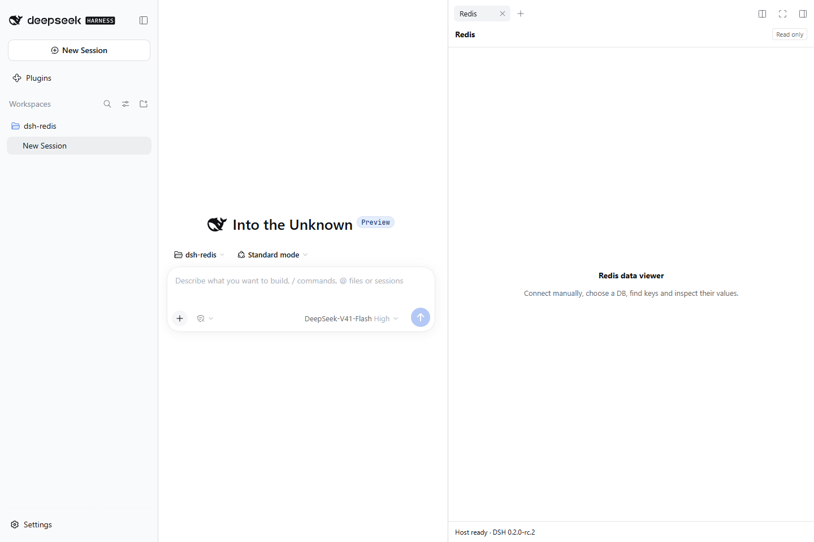

# 01 原生侧栏与 Host RPC 验收

验收时间：2026-10-15 23:54（Asia/Shanghai）。目标为用户指定的 DSH 0.2.0-rc.2。

- Host、Client、tests 三部分严格类型检查通过。
- 两份专项测试共 4 项通过：Host/Client 非法字段及版本拒绝、可信 Agent 查找元数据、实际浏览器 bundle 闭包、挂载失败重试、卸载贡献清理与重新注册。
- 官方 CLI 在项目专属 DSH_HOME 安装本地包并运行独立 web profile；启动前逐文件比较实际安装 lib 和当前构建 lib，字节一致。
- 原生短测完成启动鉴权、创建存活 Agent、status RPC、网关拒绝多余字段；通过实际会话树和右栏 guide 打开 Redis，浏览器调用 Host 并显示就绪。
- 已人工查看截图，确认 Redis 原生页签、只读空态及底栏分隔符正常。Chrome 与自己创建的 DSH 进程树在 finally 中关闭，processStopped 为 true。
- 最终验证包 SHA256：`e328834128252400813d8b33ae8246c7ef783bf8665ec2b9f1b0934a42e57062`。同版本本地包采用包含 SHA 前缀的不同文件名安装，避免保留旧本地包；没有直接编辑安装目录。

原始机器记录见 01-native-smoke.json。截图中是隔离测试工作区，没有用户 Redis 内容。模型配置仅为离线占位，未发送 prompt 或调用模型。

## 复现

1. 在项目根目录执行 pnpm install --ignore-scripts、pnpm check。
2. pnpm pack --pack-destination .scratch/artifacts；把生成的 tgz 复制为带内容 SHA 前缀的新文件名。
3. 在当前命令进程设置 DSH_HOME 为项目内 .scratch/runtime/dsh-home，通过 dsh plugin --profile web add 该 tgz 绝对路径 --ignore-scripts 安装。
4. 设置 DSH_CLI_ENTRY 为已核实的 rc.2 CLI lib/bin.js，REDIS_BROWSER_EXECUTABLE 为本机 Chrome/Edge 可执行路径，运行 node scripts/smoke-dsh.mjs。脚本自行短时启动并关闭测试环境。

## 本票之外

Redis 连接、数据查看、TLS、其他主题/尺寸和完整首版安装验收属于后续任务；本票通过不代表这些能力已实现。卸载/重新注册由构建产物专项回归覆盖；原生 profile 冷启动加载与关闭已实测，运行中改装 bundle 按 rc.2 官方规则需要重启 profile，不声称热替换。
