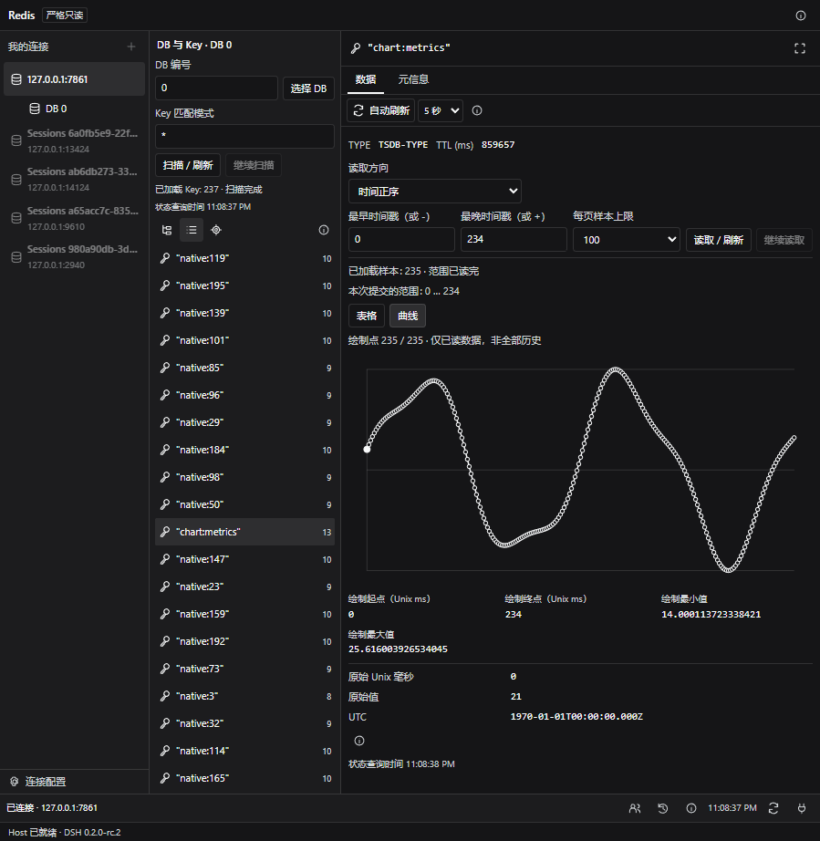

# 29：已读 TimeSeries 样本曲线（已验收）

原 01–29 全部 done：21 张 P0、8 张 P1，编号、优先级与依赖未变。最后一票仍仅依赖 16。下文区分纯模型、真实 Redis、原生安装包与未验证范围；完成的是约定范围，未新增 P2。

## 用户操作和工作台

沿用 Database/RESP 的工作台：宽栏从左至右为连接/DB、Key 导航、数据详情；窄栏压缩连接入口，Key 与详情仍并列。设置用弹窗、元信息用页签、长说明通过帮助展开，主区域保留数据和操作。表格及曲线仅在同一个 TimeSeries 详情内切换，不打开新窗口、不复制缓存。

1. 选中 TimeSeries Key，按既有时间方向、范围和每页数量读取，默认显示样本表格。
2. 点击“曲线”展示当前已读样本；“继续读取”仍由用户显式触发，图表不会自动追读历史。
3. 点击或悬停数据点，在详情区查看原始 Unix 毫秒和值；聚焦曲线后，左右键逐点查看，Home/End 到首尾。选点只滚动曲线内部。
4. 刷新使用原已提交参数，先移除旧点。成功后以新样本重画；取消、失败、消失、变型或超时不能恢复旧图。自动刷新保留曲线模式，沿用 28 的首个有界页替换规则。

[中文 JSON 三栏](artifacts/29-timeseries-chart/native-workbench-panel-wide-zh.png)、[窄栏 Key/曲线并列](artifacts/29-timeseries-chart/native-chart-panel-narrow-dark.png)。截图来自本次真实 rc.2 安装包，已查看；布局通过不等于用户已认可视觉。

## 数值、时间与显示预算

现有 domain、TimeSeries Host 和双端严格 DTO 已规定 timestamp/value 为字符串；时间范围为 0..9223372036854775807，值为有限 double 的原始文本。本票不增加服务器语法或类型契约。

- 时间差先用 BigInt 计算，再映射为百万分之一的屏幕比例；绝对时间不先转 Number。相邻的大时间戳在小窗口仍可分开。大跨度下接近点可能映射到同一屏幕位置，键盘仍逐项检查原始时间。
- 纵坐标先按最大绝对值归一化，再减最小值，避免正负 double 极值相减溢出。坐标用于近似显示，原始时间和值始终保留；不宣称像素或 Number 为任意精度数值。
- 取读取顺序前 512 个点，再按时间升序绘制副本；不改变表格顺序，不做均值、插值或静默滤除。显示 loaded/drawn/omitted 与实际绘制起止、最小值、最大值。
- 前向已读 600 点 0..599 时只画 0..511；反向已读 699..100 时只取前 512 项，再按 188..699 升序画。其余 88 项完整留在表格，图上明确未绘制数；图不代表全历史。
- 校验全部已读点，包括第 513 项之后。非法时间、非法值或重复时间任一项使整图拒绝，不悄悄删除异常点。空样本不造零线；单点、常量和零值居中显示。
- UTC 只作辅助。Unix 毫秒不超过 8640000000000000 时转 Date/toISOString；超出日期显示范围仍完整显示原始毫秒，并提示无法显示辅助日期。无隐含本地时区换算。

依据 [BigInt 转换精度约束](https://developer.mozilla.org/en-US/docs/Web/JavaScript/Reference/Global_Objects/BigInt)与 [Date 日期边界](https://developer.mozilla.org/en-US/docs/Web/JavaScript/Reference/Global_Objects/Date)。本轮浏览工具未取得 TS.RANGE 文档正文，因此没有据此添加新语法；现有命令依据 16 的固定源码/协议证据和本轮实际 TimeSeries 80210 实连。

## 实现职责

| 文件 | 修改与影响 |
| --- | --- |
| src/client/timeseries-plot.ts | 无 React/DOM/Host 的纯投影；校验、512 点前缀、BigInt 差值、有限纵坐标、范围统计、UTC 辅助。模型小目标提交 5f95bf8。 |
| src/client/TimeSeriesChart.tsx | useMemo 使用现有 samples；最多 512 个 SVG 点、网格与折线；精确点详情、原文 title、本地选择与局部横滚。刷新丢失已选点时回到新首点，空数据不保留旧详情。 |
| src/client/TimeSeriesView.tsx | 默认表格，增加本地 table/chart 状态；模式不进入 queryKey，不注册新 reader。原范围草稿、提交、分页、取消和自动刷新仍由 useCollectionScan 负责。 |
| src/client/locales.ts / styles.ts | 中英文操作/预算/UTC文案；主题变量、有限 SVG 容器、窄栏内部横滚、可换行点详情；不改变工作台所有权与分栏。 |
| tests/timeseries-chart.test.ts | 10 项数值/顺序/预算/非法/日期模型行为，验证副本不改变原 cache。 |
| scripts/smoke-timeseries-chart.mjs / smoke-dsh.mjs | 独立 CHART 模式，真实模块/大时间/预算/故障/主题/语言/几何；所有种子与故障写仅属于本次自建夹具，finally 关闭自有资源。 |
| README.md / 原票 / 六份进度文档 / UPDATE_LOG.md | 实际操作、来源、版本、验收和边界；29 五项勾选，原票图保留。 |

无新增 Host RPC、Typert schema、Redis 命令、依赖或持久设置；公开方法仍为 27 个。原 TimeSeries 每页最多 100、cache 最多 5000 行或 2MiB、可信会话/DB/代次、原始 Key 字节、队列、10 秒截止与有界接收继续有效。512 是客户端绘制预算，不是驱动接收或 JS 堆内存上限。

原型仅在 prototype/timeseries-chart-state 分支 d66eebd625a91822f0fd7072da53687609f768bf，单文件内存 HTML 的三个引导与自由操作用于数值状态推演；无 DB/服务/浏览器/原型测试，HTML 壳不进 main。该设计取舍由根模型根据严格 DTO 和数值行为确定，不声称用户批准过视觉。

## 最终同包验收

包 SHA256：b21a919b4ac93768fc22fdf47ecd8c6fd609687f9b216bb277ad8e6369ceb737，140128 字节。仅安装项目隔离 DSH_HOME，目标 DSH 0.2.0-rc.2（预发布），未改日常 profile。

| 门禁 | 实际结果 |
| --- | --- |
| 严格 Host/Client/tests 类型、构建、模型/协议 | prepack 29 文件 296 项全部通过，含 10 项新投影行为。 |
| 曲线原生专项 | 21 组通过；真实 Redis 8.2.6、TimeSeries 80210；二进制 Key、大时间、极值、600 已读/512 绘制、逆向/空/常量、局部交互零额外读取。 |
| 自动刷新集成 | 同一个实际 TimeSeries reader；200 已读点在一轮自动刷新后替换为首 100 点，曲线模式保留，不再存在的选点回到新首点。 |
| 真实故障 | 取消 44ms；扣留真实回复后生产截止 10037ms；ACL、删除、变型、新代次/旧目标、B隔离、DUMP/绝对过期不变通过。 |
| 完整数据/会话/实际 SDK | 87 组通过；27 方法的非法成功 HTTP 结果全部拒绝；React 18.3.1 为宿主同对象，Chrome 155.0.8059.80 / Node 22.22.1。 |
| 整体工作台 | 24 组、22 几何样本；300/340/900px、12 viewer、明暗、EN/ZH/EN；Key/详情持续并列、连接弹窗按需、帮助默认折叠、滚动位置保持。 |
| 曲线几何 | 900px 明亮英文、340px 暗色英文、900px 暗色中文；root/Key/document 横向溢出均 0，窄曲线内部 121px 横滚为预期局部滚动。 |
| 包与安装 | 93 打包文件、84 lib、12 Host peer、2依赖、172源码输入逐文件 SHA 匹配；源码母提交 5f95bf81733872e48d4d99ba8aedf5280d273a6f。 |

[曲线报告](artifacts/29-timeseries-chart/native-chart-smoke.json)、[曲线时序和几何](artifacts/29-timeseries-chart/native-chart-details.json)、[完整数据/会话/SDK](artifacts/29-timeseries-chart/native-ui-release-smoke.json)、[工作台报告](artifacts/29-timeseries-chart/native-workbench-smoke.json)、[包及实际安装清单](artifacts/29-timeseries-chart/workbench-release-manifest.json)、[32 份原件 SHA 清单](artifacts/29-timeseries-chart/inventory.json)。原始控制台、原生日志和截图按字节保留，未混用旧包报告。三套原生 page/console 错误均为空；曲线 1 条预期 readTimeSeries ERR_ABORTED、完整回归 1 条预期 readString ERR_ABORTED、布局请求错误为空。processStopped/fixturesStopped 全为 true，曲线 recoveryProxyStopped 也为 true。

## 证据边界和复现

真实 Redis 测试仅为固定 8.2.6/TimeSeries 80210；未扩张到其他版本、Cluster、Sentinel 或 TLS 专项。本轮真实 700 点序列、手动已读 600 点；5000 缓存行坐标预算是模型验证，不冒充真实 5000 行曲线实测。无 OS 最小化/睡眠或浏览器兼容矩阵声明。

数字型 timestamp 的坏结果通过明确 HTTP 注入验证实际严格浏览器解码器；不是 Redis 返回该值。TS.INFO 权限拒绝时仍可读样本，TS.RANGE 权限拒绝会清空旧图，均为真实 ACL。慢回复通过 TCP 代理扣留 Redis 已产生的回复，不表示服务器计算变慢。

取消沿用 rc.2 fetch AbortSignal/Host Request.signal。专项等待实际 requestfailed、保持 A 回复扣留并完成 B 的实际 Host 读取后才放行，验证该交付顺序下 A 无取消后的后置命令；没有独立远程取消 ACK，不承诺点击瞬间 Redis 计算停止。传输取消停止等待并排空有界帧，截止关闭停滞连接；没有重放查询或自动重连。

复现环境与只读夹具所有权规则见 21 验收文档：先 pnpm pack 完成严格 prepack，固定实际 SHA 文件名，仅安装隔离 DSH_HOME 并运行 verify-release-package.mjs。曲线设置 REDIS_SMOKE_CONNECTIONS=1、REDIS_SMOKE_KEYS=1、REDIS_SMOKE_CHART=1 后运行 node scripts/smoke-dsh.mjs；完整回归为既有 RELEASE+12类型+SESSIONS，布局为 LAYOUT=1。各 WSL 原生门禁串行；文件清单核对可独立并行。未启动 npm dev/start、访问业务 Redis、清理 C 盘或调用网页端 GPT 评审。
