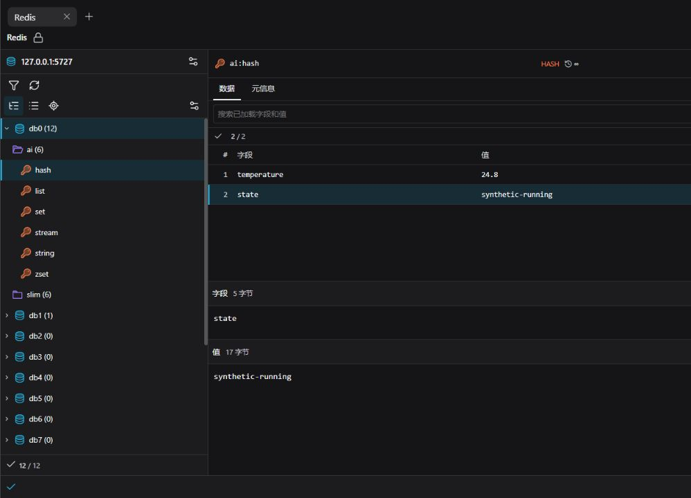

# Redis官方工具与对话接线验收

日期：2026-10-19。应用检查点：A `98db09f`、B `7cd6c3c`、C `16093e3`。固定DSH/SDK为0.2.0-rc.2；只在独立profile和合成Redis中进行模型/工具测试。

## 当前结果

| 检查层 | 本轮结果 | 证据边界 |
|---|---|---|
| 严格类型/构建/回归 | 21文件205项通过；打包prepack再次通过 | 官方SystemPrompt/ToolRuntime组装；单元传输为合成实现 |
| 候选安装 | SHA256 `cbc2636620c57af58551184f54ce3e877b364d008356f3dbc09d1d209a7c04ac`；73发布/62lib/13宿主peer/3运行依赖匹配 | 候选README早于本轮对话说明；最终包另行记录 |
| 原生AgentLoop接线 | 30调用；除1次预期未连接拒绝外成功 | **脚本SSE模型**、真实官方AgentLoop及Redis8.2.6；不证明真实模型会正确选择工具 |
| 现用真实模型 | TIMEOUT；0工具调用 | bzkj / DeepSeek-V4-Flash；没有把超时或本地脚本输出当作真实模型成功 |
| 日常最终安装 | 待核对 | 安装完成后补最终SHA与文件/配置核对 |

## 原生接线具体操作

通过CUA操作实际DSH页面，Session API只用于读取持久化调用历史；未使用headless浏览器或页面内部状态注入。

1. 新会话未连接时，status显示disconnected且currentSelection为空。
2. 侧栏手动连接独占合成Redis，自动SCAN得到DB0的12个Key；同会话对话检索`ai:*`得到6个。
3. 依次明确读取String/Hash/List/Set/ZSet/Stream。类型、TTL、文本/原始字节、数量及完整性与种子相符；Stream两次同名field均保留。
4. 侧栏分别选择Hash的state、List下标1、Set的synthetic-beta、ZSet相同成员、Stream消息1-0的第二字段、String Key；工具不传Key，实际标识/值相符。ZSet原始分数2.5、Stream第二值synthetic-second均断言通过。
5. String开启自动刷新后，工具明确SELECT DB1；Host保持原连接ID、generation变为2，侧栏跟随显示1/1，旧选择为空，旧目标自动刷新卸载。DB1读取db1:only得到synthetic。
6. 工具明确切回DB0，generation变为3；侧栏跟随12/12，旧Key未被冒充为新选择。
7. 第二会话status仍未连接，value明确拒绝；返回原会话，原连接仍在。全程代理只有1个Redis连接，未使用第二连接或伪造session绕过隔离。

第二会话首轮脚本选择了status；补发CURRENT后才实际执行value拒绝，统计按实际30次调用计。没有把预期值读取拒绝当成功数据，也没有把初次夹具配置失败计入通过。

证据：[工具轨迹](assets/ai-read-native-tool-trace.json)、[断言及命令集合](assets/ai-read-native-assertions.json)。轨迹仅保留合成会话工具输入/结果/文本，不含provider配置、凭据、认证URL或完整系统提示词。

## 只读与清理

- 自有官方Redis8.2.6镜像文件经既有WSL验收后端启动；无业务服务器数据挂载，所有种子写入发生在所属夹具设置阶段。
- 12个合成Key的DUMP前后相同，原Stream消费组相同。代理命令只含固定只读/连接/SELECT命令，无写Key、KEYS或自由命令，无协议错误。DB1读取通过；本轮DUMP清单为DB0的12个Key，不扩大宣称为逐DB全量对比。
- 一轮执行环境中断后，以owner/PID/cwd核对清理了所属WSL残留，再重建；不是对未知进程执行批量清理。
- 临时DSH与Redis已按夹具finally核对停止/清理，模型stop后已确认端口无监听。真实provider私有凭据副本已在原实例停止后删除；本地脚本模型只用自有占位值。最终安装在后续检查点补充。

## 真实模型尚未通过的原因

沿用日常profile的provider/default-model配置，在独立DSH_HOME中对合成数据发起实际请求。DSH显示Request timed out，5次重试后本轮失败；Session持久化历史没有任何Redis工具调用。对同一服务的HEAD检查直连超时，经本机现有代理得到502。未更换日常模型、修改代理或猜测其他服务器。

因此本轮不能宣称真实模型自然语言联调完成。恢复现用服务后，应复测明确六类型、当前选中内容、明确切DB及侧栏同步；本地脚本接线只说明这些路径在官方AgentLoop中可执行。未启用PTC的实际模型验收，本轮不宣称PTC专项通过。

## 最终安装记录

待最终包/日常profile安装核对后补充；源码存在、候选安装和日常实际运行分别计。
