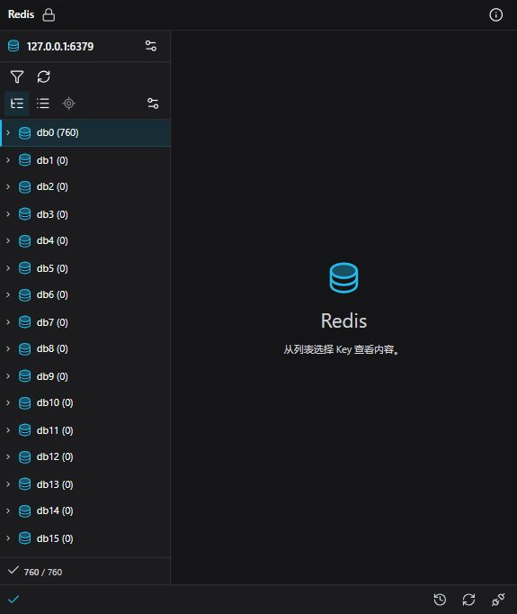

# DSH 真实模型与真实 Redis 数据联调

日期：2026-10-19。用户已恢复 DSH 普通模型连通，并明确要求使用其真实 Redis 数据。本轮在日常 DSH `127.0.0.1:7198` 的新建会话内测试，模型为 `deepseek-official / deepseek-flash`，界面显示 DeepSeek-V41-Flash，推理等级 Max。

安装包 SHA256：`a23e3902105e1b7a9ebadaee373eb3db52ab74293c9cb74d32ab01252c7b4689`。本轮先验证已安装版本，不重新安装、不修改日常模型配置。

## 数据与操作范围

- 真实 Redis：`127.0.0.1:6379`，Redis `8.10.0`，DB0。
- 使用 `DBSIZE`、完整 `SCAN` 和 `TYPE` 只读统计：760 个唯一 Key，全部为 Hash；统计前后 DB 总数均为 760。
- 不为测试创建其他类型，不使用合成数据替代真实数据。本轮没有 String、List、Set、ZSet、Stream 的真实样本；其既有隔离验收仍见[此前专项](ai-read-2026-10-19.md)，不写成真实数据通过。
- 通过 DSH 原生界面发送自然语言，由实际模型调用插件。只解压本轮所属会话的官方持久日志到内存，按工具调用 ID 配对结果；不读取其他会话正文。
- 用独立只读 `HLEN/HGET` 在内存逐字节对照模型工具返回，记录中只保存布尔断言、类型和数量，不保存业务 Key、字段或值。当前字段读取不声明集合基数，`metadata.length: null` 不当作零。
- 停止原本准备的隔离 DSH/Redis，确认所属进程、Redis 与目录已清理，并删除临时模型凭据副本；未向隔离环境发送模型提示。FlClash、系统代理和路由保持原样。

## 已完成检查

| 检查 | 结果 | 依据 |
| --- | --- | --- |
| 模型能发现并执行官方工具 | 通过 | 两个会话共 7 轮自然语言对话，14 次调用及 14 个结果；13 成功、1 次预期未连接拒绝 |
| 未连接时不冒用其他会话连接 | 通过 | 初始 status 返回 disconnected；第二会话实际 value 请求也被连接校验拒绝 |
| 手动连接后对话沿用同一会话目标 | 通过 | 侧栏 DB0 自动加载 760/760，模型随后识别 connected/DB0 |
| 对话检索真实 Key | 通过 | 实际执行两批 SCAN；模型明确仍有游标，没有把两批说成全量 |
| 真实 Hash 整体读取 | 通过 | 返回 8 个字段，完整性为 true；8 个值逐字节匹配实时 HGET，字段数匹配 HLEN |
| 不提供名称，读取当前选中字段 | 通过 | 侧栏切到另一 Key 后选中一行；模型先查状态，再以空参数调用 value，实际读取新选择 |
| 当前字段身份和值正确 | 通过 | 工具返回 Hash 字段身份，值与该字段实时 HGET 字节一致；模型回答与界面相符 |
| 对话显式切 DB 并同步侧栏 | 通过 | 实际 DB0→1→0，连接 ID 始终相同，generation 2→3→4；DB1 空批次且扫描完成 |
| 旧选择及自动刷新清理 | 通过 | 切库前开启 5 秒刷新；切到 DB1 后旧 Hash 表格/刷新控件卸载，切回 DB0 选择为空 |
| 新会话隔离与返回原会话 | 通过 | 新会话 status 未连接，空参数 value 实际拒绝；返回原会话后 ID/代次保持、DB0 可用 |

脱敏断言：[真实数据结果](assets/ai-read-real-data-20261019.json)。完整轨迹仅检查上述两个所属会话，工具名集合为插件全部四个工具，没有其他工具；1 次拒绝属于隔离验收的预期结果，未发现非预期工具错误。独立核对结束时 DB0 总数仍为 760。

本轮未修改产品代码、依赖或安装包，因此没有把历史 205 项回归写成本轮重跑。现有安装继续使用；日常 7198 保留在原会话、DB0、未选 Key 的状态。模型给出的设备业务含义属于模型解释，不是插件验证的业务规则。

## 界面观察与尚未定位的问题

截取切库证据时发现一次 Redis 样式丢失：页面没有 `style[data-dsh-redis]`，根节点显示 block，部分 SVG 被放大，造成内容超高。核对源码和实际安装 bundle 后，确认样式以 TypeScript 函数内联并通过 effect 安装，不需要额外的 index.css。

页面重载后样式节点恢复为 1，根节点为 flex/682px，普通图标为 16px；随后切换两个会话并返回，样式仍正常。没有编译变更或控制台错误可用于定位，**本轮只确认重载后恢复，未声称已修复根因**。此问题保留为待复现观察项，不以缺少独立 CSS 文件为由修改构建。

以下截图在返回 DB0 后拍摄，目录折叠且没有选中业务 Key，只展示本机连接与 DB 数量：

## 验证边界

独立核对仅发送 `INFO server`、`DBSIZE`、`SCAN`、`TYPE`、`HLEN` 和 `HGET`。当前模型轨迹只包含插件 status、keys、value 工具，没有终端或文件工具。本轮没有使用 MONITOR、全库 DUMP、生产网络代理或服务重启；“DB 总数不变”只代表该指标，不冒充所有业务值在动态运行期间保持不变。

真实值留在用户本机 DSH 对话记录中；测试文档与 Git 不包含业务 Key、字段、值或认证，截图只含连接状态与 DB 计数。没有改动 FlClash，也没有重启日常 DSH。
